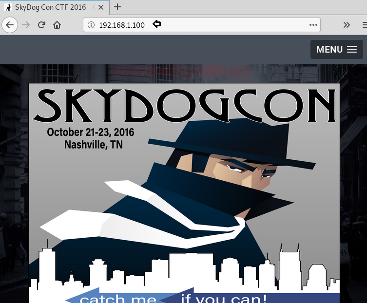
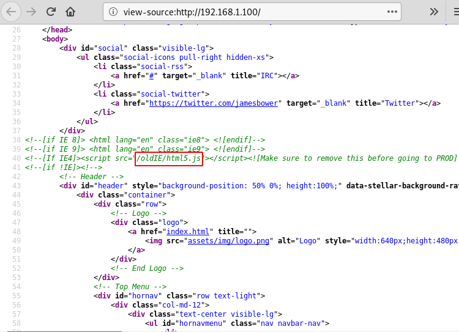
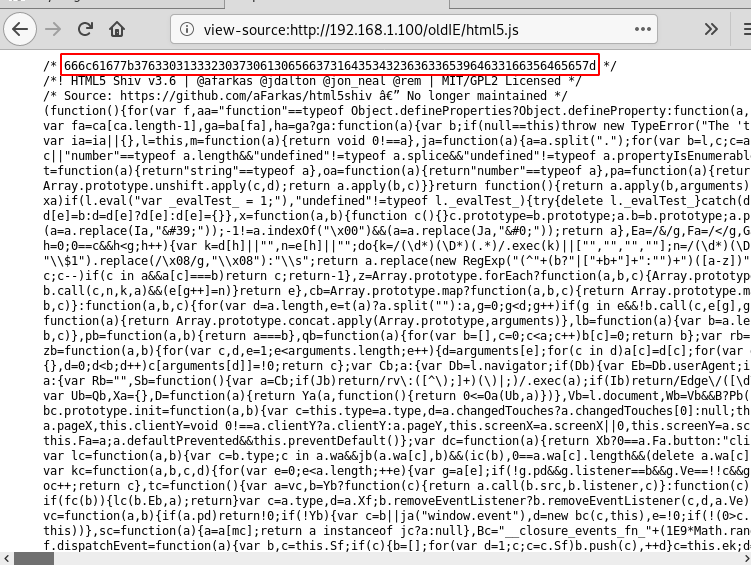

# SkyDog: 2016 — Catch Me If You Can — Writeup

| Field | Value |
|---|---|
| **Target IP** | 192.168.1.100 |
| **Difficulty** | Medium |
| **OS** | Linux |
| **Goal** | Capture 8 flags hidden across the machine |
| **Source** | [HackingArticles](http://www.hackingarticles.in/hack-skydog-con-ctf-2016-catch-can-vm/) |

## Attack Summary

Decode a hex hint in page source to find SSH, inspect the TLS certificate for directory names, spoof a legacy User-Agent with Burp Suite to access a restricted FBI page, use steghide to extract credentials from an image, SSH in as Barry Allen, and parse a memory dump with Volatility to capture the final flag.

## Methodology

1. Reconnaissance (netdiscover + nmap)
2. Web enumeration (page source, hex decoding, directory walking)
3. TLS certificate inspection
4. User-Agent spoofing via Burp Suite
5. Steganography extraction
6. SSH lateral movement
7. Memory forensics with Volatility

## Step 1: Host Discovery

Use `netdiscover` on your local segment to find the target.

```bash
netdiscover -r 192.168.1.0/24
```

The target responds at **192.168.1.100**.

## Step 2: Reconnaissance

Run a full-port service scan.

```bash
nmap -p- -sV 192.168.1.100
```


Key findings:

| Port | Service | Note |
|------|---------|------|
| 22   | SSH     | Closed (deliberate decoy) |
| 80   | HTTP    | Apache web server |
| 443  | HTTPS   | TLS-enabled web server |
| 22222 | SSH   | Open — the real SSH port |

> Flag 1 hint: the scan itself reveals the word **nmap** as the first flag answer.

## Step 3: Web Enumeration and Hex Decoding

Browse to `http://192.168.1.100` and view the page source. A hex-encoded string is embedded in the HTML.

```bash
echo "6e6d6170" | xxd -p -r
# Output: nmap
```

The decoded value is the first flag: **nmap**.

Navigate to the linked directory in the source. A second hex string encodes a path fragment. Decode it with `xxd -p -r` to reveal the next directory.


## Step 4: TLS Certificate Inspection

Visit `https://192.168.1.100` and inspect the certificate details (Subject / SAN fields). One of the certificate fields contains the word **personnel**, which is Flag 3 and points to a new web path.

Browse to `https://192.168.1.100/personnel`.

## Step 5: Finding the Evidence Directory

From the `/personnel` page, decode another encoded hint to get **evidence**. Prefix it to reach `/newevidence`.

Flag 4: **evidence**

The `/newevidence` page presents a login form.

## Step 6: User-Agent Spoofing (Burp Suite)

The FBI workstation page checks the browser's User-Agent and only allows legacy clients. Intercept the request in Burp Suite and replace the `User-Agent` header:

```
User-Agent: MSIE 4.0
```

Forward the modified request. The page now loads and reveals credentials.

Flag 5: **panam** (found in `evidence.txt`)



## Step 7: Steganography Extraction

Log in to the portal with the discovered credentials and download `newevidence.jpeg`. Extract the hidden file:

```bash
steghide extract -sf newevidence.jpeg
# Passphrase: iheartbrenda
```

This outputs `flag.txt`:

```
Flag 6: ILoveFrance
```

## Step 8: SSH as Barry Allen

Use the username and password found across the earlier flags to log in:

```bash
ssh barryallen@192.168.1.100 -p 22222
```

Once logged in:

```bash
cat flag.txt
# Flag 7: flash
```



## Step 9: Memory Forensics

Transfer the memory image to your attack machine:

```bash
scp -P 22222 barryallen@192.168.1.100:security-system.data .
unzip security-system.data
```

Analyse the dump with Volatility to extract open Notepad contents:

```bash
volatility -f memory.dmp --profile=Win7SP1x64 notepad
```

The notepad output contains Flag 8.



## Lessons Learned

1. Non-standard SSH ports (`22222`) are easy to miss without a full `-p-` port scan.
2. User-Agent checks can be trivially bypassed with an intercepting proxy such as Burp Suite.
3. Steganography (`steghide`) is a common CTF technique for hiding credentials inside images.
4. TLS certificate metadata (CN, SAN, OU) often contains clues in CTF machines.
5. Volatility is the standard tool for analysing Windows memory dumps during forensics challenges.

## Remediation

| Vulnerability | Fix |
|---|---|
| Secrets encoded in page source | Never embed sensitive hints or credentials in client-side HTML |
| User-Agent authentication bypass | Perform server-side authentication; do not trust client-supplied headers |
| Steganographic credential storage | Store credentials in a secrets manager, not hidden inside media files |
| Weak SSH key management | Use key-based authentication with strong passphrases |
| Sensitive data in TLS certificate fields | Audit certificate fields before issuance; avoid embedding internal paths |
