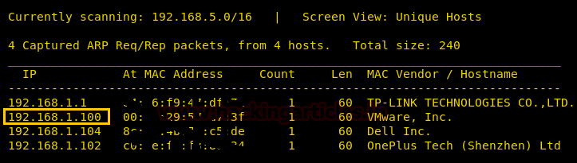
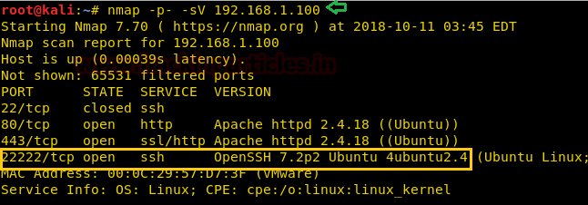
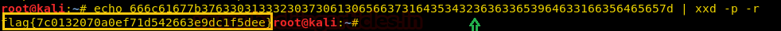
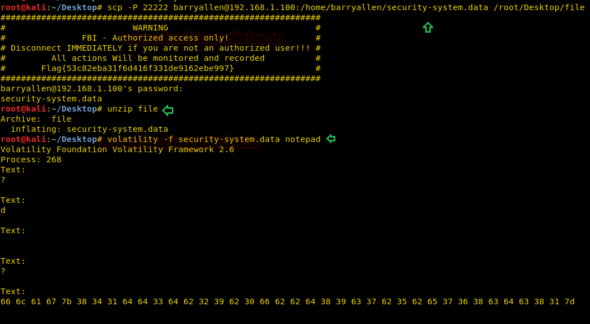

# SkyDog: 2016 — Catch Me If You Can — Writeup

| | |
|-|-|
| **Target IP** | 192.168.1.100 (DHCP) |
| **Difficulty** | Medium |
| **OS** | Linux |
| **Flags** | 8 flags (hex-encoded, multi-stage CTF) |
| **Source** | [VulnHub](https://www.vulnhub.com/entry/skydog-2016-catch-me-if-you-can,172/) |

## Attack Summary

nmap → SSH on port 22222 → User-Agent spoof (IE4) → FBI portal → steghide extraction → SSH as barryallen → Volatility memory forensics

## Methodology

1. Network discovery and port scanning
2. Source code and TLS certificate enumeration
3. User-Agent spoofing to access hidden portal
4. Steganography to extract SSH credentials
5. SSH login and flag collection
6. Memory forensics with Volatility

---

## Step 1: Network Discovery

```bash
sudo netdiscover -i eth1 -r 192.168.1.0/24
nmap -p- -sV 192.168.1.100
```

Findings: port 80 (HTTP), 443 (HTTPS), 22222 (SSH open — moved from 22 as decoy).



---

## Step 2: SSH and Flag 1

Port 22 is closed. SSH is running on port 22222.

```bash
ssh 192.168.1.100 -p22222
```

The page source of the homepage contains a hex string. Decode it:

```bash
echo "4e6d6170" | xxd -r -p
# outputs: nmap
```

**Flag 1:** `nmap`



---

## Step 3: TLS Certificate → Hidden Directory (Flag 3)

Open the site in a browser, view the TLS certificate under Security > View Certificate. The certificate CN field decodes to `personnel`, which maps to the path `/personne1`.

**Flag 3:** `personnel`


---

## Step 4: User-Agent Spoofing (Flags 4–5)

The `/personne1` page requires Internet Explorer 4. Capture the request in Burp Suite and change:

```
User-Agent: Mozilla/4.0 (compatible; MSIE 4.0; Windows NT)
```

The page returns an FBI login portal. The page source reveals `evidence.txt`, which decodes to `panam`.

From the portal, navigating to `/newevidence` yields another flag.

**Flag 4:** `evidence` → path `/newevidence`
**Flag 5:** `panam`

---

## Step 5: Steghide — Extract Credentials (Flag 6)

Download `newevidence.jpeg` from the portal:

```bash
wget http://192.168.1.100/newevidence.jpeg
steghide extract -sf newevidence.jpeg
# passphrase: (empty or from hint)
cat flag.txt
# decodes to: ILoveFrance
# clue: iheartbrenda (SSH password)
```

**Flag 6:** `ILoveFrance`
**Credentials:** `barryallen:iheartbrenda`



---

## Step 6: SSH Login and Flag 7

```bash
ssh barryallen@192.168.1.100 -p22222
ls
cat flag.txt
# decodes to: flash (Barry Allen = The Flash)
```

**Flag 7:** `flash`

---

## Step 7: Memory Forensics with Volatility (Flag 8)

```bash
scp -P 22222 barryallen@192.168.1.100:/home/barryallen/security-system.data /tmp/
unzip /tmp/security-system.data
volatility -f security-system.data notepad
```



---

## Lessons Learned

1. **Non-standard SSH ports** are easily found with a full port scan (`-p-`); port 22 closed is a decoy, not security
2. **TLS certificate fields** can embed hints — inspect CN, OU, and SAN fields
3. **User-Agent filtering** is trivially bypassed with Burp Suite; never use UA as an access control
4. **Steganography** (`steghide`) hides credentials inside images — check all downloadable media
5. **Volatility** recovers notepad contents, clipboard, and process memory from live memory dumps

## Remediation

| Vulnerability | Fix |
|---------------|-----|
| Credentials in steganography | Use proper secret management; don't embed creds in downloadable files |
| User-Agent access control | Use real authentication (session tokens, certificates) |
| Secrets in TLS certificate fields | Use generic certificate metadata |
| Memory forensics exposure | Encrypt sensitive data in memory; use secure wipe on exit |
